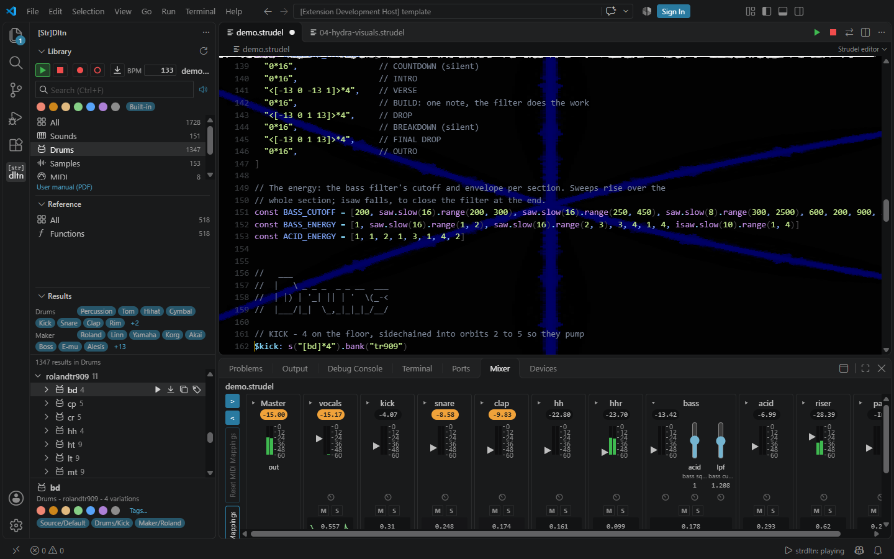
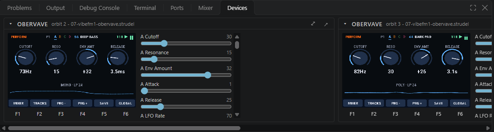
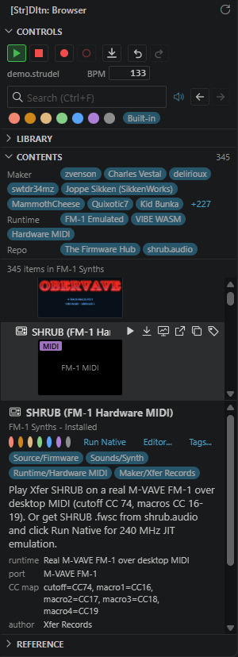
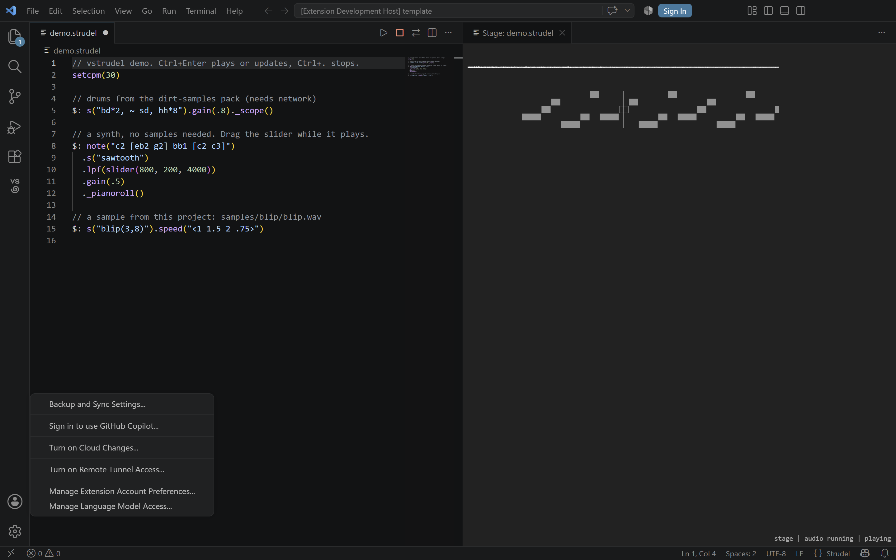
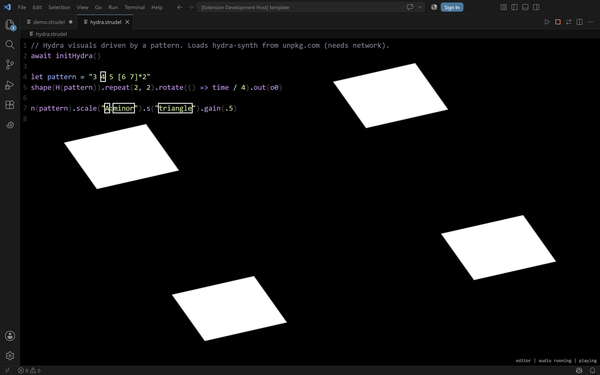
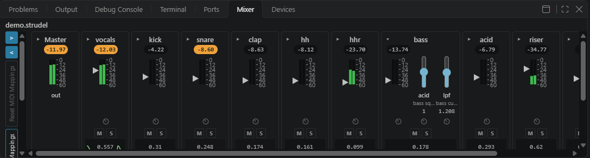
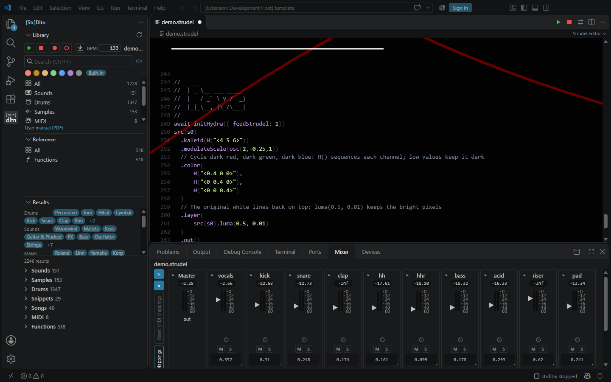

<p align="center">
  
</p>
<!-- SCREENSHOT SPEC: doc/logo.jpg
  Static project logo artwork (dark background, "[str]dltn Live[code]" typography with cyan "[str]" and "[code]").
  Do not recapture; keep existing file.
-->

# [str]dltn Live[code]

**[str]dltn Live[code] (pronounced "Stroo-del-ton") is a VS Code extension for Strudel live coding.
However it is much more than that, as it turns your editor in a DAW on top of Strudel.**

[Strudel](https://strudel.cc) is a language for making music with code. [str]dltn Live[code] embeds
the real Strudel, the same editor and the same sound engine as strudel.cc, and adds
features that you would expect of a DAW, but that play nice with the code on screen.

> **[UNOFFICIAL NOTE]** [str]dltn Live[code] is an independent project. It is neither an
> official project nor a component of Strudel, and it is not endorsed or supported by the
> Strudel authors. It is an independent, AGPL-3.0-or-later derivative work that uses
> Strudel's published packages (`@strudel/*` on npm). For Strudel itself, see
> [strudel.cc](https://strudel.cc) and its source at
> [codeberg.org/uzu/strudel](https://codeberg.org/uzu/strudel). Please report problems with
> this extension [here](https://github.com/alienmind/strdltn/issues), not to the Strudel
> project.

You can either use the specialized panels OR keep writing code OR a mix of both. Some of the features (more underway!):

- **Controls**: Play, Stop, Record, Render, Undo, Redo, BPM, Back/Forward Browser history,
  search and color filters in a dedicated top pane that stays visible while you browse.
- **Mixer**: a strip per part of the song you play, with faders, level meters, mute, solo,
  sidechain cables you drag, and drag-and-drop from the Browser to add new tracks. Every
  change is plain Strudel code.
- **Browser**: every sound, synth, drum machine, FM-1 firmware, snippet, song and function,
  with one search, colors, tags and drag-to-insert into code or the Mixer. Single-click any
  sound or synth to hear a timed 1-loop preview, even with no song open.
- **Your files**: songs, samples, firmwares and snippets are plain files in a folder, so
  they work with git, search and everything else in your editor.

> ### M-VAVE FM-1, VIBE FM (.wasm) and real FM-1 (.fwsc) firmwares
>
> **Got an FM-1, or want its synths in software?** [str]dltn Live[code] organizes FM-1
> plugins into two parallel categories under **Plugins** (hover or click `?` for a
> comparison popover, or click `+` to manage firmware repositories):
>
> - **Plugins > VIBE FM (.wasm) (`WASM`).** Open-source VIBE FM builds from
>   [The Firmware Hub](https://thefirmwarehub.com) running directly inside Strudel's engine
>   (`s("vibefm1:obervave")`) with ~1% CPU, sample-accurate timing, live screen thumbnails,
>   Screen popup, and Devices tab controls (desktop & Codespaces).
> - **Plugins > FM-1 Firmware (.fwsc) (`FWSC` / `EXT` / `MIDI`).** Real unmodified M-VAVE
>   FM-1 hardware firmwares (~280+ Hub `.fwsc` synths, **SHRUB** listed via external
>   repository `shrub.audio`, **M-VAVE FM-1 Stock**, plus any custom repository URLs in
>   `strdltn.firmware.repositories`): launch **Run Native** (`fm1-live` 240 MHz JIT on
>   Windows, macOS, Linux — zero dropouts for SHRUB), emulate lighter `.fwsc` synths
>   in-editor (`s("fm1:<id>")`), play a real M-VAVE FM-1 over desktop MIDI, or click
  **Flash to FM-1...** to flash any `.fwsc` firmware directly onto your connected FM-1
  hardware over USB-MIDI SysEx (with model verification and OTA resume support).
>
> See `examples/07-vibefm1-obervave.strudel` and `examples/09-midi-out.strudel`.


<!-- SCREENSHOT SPEC: doc/screenshot-overview.png
  File: doc/screenshot-overview.png
  Capture: Full VS Code window at 1440x900 (or 2880x1800 downscaled 50% to 1440x900).
  Workspace / Song: template/demo.strudel open in the Strudel editor and actively playing.
  UI State:
    - Left side bar: [str]dltn Browser visible with Controls pane open at top (Play lit green, Stop, Record, Render, Undo, Redo, BPM, Back/Forward, search box, preview speaker, 7 color dots, Built-in), Library/Contents showing Drums or Sounds with rows and tag chips, Reference collapsed at bottom.
    - Center: Strudel editor showing demo.strudel with inline scopes/visuals, inline sliders, note outlines active, and knob buttons in the left gutter.
    - Bottom panel: Mixer tab active showing Master strip first, then song strips (with bass unfolded to show inner blue faders), active green level meters, pump meters, knob buttons, and orange dashed sidechain ducking cables.
    - Status bar right: "strdltn: playing".
  Must show: All three main regions (4-pane Browser, Strudel editor with live visuals, Mixer with meters and cables) clearly legible in one window.
-->

It also runs in **GitHub Codespaces**. That gives a second way to use it: keep each
music project as a repository and open it in a browser from any machine, with nothing
installed. Fork this repository, open your fork in a Codespace, and start from the
`template/` folder.

Free and open source, AGPL-3.0-or-later like Strudel.

This project is a fork of my former extension [vstrudel](https://github.com/alienmind/vstrudel)

## Install

**In VS Code:** download `strdltn.vsix` from the
[latest release](https://github.com/alienmind/strdltn/releases/latest). In the
Extensions view press `...` and choose "Install from VSIX...". Then make a file called
`song.strudel`, type `s("bd sd, hh*4")`, click in the code and press Ctrl+Enter.

**In Codespaces:** on GitHub press Code, Codespaces, `...`, "New with options", and
choose the configuration "[str]dltn Live[code] template (released extension)". Open
`demo.strudel`, click in the code and press Ctrl+Enter. The sound comes out of your
browser.

## Features

**Editor**

- The real Strudel editor for `.strudel` files: the upstream packages, not a copy.
- Inline scopes, piano rolls and other visuals under the line that makes them.
- Sliders inside the code that you drag while the song plays.
- The notes that are sounding are outlined in the code.
- Hydra visuals behind the code.
- One button switches a file between the Strudel editor and the native VS Code editor.
- A stage beside the native editor: sliders and visuals, each with a name taken from
  your code.
- Edits from outside (git, another editor) show up at once, while it plays.
- An error in the code is underlined and listed in the Problems view, and the song keeps
  playing what worked last.
- A status bar item says what the song does (playing, stopped, error) and plays or stops
  it with a click.
- Settings for the theme of the editor (the 39 themes of strudel.cc) and its font. By
  default the font and size are those of your VS Code editor.
- Ctrl+. stops the song in front. Press it again to stop a song that plays in another
  tab. "strdltn: Stop all" stops every song.

**Mixer and Music Controls**

- Controls pane at the top of the Browser (always reachable, collapsible): Play, Stop,
  Record, Render, song Undo and Redo, and the BPM of the song. Type a BPM to write
  `setcpm(<bpm>/4)`; double click it to go back to Strudel's default, 120.
- Drag any sound, synth, drum or FM-1 firmware from the Browser onto the Mixer strip area
  to append a new playable `$name:` strip at the bottom of the song.
- A mixer in the bottom panel, next to Terminal: one strip per chain of the song in front
  (`$kick:`, `bass:`), side by side as in the Session view of Live.
- A strip shows the slider in the chain's `.gain()` as a fader. Unfold it to see every
  other slider of the chain. A slider assigned to a constant (`const KICK_VOL =
  slider(...)`) shows in the chain that uses the constant.
- M and S on each strip, above its scope. M mutes and S solos the chain, written as
  upstream's own labels (`_kick:`, `Skick:`); a song that plays is updated at once.
- A click on the gain fader's triangle, without dragging it, takes the gain fader out of the
  code; on a chain without one, the dim triangle puts one in (`.gain(slider(1, 0, 1))`). A
  gain that comes from a knob or a pattern keeps working: the fader scales it.
  The gain's value shows in the corner of the strip's scope.
- The jack at the foot of a strip tells its orbit when the mouse is over it.
- Sidechain cables: a chain with `.duck("2:3")` is cabled to the chains on those orbits.
  Drag from the jack at the foot of a strip onto another strip to duck it; pull a cable off
  by its end to stop. The code gets the `.duck()`, and an `.orbit()` of its own for a
  target that had none.
- A fader changes the sound at once and the number in the code a moment later, like the
  slider in the code. Moving the slider in the code moves the fader.
- A pump meter under the faders of each strip: it pumps with the chain's notes while the
  song plays, green when the chain has `._scope()`, a gray flat line when not. A click
  adds or removes `._scope()`.
- A song or snippet without `$:` labels shows as one strip named after the file.
- The Mixer comes to the front when a song starts playing.
- The window button in the Mixer's title floats it in a window of its own. The dock
  button, or closing that window, puts it back in the panel.

- A level meter behind each strip's gain fader, as in Live: two bars on a 0 to 60 dB scale, and the highest peak
  above them, orange when it went over 0 dB. A click starts the peak again. A Master strip, first, meters the whole mix; unfold it for the global sliders (in
  `setcps()`, or used by no chain).

**Render and record**

- Record, the red circle in Music Controls: plays the song and records what you hear into a `.wav` and an `.mp3` next to
  it. Click again, or Stop, to end the take. Each take is kept.
- Render audio, the arrow down: plays the whole song once from the start with the sound off, and writes it into
  `<song>.wav` and `<song>.mp3`. It takes as long as the song; a notification shows it, and its Cancel stops it. A
  song says its length with `// @length <cycles>` in its header; without it, 16 cycles (setting
  `strdltn.render.cycles`). Everything you hear is in it, firmwares included; MIDI devices stay quiet meanwhile.
- The MP3's bitrate is the setting `strdltn.render.mp3Bitrate` (320 kbit/s by default).
- Renders and recordings show under Render in the Library. A click plays one.

**Devices**

- A Devices tab in the bottom panel, next to the Mixer: one panel per firmware that plays
  (`s("vibefm1:obervave")`), with the firmware's own screen, its six soft keys F1 to F6
  and its parameters as sliders. The mouse wheel over the screen turns its DATA knob.
- Fold a panel, fill the view with it, or take it out into a tab of its own.


<!-- SCREENSHOT SPEC: doc/screenshot-devices.png
  File: doc/screenshot-devices.png
  Capture: Cropped bottom panel (Devices tab) or full window showing Devices prominently (~1440x420 or half-size crop).
  Workspace / Song: template/examples/07-vibefm1-obervave.strudel open and playing.
  UI State:
    - Bottom panel switched to the Devices tab.
    - At least two OBERVAVE device panels side by side (orbit 2 bass and orbit 3 pad, e.g. "56 DEEP BASS" and "44 DARK PAD").
  Must show: Each panel's live 480x320 firmware display, the six soft keys F1 to F6 underneath, parameter sliders on the right, and fold/maximize/pop-out buttons in each panel header.
-->

**Browser**

- A Browser in the side bar, like the browser of Ableton Live, in one view with four panes:
  **Controls** (Music Controls with Undo/Redo, Back/Forward browser history beside the
  search field, preview toggle, seven colors, and Built-in switch), **Library** (Sounds,
  Drums, Samples, Plugins > FM-1 Synths, Render, MIDI, Songs, Snippets), **Contents**
  (renamed **Results** while searching, with tag chips, flat rows and details pane), and
  **Reference** (every function of Strudel). Picking a category folds Library and Reference
  so Contents fills the height below Controls.
- Back and Forward history buttons (`Alt+Left` / `Alt+Right` or mouse side buttons) step
  through previous searches, categories and pane states.
- Search by name, bank, folder, description or tag. Every word must match. `#kick`
  looks only at tags.
- Tags come by themselves from the names: Kick, Snare, Hihat... for drums, Bass, Pad,
  Keys... for instruments, the maker of a drum machine, `Runtime/...` for FM-1 synths,
  and where a sound comes from. Click a chip to filter, Ctrl+click to take several of a
  group.
- Put anything in a collection: the tag button on a row, the color dots under the
  selected item, or the keys 1 to 7 (0 clears). Your own tags come from the same button
  ("Edit tags...") or the "Tags..." button. They are kept in `strdltn.index.json` in your
  project, so they travel with it. Tags of a snippet go into its own header.
- Save a search: it becomes a row under Collections.
- Single-click preview works for every sound and synth (samples, drum machines, plain
  waves, soundfonts, `supersaw`, `zzfx`, VIBE `.wasm`, emulated `.fwsc`, and hardware
  MIDI profiles), even with no song open. Each preview plays for 1 loop (of the active
  song, or 120 BPM when no song plays), fades out smoothly over 0.5 s, and disposes
  cleanly; pressing Stop cuts it off at once.
- Drag and drop any row from the Browser into the Strudel editor or native editor to insert
  a complete playable `$name:` line with an example pattern and gain slider (or bare name
  inside `"..."`), drag an effect function (like `lpf` or `room`) onto an existing chain
  line to append it, or drop any instrument onto the Mixer to append a new strip.
- A click on a sound never types. Enter, a double click (not on a snippet, which opens its
  file) or the insert button types the code at the cursor. A bank in the Drums tree has a
  button on hover that types `.bank("...")`.
- A pane at the bottom shows the selected item: its tags, a snippet's description and
  code, a function's parameters and an example, or an FM-1 synth's screen/editor buttons.
- A song can be inserted at the cursor too (its code, without its header), and a function
  has "Insert an example".
- "User manual (PDF)" at the foot of the Library opens the manual of the latest release.
- The list is there as soon as VS Code starts, before you open a song.


<!-- SCREENSHOT SPEC: doc/screenshot-fm1-synths.png
  File: doc/screenshot-fm1-synths.png
  Capture: Cropped Browser side bar (~360px wide, full height) showing Plugins > FM-1 Synths.
  Workspace / Song: template/ workspace open (at least one installed firmware or default hub catalog loaded).
  UI State:
    - Controls pane open at top.
    - Library folded after clicking Plugins > FM-1 Synths (or showing FM-1 Synths > Installed, Hardware (MIDI), Available).
    - Contents pane showing Runtime chips (Runtime/VIBE WASM, Runtime/FM-1 Emulated, Runtime/Hardware MIDI), FM-1 rows with screen thumbnails and color-coded WASM (green), FWSC (orange) and MIDI (purple) badges, with SHRUB (FM-1 Hardware) selected so the Details pane at the bottom shows CC 74 / CC 16-19 details and the "Editor..." button.
  Must show: Runtime chips, color-coded WASM / FWSC / MIDI badges, screen thumbnails on VIBE rows, and SHRUB details with the Editor button.
-->

**Sounds**

- All the sounds of strudel.cc: drum machines, piano, the VCSL instruments, the General
  MIDI soundfonts, the synths.
- Your own samples: audio files in a `samples/` folder are sounds, with no setup. New
  files appear without a reload.
- Sample packs from GitHub (`samples('github:user/repo')`) or from any address
  (`samples('https://.../strudel.json')`) are listed before you press play, get their
  own group, and are copied into your project so they play offline.
- Commands show how much space the copies take, and delete them.
- Synths from [The Firmware Hub](https://thefirmwarehub.com): browse and install VIBE FM
  (`.wasm`, played as `s("vibefm1:<id>")`) and real FM-1 (`.fwsc`, emulated as
  `s("fm1:<id>")`) firmwares right from **Plugins > FM-1 Synths**, drop local `.wasm` or
  `.fwsc` files into `firmware/`, or load by URL with `firmware('https://.../name.wasm')`.
  Hardware MIDI profiles (**SHRUB**, **FM-1 Stock**) target a real M-VAVE FM-1 over desktop
  MIDI with built-in CC maps. The firmware can change per step
  (`s("vibefm1:<obervave sloop>")`) and `.progNum()` picks its sound. Effects on its line,
  such as `.room()`, do not reach a firmware yet.

**Snippets**

- The `.strudel` files in your `lib/` folder are the Snippets of the Browser, grouped by
  category, with their tags.
- Two buttons on each snippet: one inserts the code at the cursor, one opens the file.
- Snippets describe themselves in comments at the top of the file.

**Projects**

- Songs, samples and snippets are plain files: git, search and folders work as usual.
- The Songs of the Browser are every `.strudel` file of your project, by folder, and
  only those. A click opens one.
- MIDI on desktop: Strudel's `.midi()` plays a synth or a drum machine on a MIDI device,
  in time with the sound, and `midin()` and `midikeys()` read a controller or a keyboard.
  `midimaps()` and `defaultmidimap()` name the CCs. The Library's MIDI category lists your
  devices; a click types `.midi('name')` or `midin('name')`. See `examples/09-midi-out.strudel`.
  To see what a controller sends, run "strdltn: Show MIDI messages in the Output": every
  message in and out shows in Output > strdltn.
- **Line actions (`M` / `S` / `C`)** left of the line numbers in the Strudel editor: click
  `M` to mute a chain, `S` to solo it, or `C` (MIDI Capture) on any `slider(...)` line to
  map a physical MIDI knob, each with hover tooltips.
- **Native FM-1 emulation (`fm1-live`):** click **Run Native** on **SHRUB** (with your own
  `SHRUB.fwsc`) or any `.fwsc` firmware to run it natively at 240 MHz JIT on Windows, macOS
  (Apple Silicon), and Linux — with platform-specific `.vsix` bundles built in GitHub
  Actions.
- VS Code's keys in the Strudel editor: Ctrl+F finds, Ctrl+H replaces, Ctrl+G goes to a
  line, Ctrl+D selects the next match, Ctrl+Shift+L every match. Change them in Keyboard
  Shortcuts under `strdltn.editor.*`.
- A template to start from, with a demo song, examples and a library of snippets.
- Runs in GitHub Codespaces: fork, open, play.

Experimental, off by default: the setting `strdltn.experimental.shrubEditor` adds a tab
with Xfer's SHRUB web editor, to see how it would look. It is not connected to your songs.

Not there yet: MIDI in Codespaces, MIDI devices in the Mixer, sound across a switch of editor, completion and hover in the code,
the Marketplace. See `doc/TODO.md`.

## A closer look

### The Strudel editor

`.strudel` files open in the editor of strudel.cc: inline scopes and piano rolls under
the line that makes them, sliders inside the code, and an outline on the notes that are
playing. Hydra visuals work too.

A button in the title bar switches the same file to the native VS Code editor, for
bigger edits with your own keys and extensions. Press play there and a
stage opens below the code with the visuals of the song. Each is named from your code:
the name of the pattern (`$kick:`), the name of a variable, the comment above the line,
or the code itself. The sliders are faders in the Mixer.


<!-- SCREENSHOT SPEC: doc/screenshot-stage.png
  File: doc/screenshot-stage.png
  Capture: Full VS Code window at 1440x900 (or half-size downscale from 2880x1800).
  Workspace / Song: template/demo.strudel (or an example with inline scopes) switched to the native VS Code text editor (Ctrl+Alt+M) and playing.
  UI State:
    - Top editor group: native VS Code editor showing Strudel code with syntax highlighting and knob icons in the gutter left of line numbers.
    - Lower editor group: Stage panel showing live named visuals/scopes (each labeled from its chain or comment).
    - Bottom panel: Mixer visible with live meters and strips.
  Must show: Native VS Code editor on top, Stage with named scopes underneath, Mixer at the bottom.
-->

[Hydra](https://hydra.ojack.xyz) works as on strudel.cc: call `initHydra()` and the
visuals draw behind your code, driven by your pattern.


<!-- SCREENSHOT SPEC: doc/screenshot-hydra.png
  File: doc/screenshot-hydra.png
  Capture: Full VS Code window at 1440x900 (or half-size downscale from 2880x1800).
  Workspace / Song: template/examples/06-hydra.strudel (or demo.strudel during a Hydra drop) open in the Strudel editor and playing.
  UI State:
    - Strudel editor focused and playing so Hydra canvas renders vivid geometric/shader shapes behind the code text.
    - Code text legible over the Hydra background; active notes outlined.
  Must show: Live Hydra visuals visible behind the Strudel code inside VS Code.
-->

Edits made outside the editor, by git or another editor, show up at once, even while the
song plays.

### The Mixer and Music Controls


<!-- SCREENSHOT SPEC: doc/screenshot-music.png
  File: doc/screenshot-music.png
  Capture: Cropped Mixer bottom panel (~1440x360).
  Workspace / Song: template/demo.strudel playing.
  UI State:
    - Left utility column visible (blue > and < unfold/fold buttons, Reset MIDI Mappings, Show MIDI Mappings, Show MIDI Routing).
    - Master strip first with active stereo green meter and peak dB readout.
    - Chain strips side by side (kick, bass unfolded showing inner blue faders, pad, hats, vocals, etc.), M and S buttons, knob buttons under faders, active green pump meters, jacks at the foot, and orange dashed sidechain cables from kick to ducked strips.
  Must show: Master strip, unfolded inner blue faders, stereo level meters with peak dB, M/S, knob buttons, pump meters, and orange dashed ducking cables.
-->

The bottom panel has a tab called Mixer, for the song in front. Each part of the song
(`$kick:`, `bass:`) is a strip with its faders and level meter. M mutes, S solos, a click
on the gain fader's triangle adds or removes it. Drag from the jack at the foot of a strip
onto another strip and the first ducks the second (`.duck()`); pull the cable off to stop.
Drop any instrument from the Browser onto the Mixer strip area to append a new strip.
Music Controls (Play, Stop, Record, Render, Undo, Redo, BPM) sit in the top **Controls**
pane of the Browser. Every change is an edit of the song, so Undo takes it back.

### The Browser


<!-- SCREENSHOT SPEC: doc/screenshot-browser.png
  File: doc/screenshot-browser.png
  Capture: Cropped Browser side bar (~320-360px wide, ~750-900px tall).
  Workspace / Song: template/ workspace open.
  UI State:
    - Four stacked pane headers visible inside the Browser view: Controls (open), Library (showing Sounds, Drums, Samples, Plugins > FM-1 Synths, Render, MIDI, Songs, Snippets), Contents (open with tag chips, sound rows and Details pane at bottom), and Reference (collapsed at bottom).
    - Controls pane clearly shows: Music Controls row (Play, Stop, Record, Render, Undo, Redo, BPM), Back/Forward arrows beside the Search box and speaker preview toggle, and the row of 7 color dots + Built-in toggle button.
  Must show: All four pane headers (Controls, Library, Contents, Reference), Back/Forward and Undo/Redo buttons, colors + Built-in row, and Contents rows with chips.
-->

The [str]dltn Live[code] icon in the activity bar opens the Browser, one view with four
panes: **Controls**, **Library**, **Contents** (called **Results** while searching), and
**Reference**. Controls stays open at the top so transport, history, search and quick
filters remain reachable while Library and Reference auto-fold to give Contents full height.

- **Controls.** Music Controls (Play, Stop, Record, Render, Undo, Redo, BPM), Back and
  Forward history buttons (`Alt+Left` / `Alt+Right`) beside the search field (Ctrl+F /
  Ctrl+Alt+F, Esc clears) and speaker preview toggle, seven color dots (right click to
  rename; 1 to 7 color rows, 0 clears), and the Built-in switch (everything / Built-in /
  Not built-in).
- **Library.** Collections (your saved searches) and the category tree: All, Sounds
  (Synths, Soundfonts, Wavetables), Drums (by bank, with `.bank("...")` on hover), Samples,
  Plugins > FM-1 Synths (Installed, Hardware (MIDI), Available), Render, MIDI, Songs,
  Snippets, plus "User manual (PDF)" at the foot.
- **Contents / Results.** Tag chips on top narrow the flat list; rows show their group as
  dim text. Arrow keys move, Enter inserts (or opens a song), Space plays, drag and drop
  inserts a playable `$name:` line into code (or appends an effect onto a chain, or adds a
  strip in the Mixer).
- **Reference.** Every function of Strudel with parameters, descriptions and "Insert an
  example".
- **Details.** At the bottom of Contents: seven color dots, "Tags..." button, tags,
  description, code/parameters, and FM-1 Screen / Editor buttons.

The speaker button beside the search turns single-click preview on or off. Every sound and
synth (samples, drum machines, plain waves, soundfonts, `supersaw`, `zzfx`, VIBE `.wasm`,
emulated `.fwsc`, and hardware MIDI profiles) plays a 1-loop preview with a smooth fade-out
and automatic disposal, with or without an open song. While a song plays, previews start on
the next beat.

Colors, your own tags and saved searches are kept in `strdltn.index.json` at the root of
your project. Commit it and they travel with your songs.

Your own samples need no setup. A folder `samples/kick/` with audio files in it becomes
`s("kick")`, and `s("kick:1")` is its second file. A new folder shows up a few seconds
after you copy it in.

A song can load a pack from GitHub with `samples('github:user/repo')`, or from any
address with `samples('https://.../strudel.json')`. The pack shows up in the Browser
when you open the file, and it is copied into `.strdltn/` in your project, so next time
it plays without the network. That folder ignores itself for git. "strdltn: Show sample
pack cache size" says how much it holds, and "strdltn: Clear sample pack cache" deletes
it.

### Snippets

Put `.strudel` files in a `lib/` folder and they appear under Snippets in the Browser,
grouped by category. Select one to see its description and its code below the list. The
first button on the row inserts the code at the cursor, the second opens the file.

A snippet describes itself in comments at the top:

```
// @title Four on the floor
// @category drums
// @details Kick on every beat, clap on 2 and 4, open hat on the off beat.
// @tags house, techno, 909
// @by alienmind
s("bd*4, ~ cp ~ cp, [~ oh]*4").bank("RolandTR909")
```

A long value goes on over the next lines, indented two spaces after the `//`:

```
// @details Kick on every beat, clap on 2 and 4,
//   open hat on the off beat.
```

Only the code is inserted. The categories are `drums`, `bass`, `melody`, `chords`,
`texture`, `effect`, `function`, `song` and `visual`.

### Errors and the status bar

When the code has an error, the song keeps playing what worked last. The error is
underlined in the native editor, listed in the Problems view, and the status bar item
turns red with the message. The item also says whether the song plays, and a click on it
plays or stops.

### Settings

| Setting | Does |
|---|---|
| `strdltn.editor.theme` | The color theme of the Strudel editor, one of the themes of strudel.cc |
| `strdltn.editor.fontFamily`, `strdltn.editor.fontSize` | Its font. Empty and 0 take the font of your VS Code editor |
| `strdltn.samplesFolder` | The folder of your own samples. Default `samples` |
| `strdltn.libFolder` | The folder of your snippets. Default `lib` |
| `strdltn.remoteSamples.cache`, `strdltn.remoteSamples.maxFiles` | Whether packs are copied into the project, and up to how many files |

## Keys

| Key | Does |
|---|---|
| Ctrl+Enter | Play, or update the playing pattern |
| Ctrl+. | Stop the song in front. Again: stop the song that plays in another tab |
| Ctrl+Alt+M | Switch between the Strudel editor and the native editor |

On a Mac use Cmd in place of Ctrl.

The first time you press play from a button or from the native editor, the page may ask
for one click ("Click to enable audio"). Browsers do not start sound without a click.

## The template

`template/` is a starting point for a music project:

| Folder | Holds |
|---|---|
| `demo.strudel` | A first song |
| `examples/` | Songs to learn from and to play, from a first beat to full tracks |
| `lib/` | Snippets: drums, bass lines, chords, effects, helper functions |
| `samples/` | Your own audio files |
| `reference/` | Every Strudel function and the strudel.cc tutorial as text, to look things up |

## Work on [str]dltn Live[code] itself

You need Node 24 and pnpm.

```
pnpm install
pnpm build
```

Then press F5 in VS Code. A second window opens on the `template/` folder with the
extension loaded.

| Command | Does |
|---|---|
| `pnpm watch` | Rebuild on every change |
| `pnpm typecheck` | Type check without building |
| `pnpm test:unit` | Run the unit tests, for now the rules that name things in the stage |
| `pnpm smoke` | Serve the editor in a plain browser, muted, to test without VS Code |
| `pnpm test:quick` | The integration test for a small change: silent, about 75 seconds |
| `pnpm test:vscode` | The full integration test inside a real VS Code. Plays sound, about ten minutes |
| `pnpm reference`, `pnpm tutorial` | Write `template/reference/` again from upstream |
| `pnpm package` | Build a `.vsix` |
| `pnpm promote` | Build a release copy into `.bin/` and install it in your own VS Code |

MIDI and the tests: no test needs a MIDI device or a virtual MIDI port such as loopMIDI;
the unit tests only use device names as text. The full integration test plays every
example, and `examples/09-midi-out.strudel` opens an "MPK mini 3" and plays an "M-VAVE
FM-1". Without those two devices the test reports that file as a problem ("not found");
with them, the FM-1 plays along during the test. To measure MIDI timing by hand, we used
loopMIDI (a free virtual port for Windows) and read the notes back from its input.

| Folder | Holds |
|---|---|
| `src/extension/` | The part that runs in VS Code |
| `src/webview/` | The page that hosts the Strudel editor and makes the sound |
| `doc/` | Architecture, open work and dropped ideas |

## Thanks

All of the music making is [Strudel](https://codeberg.org/uzu/strudel), by Felix Roos,
Alex McLean and the Strudel contributors. [str]dltn Live[code] hosts the upstream `@strudel/*`
packages unchanged.

Several snippets use techniques learned from Switch Angel, and her trance gate is in
`lib/function/trancegate.strudel` and on the demo's pad.
