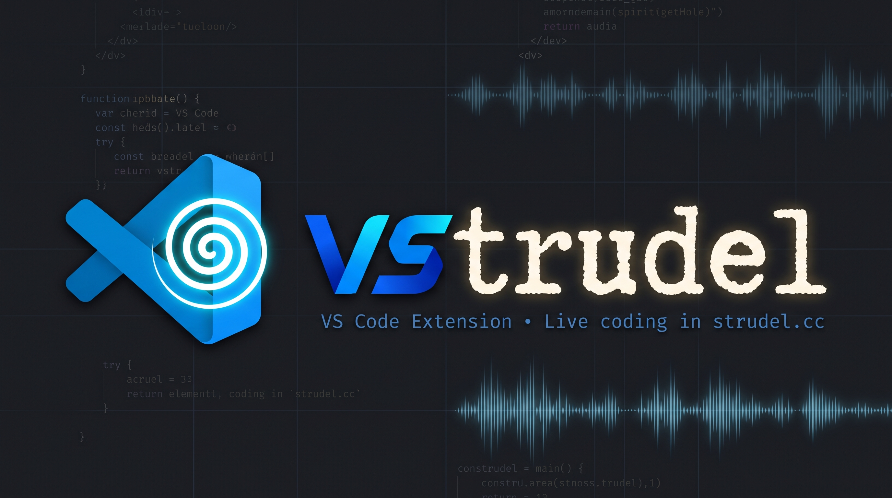

<p align="center">
  
</p>

# vstrudel

**vstrudel is a VS Code extension. It turns your editor into a Strudel IDE whenever you
open a `.strudel` file.**

[Strudel](https://strudel.cc) is a language for making music with code. vstrudel embeds
the real Strudel, the same editor and the same sound engine as strudel.cc, and adds
panels around it for the things a web page cannot give you:

- **Sounds**: every instrument you can play, to browse, hear and insert. Drum machines
  by bank, synths, soundfonts, and your own samples.
- **Snippets**: your own library of reusable code, with a description and a preview of
  each piece, one click away from your song.
- **Your files**: songs, samples and snippets are plain files in a folder, so they work
  with git, search and everything else in your editor.

It also runs in **GitHub Codespaces**. That gives a second way to use it: keep each
music project as a repository and open it in a browser from any machine, with nothing
installed. Fork this repository, open your fork in a Codespace, and start from the
`template/` folder.

Free and open source, AGPL-3.0-or-later like Strudel. **Version 0.1.0.** See
`doc/TODO.md` for what is missing.

## Install

**In VS Code:** download `vstrudel.vsix` from the
[latest release](https://github.com/alienmind/vstrudel/releases/latest). In the
Extensions view press `...` and choose "Install from VSIX...". Then make a file called
`song.strudel`, type `s("bd sd, hh*4")`, click in the code and press Ctrl+Enter.

**In Codespaces:** on GitHub press Code, Codespaces, `...`, "New with options", and
choose the configuration "vstrudel template (released extension)". Open
`demo.strudel`, click in the code and press Ctrl+Enter. The sound comes out of your
browser.

## Features

**Editor**

- The real Strudel editor for `.strudel` files: the upstream packages, not a copy.
- Inline scopes, piano rolls and other visuals under the line that makes them.
- Sliders inside the code that you drag while the song plays.
- The notes that are sounding are outlined in the code.
- Hydra visuals behind the code.
- One button switches a file between the Strudel editor and the native VS Code editor.
- A stage beside the native editor: sliders and visuals, each with a name taken from
  your code.
- Edits from outside (git, another editor, an AI agent) show up at once, while it plays.

**Sounds**

- All the sounds of strudel.cc: drum machines, piano, the VCSL instruments, the General
  MIDI soundfonts, the synths.
- A Sounds view that lists everything you can play, with an icon per kind.
- Drum machines grouped by bank.
- A click types the name of a sound at the cursor. With preview on, it also plays it.
- A button on a bank types `.bank("...")`.
- Your own samples: audio files in a `samples/` folder are sounds, with no setup. New
  files appear without a reload.
- Sample packs from GitHub (`samples('github:user/repo')`) are listed before you press
  play, get their own group, and are copied into your project so they play offline.

**Snippets**

- A Snippets view over the `.strudel` files in your `lib/` folder, grouped by folder.
- A click opens a card: description, tags, author, and the code in color.
- "Insert at cursor" pastes the code. A double click opens the file.
- A filter box that searches titles, descriptions and tags.
- Snippets describe themselves in comments at the top of the file.

**Projects**

- Songs, samples and snippets are plain files: git, search and folders work as usual.
- A template to start from, with a demo song, examples and a library of snippets.
- Runs in GitHub Codespaces: fork, open, play.

Not there yet: MIDI, sound across a switch of editor, completion and hover, the
Marketplace. See `doc/TODO.md`.

## A closer look

### The Strudel editor

`.strudel` files open in the editor of strudel.cc: inline scopes and piano rolls under
the line that makes them, sliders inside the code, and an outline on the notes that are
playing. Hydra visuals work too.

A button in the title bar switches the same file to the native VS Code editor, for
bigger edits with your own keys, extensions and AI completion. Press play there and a
stage opens beside the code. It lists the sliders of the song, then its visuals. Each
row is named from your code: the name of the pattern (`$kick:`), the name of a variable,
the comment above the line, or the code itself. Drag a slider there and the number in
the code follows.

Edits made outside the editor, by git or by an agent, show up at once, even while the
song plays.

### Sounds

The vstrudel icon in the activity bar opens the Sounds view. It lists what the engine
can play, your own samples first:

- A click types the name of the sound at the cursor.
- With the speaker button at the top of the view on, the click also plays the sound.
- Drum machines are grouped by bank. The button on a bank types `.bank("RolandTR909")`.

Your own samples need no setup. A folder `samples/kick/` with audio files in it becomes
`s("kick")`, and `s("kick:1")` is its second file. A new folder shows up a few seconds
after you copy it in.

A song can load a pack from GitHub with `samples('github:user/repo')`. The pack shows up
in the Sounds view when you open the file, and it is copied into `.vstrudel/` in your
project, so next time it plays without the network. That folder ignores itself for git.

### Snippets

Put `.strudel` files in a `lib/` folder and they appear in the Snippets view, grouped by
folder. A click opens a card with a description, the code in color and an "Insert at
cursor" button. A double click opens the file.

A snippet describes itself in comments at the top:

```
// @title Four on the floor
// @category drums
// @details Kick on every beat, clap on 2 and 4, open hat on the off beat.
// @tags house, techno, 909
// @by alienmind
s("bd*4, ~ cp ~ cp, [~ oh]*4").bank("RolandTR909")
```

Only the code is inserted. The categories are `drums`, `bass`, `melody`, `chords`,
`texture`, `effect`, `function`, `song` and `visual`.

## Keys

| Key | Does |
|---|---|
| Ctrl+Enter | Play, or update the playing pattern |
| Ctrl+. | Stop |
| Ctrl+Alt+M | Switch between the Strudel editor and the native editor |

On a Mac use Cmd in place of Ctrl.

The first time you press play from a button or from the native editor, the page may ask
for one click ("Click to enable audio"). Browsers do not start sound without a click.

## The template

`template/` is a starting point for a music project:

| Folder | Holds |
|---|---|
| `demo.strudel` | A first song |
| `examples/` | Songs to learn from and to play, from a first beat to full tracks |
| `lib/` | Snippets: drums, bass lines, chords, effects, helper functions |
| `samples/` | Your own audio files |

## Work on vstrudel itself

You need Node 24 and pnpm.

```
pnpm install
pnpm build
```

Then press F5 in VS Code. A second window opens on the `template/` folder with the
extension loaded.

| Command | Does |
|---|---|
| `pnpm watch` | Rebuild on every change |
| `pnpm typecheck` | Type check without building |
| `pnpm test:unit` | Run the unit tests, for now the rules that name things in the stage |
| `pnpm smoke` | Serve the editor in a plain browser, muted, to test without VS Code |
| `pnpm test:vscode` | Run the integration test inside a real VS Code |
| `pnpm package` | Build a `.vsix` |
| `pnpm promote` | Build a release copy into `.bin/` and install it in your own VS Code |

| Folder | Holds |
|---|---|
| `src/extension/` | The part that runs in VS Code |
| `src/webview/` | The page that hosts the Strudel editor and makes the sound |
| `src/snippets-view/` | The page of the Snippets view |
| `doc/` | Architecture, open work and dropped ideas |

## Thanks

All of the music making is [Strudel](https://codeberg.org/uzu/strudel), by Felix Roos,
Alex McLean and the Strudel contributors. vstrudel hosts the upstream `@strudel/*`
packages unchanged.
