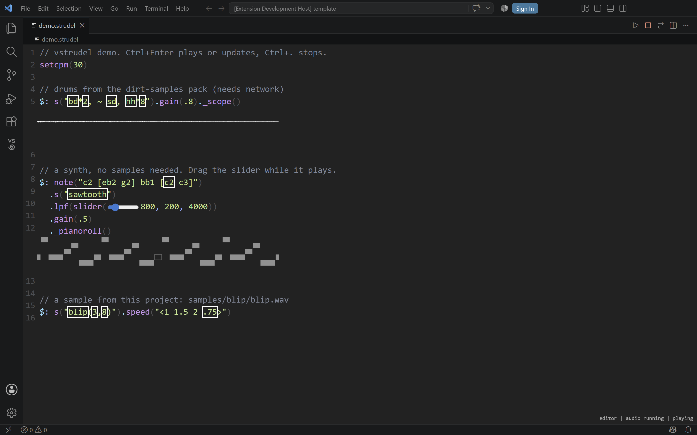

# vstrudel


**vstrudel is a VS Code extension. It turns your editor into a Strudel IDE whenever you
open a `.strudel` file.**

[Strudel](https://strudel.cc) is a language for making music with code. Its home is a
web page, and a web page is a hard place to keep a growing pile of songs, samples and
reusable ideas. vstrudel embeds the real Strudel, the same editor and the same sound
engine, and adds panels around it: the songs of your project, every sound you can play,
your own library of snippets, and your music as plain files in a project.


[Download the latest release](https://github.com/alienmind/vstrudel/releases/latest) | [Source on GitHub](https://github.com/alienmind/vstrudel)

Free and open source (AGPL-3.0-or-later, like Strudel). It runs on desktop VS Code and
in GitHub Codespaces, so you can also keep a music project as a repository and play it
from a browser on any machine, with nothing installed.

> **Version 1.0.0.** The first stable release. Errors in the code are shown where they
> are, a status bar says what plays, the side bar has a Files view and new Snippets, and
> AI assistants know how to edit a song. See "What is missing" at the end.

---

## Features

**Editor**

- The real Strudel editor for `.strudel` files: the upstream packages, not a copy.
- Inline scopes, piano rolls and other visuals under the line that makes them.
- Sliders inside the code that you drag while the song plays.
- The notes that are sounding are outlined in the code.
- Hydra visuals behind the code.
- One button switches a file between the Strudel editor and the native VS Code editor.
- A stage beside the native editor: sliders and visuals, each with a name taken from
  your code.
- Edits from outside (git, another editor, an AI agent) show up at once, while it plays.
- An error in the code is underlined and listed in the Problems view, and the song keeps
  playing what worked last.
- A status bar item says what the song does (playing, stopped, error) and plays or stops
  it with a click.
- Settings for the theme of the editor (the 39 themes of strudel.cc) and its font. By
  default the font and size are those of your VS Code editor.
- Ctrl+. stops the song in front. Press it again to stop a song that plays in another
  tab. "vstrudel: Stop all" stops every song.

**Sounds**

- All the sounds of strudel.cc: drum machines, piano, the VCSL instruments, the General
  MIDI soundfonts, the synths.
- A Sounds view that lists everything you can play, with an icon per kind.
- Drum machines grouped by bank.
- A click on a sound plays it when preview is on. It never types.
- Two buttons on each sound: one types its name at the cursor, one plays it.
- A button on a bank types `.bank("...")`.
- The list is there as soon as VS Code starts, before you open a song.
- Your own samples: audio files in a `samples/` folder are sounds, with no setup. New
  files appear without a reload.
- Sample packs from GitHub (`samples('github:user/repo')`) or from any address
  (`samples('https://.../strudel.json')`) are listed before you press play, get their
  own group, and are copied into your project so they play offline.
- Commands show how much space the copies take, and delete them.

**Snippets**

- A Snippets view over the `.strudel` files in your `lib/` folder, grouped by folder,
  with a colored dot per category and the tags of each snippet.
- Rest the mouse on a snippet: its description and its code in color float beside it.
- Two buttons on each snippet: one inserts the code at the cursor, one opens the file.
- Snippets describe themselves in comments at the top of the file.

**Projects**

- Songs, samples and snippets are plain files: git, search and folders work as usual.
- A Files view lists every folder of your project that holds songs, and only those.
- Ready for AI assistants such as Copilot: the template tells them that "add a bass line"
  means a change to the song you have open, and gives them the Strudel reference and
  tutorial to look things up.
- A template to start from, with a demo song, examples and a library of snippets.
- Runs in GitHub Codespaces: fork, open, play.

---

## A closer look

### The Strudel editor



vstrudel does not imitate Strudel. It hosts the upstream Strudel packages, so you get
the same editor and engine as on strudel.cc, and new Strudel features arrive with a
version bump.

### Sounds

The **Sounds** view lists what the engine can play, your own samples first. Click a
sound to hear it. The two buttons on the row type its name where your cursor is, or play
it. The speaker button at the top decides whether a click plays.

Your own samples need no setup. Put audio files in a `samples/` folder:

```
samples/
  kick/
    kick1.wav
    kick2.wav
  snare/
    snare.wav
```

Now `s("kick snare")` plays them, and `s("kick:1")` picks the second kick.

A song can also load a pack from GitHub with `samples('github:user/repo')`, or from any
address with `samples('https://.../strudel.json')`. vstrudel sees that line when you
open the file: the pack shows up in the Sounds view at once, and it is copied into a
`.vstrudel/` folder of your project so it plays without the network next time.

### Snippets

Put `.strudel` files in a `lib/` folder. The **Snippets** view shows them by folder.
Rest the mouse on one to see what it is and its code. A button inserts it at the cursor.

A snippet describes itself in comments at the top of the file:

```
// @title Four on the floor
// @category drums
// @details Kick on every beat, clap on 2 and 4, open hat on the off beat.
// @tags house, techno, 909
// @by alienmind
s("bd*4, ~ cp ~ cp, [~ oh]*4").bank("RolandTR909")
```

Only the code is inserted. The template comes with a starting library: drums, bass
lines, chords, melodies, effects, helper functions and song skeletons.

### Errors and the status bar

When the code has an error, the song keeps playing what worked last. The error is
underlined in the native editor and listed in the Problems view, and the status bar
turns red with the message. The status bar also says whether the song plays, and a click
on it plays or stops.

### With an AI assistant

The template tells assistants such as Copilot how a song is written, and that a request
like "add a bass line" means a new line in the song you have open. It also holds the
whole Strudel reference and the strudel.cc tutorial as text, so the assistant can look up
a function instead of guessing one.

### Two ways to edit the same file

One button in the title bar switches a file between two editors:

- The **Strudel editor**, for playing: visuals and sliders inside the code.
- The **native VS Code editor**, for bigger edits: multi-cursor, your keybindings, your
  other extensions, AI completion. Press play there and a **stage** opens beside the
  code.


The stage lists the sliders of the song, then its visuals. Each row is named from your
code: the name of the pattern (`$kick:`), the name of a variable, the comment above the
line, or the code itself. Drag a slider in the stage and the number in the code follows.

### Hydra visuals

[Hydra](https://hydra.ojack.xyz) works as it does on strudel.cc. Call `initHydra()` and
the visuals draw behind your code, driven by your pattern.


---

## Install

### In VS Code

1. Download `vstrudel.vsix` from the
   [latest release](https://github.com/alienmind/vstrudel/releases/latest).
2. In VS Code open the Extensions view, press `...` at the top, and choose
   **Install from VSIX...**
3. Make a file called `song.strudel`, type `s("bd sd, hh*4")`, click in the code and
   press **Ctrl+Enter**.

### In GitHub Codespaces

1. Open [github.com/alienmind/vstrudel](https://github.com/alienmind/vstrudel).
2. Press **Code**, then **Codespaces**, then `...` and **New with options**.
3. Choose the configuration **vstrudel template (released extension)** and create it.
4. Open `demo.strudel`, click in the code and press **Ctrl+Enter**.

The sound comes out of your browser.

## Keys

| Key | Does |
|---|---|
| Ctrl+Enter | Play, or update the playing pattern |
| Ctrl+. | Stop the song in front. Again: stop the song that plays in another tab |
| Ctrl+Alt+M | Switch between the Strudel editor and the native editor |

On a Mac use Cmd in place of Ctrl.

## Good to know

- **"Click to enable audio."** A browser does not start sound without a click. When you
  press play from a button or from the native editor, the page may ask for one click
  first. Pressing Ctrl+Enter inside the Strudel editor counts as that click.
- **The network.** The default sounds and Hydra are downloaded when they are used.
  Offline, the synths, your own samples and the packs already copied still play.
- **Disk space.** A pack is copied whole. Some are large. "vstrudel: Show sample pack
  cache size" says how much, and "vstrudel: Clear sample pack cache" gets the space
  back.

## What is missing

- MIDI. VS Code does not let an extension's page use MIDI, so Strudel's `.midi()` and
  `midin()` do not work yet. A way around it is being built.
- The sound stops when you switch between the two editors.
- Playing notes are not outlined in the native editor.
- No completion or documentation on hover in the code yet, and no Strudel reference
  panel.
- It is not on the VS Code Marketplace yet. Install it from the `.vsix` file.

## Thanks

All of the music making is [Strudel](https://codeberg.org/uzu/strudel), by Felix Roos,
Alex McLean and the Strudel contributors. vstrudel is only the VS Code part around it.

The template includes `coastline` by eddyflux, from Strudel's own examples, and "Array
(Lil Data Edit)" by DJ_Dave. Several snippets use techniques learned from Switch Angel
and from the Art Haus live coding workshop.
