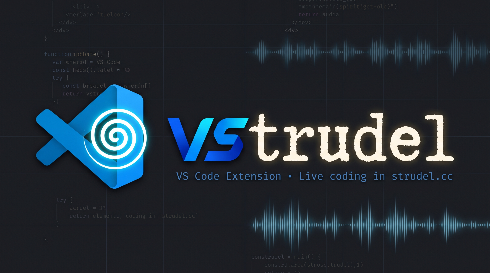
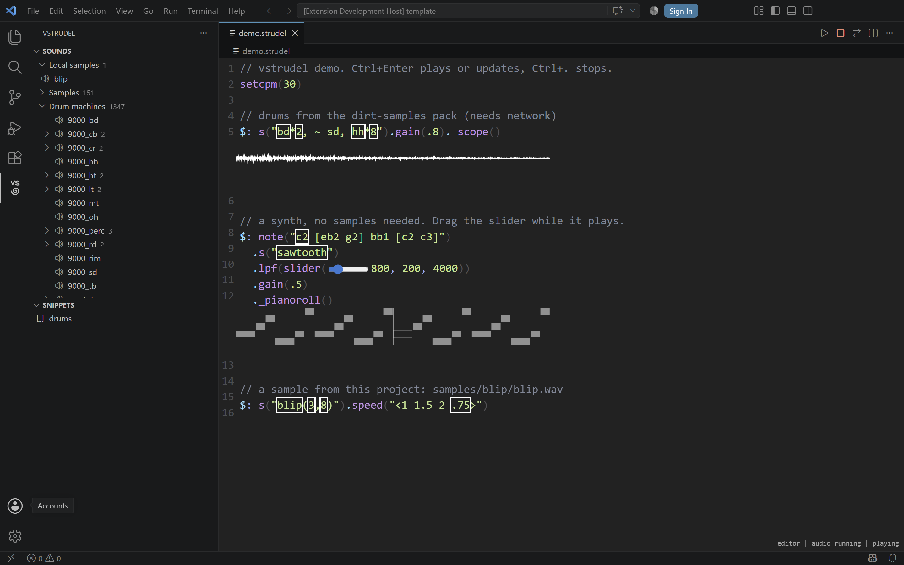
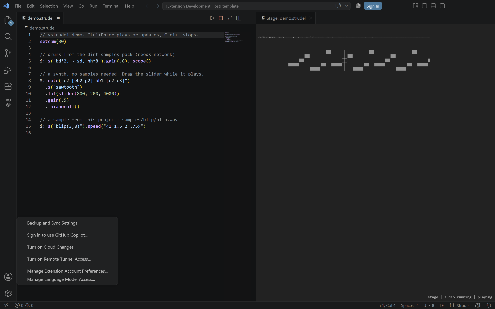

# vstrudel



**[Strudel](https://strudel.cc) live coding inside VS Code.** Open a `.strudel` file,
press Ctrl+Enter, and it plays.



Strudel is a great language for making music with code. Its home is a web page, and a
web page is a hard place to keep a growing pile of songs, samples and reusable ideas.
vstrudel puts the same editor and the same sound engine inside VS Code, so your music
lives in a normal project folder: files, folders, git, your own samples, your own
library of snippets.

[Download the latest release](https://github.com/alienmind/vstrudel/releases/latest) | [Source on GitHub](https://github.com/alienmind/vstrudel)

It is free and open source (AGPL-3.0-or-later, like Strudel). It runs on desktop VS
Code and in GitHub Codespaces, so you can also play from a browser with nothing
installed.

> **Early release, version 0.0.3.** It plays, and the parts below work. It is young:
> expect rough edges, and see "What is missing" at the end.

---

## What you get

### The real Strudel editor


vstrudel does not imitate Strudel. It hosts the upstream Strudel packages, so you get
the same editor and engine as on strudel.cc:

- Inline scopes and piano rolls, right under the line that makes them
  (`._scope()`, `._pianoroll()`).
- Sliders inside the code (`slider(800, 200, 4000)`) that you drag while it plays.
- The notes that are sounding are outlined in the code.
- Synths, samples, effects, mini-notation, `$:` patterns: the whole language.

Because it is the upstream code, new Strudel features arrive with a version bump.

### Your files are real files

A `.strudel` file is a normal text file in your project. Save, undo, search, rename and
git work as usual. If something else changes the file while it is open, such as git or
an AI agent, the editor shows the new text at once, even while the pattern plays.

### All the sounds, and yours too

The sounds of strudel.cc are loaded: the drum machines, piano, the VCSL instruments,
the General MIDI soundfonts and the synths.

The **Sounds** view lists everything you can play, your own samples first. Click a
sound to hear it. Press the insert button to type its name at the cursor.

Your own samples need no setup. Put audio files in a `samples/` folder:

```
samples/
  kick/
    kick1.wav
    kick2.wav
  snare/
    snare.wav
```

Now `s("kick snare")` plays them, and `s("kick:1")` picks the second kick. A new folder
shows up in the list a few seconds after you copy it in.

### A library of your own snippets

Put `.strudel` files in a `lib/` folder. They appear in the **Snippets** view, and a
click pastes one at the cursor. A drum pattern you like, a bass line, an effect chain:
write it once, reuse it in every song.

### Two ways to edit the same file

One button in the title bar switches a file between two editors:

- The **Strudel editor**, for playing: widgets and sliders inside the code.
- The **native VS Code editor**, for bigger edits: multi-cursor, your keybindings, your
  other extensions, AI completion. Press play there and a **stage** opens beside the
  code with the scopes and piano rolls.



### Hydra visuals

[Hydra](https://hydra.ojack.xyz) works as it does on strudel.cc. Call `initHydra()` and
the visuals draw behind your code, driven by your pattern.


---

## Install

### In VS Code

1. Download `vstrudel.vsix` from the
   [latest release](https://github.com/alienmind/vstrudel/releases/latest).
2. In VS Code open the Extensions view, press `...` at the top, and choose
   **Install from VSIX...**
3. Make a file called `song.strudel`, type `s("bd sd, hh*4")`, click in the code and
   press **Ctrl+Enter**.

### In GitHub Codespaces

1. Open [github.com/alienmind/vstrudel](https://github.com/alienmind/vstrudel).
2. Press **Code**, then **Codespaces**, then `...` and **New with options**.
3. Choose the configuration **vstrudel template (released extension)** and create it.
4. Open `demo.strudel`, click in the code and press **Ctrl+Enter**.

The sound comes out of your browser.

## Keys

| Key | Does |
|---|---|
| Ctrl+Enter | Play, or update the playing pattern |
| Ctrl+. | Stop |
| Ctrl+Alt+M | Switch between the Strudel editor and the native editor |

On a Mac use Cmd in place of Ctrl.

## Good to know

- **"Click to enable audio."** A browser does not start sound without a click. When you
  press play from a button or from the native editor, the page may ask for one click
  first. Playing with Ctrl+Enter inside the Strudel editor does not need it.
- **The network.** The default sound packs and Hydra are downloaded when they are used.
  Offline, the synths and your own samples still play.

## What is missing

- The sound stops when you switch between the two editors.
- Sliders do not show in the stage.
- Playing notes are not outlined in the native editor.
- There is no completion or documentation on hover yet, and no Strudel reference panel.
- It is not on the VS Code Marketplace yet. Install it from the `.vsix` file.

## Thanks

All of the music making is [Strudel](https://codeberg.org/uzu/strudel), by Felix Roos,
Alex McLean and the Strudel contributors. vstrudel is only the VS Code part around it.
