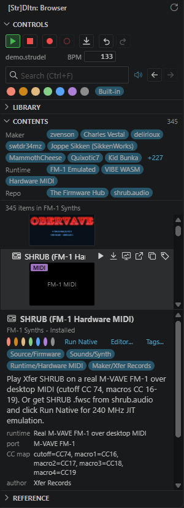
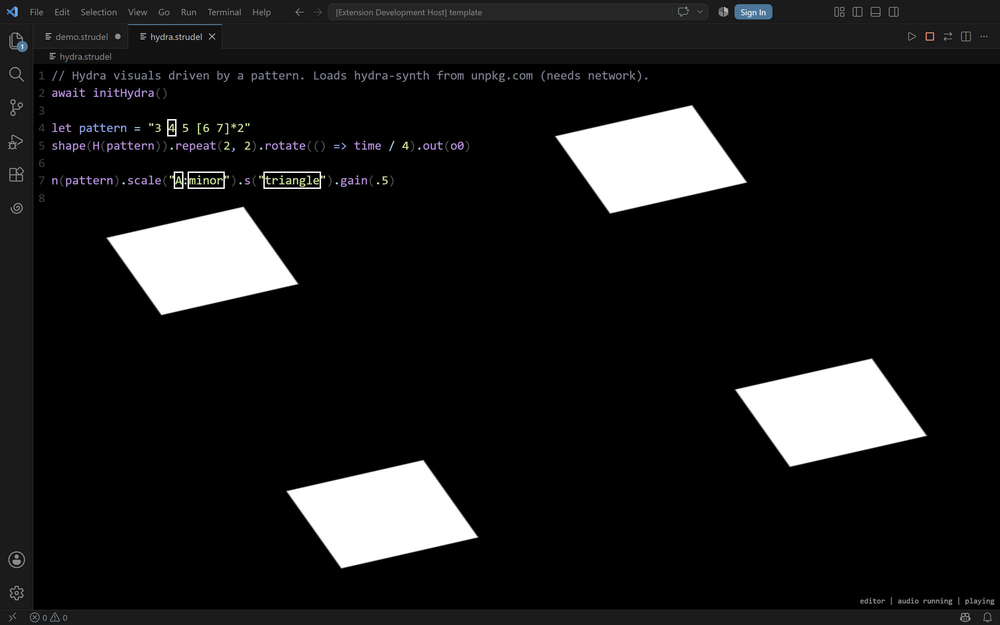

# [str]dltn Live[code]

![[str]dltn Live[code] logo](logo.jpg)
<!-- SCREENSHOT SPEC: doc/logo.jpg
  Static project logo artwork (dark background, "[str]dltn Live[code]" typography with cyan "[str]" and "[code]").
  Do not recapture; keep existing file.
-->

**[str]dltn Live[code] is a VS Code extension. It turns your editor into a Strudel IDE whenever you
open a `.strudel` file.**

[Strudel](https://strudel.cc) is a language for making music with code. [str]dltn Live[code]
embeds the real Strudel, the same editor and the same sound engine, and adds tools on top of
it, in the manner of Ableton Live: a browser of every
sound, synth, FM-1 firmware, snippet, song and function, a mixer and music controls for the
song you play, and your music as plain files in a project.


<!-- SCREENSHOT SPEC: doc/screenshot-overview.png
  File: doc/screenshot-overview.png (shared with README.md).
  Capture: Full VS Code window at 1440x900 (or 2880x1800 downscaled 50% to 1440x900).
  Workspace / Song: template/demo.strudel open in the Strudel editor and actively playing.
  UI State:
    - Left side bar: [str]dltn Browser visible with Controls pane open at top (Play lit green, Stop, Record, Render, Undo, Redo, BPM, Back/Forward, search box, preview speaker, 7 color dots, Built-in), Library/Contents showing Drums or Sounds with rows and tag chips, Reference collapsed at bottom.
    - Center: Strudel editor showing demo.strudel with inline scopes/visuals, inline sliders, note outlines active, and knob buttons in the left gutter.
    - Bottom panel: Mixer tab active showing Master strip first, then song strips (with bass unfolded to show inner blue faders), active green level meters, pump meters, knob buttons, and orange dashed sidechain ducking cables.
    - Status bar right: "strdltn: playing".
  Must show: All three main regions (4-pane Browser, Strudel editor with live visuals, Mixer with meters and cables) clearly legible in one window.
-->

[Download the latest release](https://github.com/alienmind/strdltn/releases/latest) | [User manual (PDF)](https://github.com/alienmind/strdltn/releases/latest/download/strdltn-manual.pdf) | [Source on GitHub](https://github.com/alienmind/strdltn)

Free and open source (AGPL-3.0-or-later, like Strudel). It runs on desktop VS Code and
in GitHub Codespaces, so you can also keep a music project as a repository and play it
from a browser on any machine, with nothing installed.

> **Version 0.5.0**: the knobs of your MIDI controller move the sliders of your code. Click
> the small knob beside a line or under a fader, turn a knob, and it is mapped; the Mixer
> lists and resets your mappings. The Mixer now starts with the Master strip, and a user
> manual comes with every release. Version 0.4 brought MIDI on desktop (`.midi()`, `midin()`,
> `midikeys()`), recording and rendering to `.wav` and `.mp3`, and level meters. Version 0.3
> brought the Devices view for synth firmwares; 0.2 the Mixer and the Library. See "What is
> missing" at the end.

> **M-VAVE FM-1, VIBE FM (.wasm) and real FM-1 (.fwsc) firmwares.** Got an FM-1? Play it
> over desktop MIDI with built-in Hardware profiles (**SHRUB** with CC 74 cutoff, CC 16-19
> macros and its **Editor...** button, plus **FM-1 Stock**). Without hardware, install and
> play VIBE FM `.wasm` builds (`s("vibefm1:<id>")`, each with live screens, F1-F6 keys and
> parameters) and real FM-1 `.fwsc` firmwares (`s("fm1:<id>")` via `fm1-emu`) directly from
> **Plugins > FM-1 Synths** in the Browser.

This project is a fork of [vstrudel](https://github.com/alienmind/vstrudel). We forked
it because the scope grew beyond a VS Code extension.

---

## Features

**Editor**

- The real Strudel editor for `.strudel` files: the upstream packages, not a copy.
- Inline scopes, piano rolls and other visuals under the line that makes them.
- Sliders inside the code that you drag while the song plays.
- The notes that are sounding are outlined in the code.
- Hydra visuals behind the code.
- One button switches a file between the Strudel editor and the native VS Code editor.
- A stage beside the native editor, with the visuals of the song, each with a name taken
  from your code.
- Edits from outside (git, another editor) show up at once, while it plays.
- An error in the code is underlined and listed in the Problems view, and the song keeps
  playing what worked last.
- A status bar item says what the song does (playing, stopped, error) and plays or stops
  it with a click.
- Settings for the theme of the editor (the 39 themes of strudel.cc) and its font. By
  default the font and size are those of your VS Code editor.
- Ctrl+. stops the song in front. Press it again to stop a song that plays in another
  tab. "strdltn: Stop all" stops every song.

**Mixer and Music Controls**

- A mixer in the bottom panel: the Master strip first, then one strip per part of the song
  (`$kick:`, `bass:`), side by side as in the Session view of Live. A song or snippet
  without parts is one strip. Two blue buttons unfold every strip or fold them all.
- Each slider in the code is a fader. Moving it changes the sound at once and the number
  in the code a moment later. Under the faders, a meter pumps with the part's notes; a click
  on a gray one adds `._scope()` to the part.
- M mutes, S solos, and a click on the gain fader's triangle adds or removes it. Each writes
  Strudel's own code, so the song plays the same on strudel.cc.
- Sidechain as cables: drag from a strip's jack onto another strip to duck it, pull the
  cable off to stop. The code gets the `.duck()` and `.orbit()` for it.
- Music Controls in the top Controls pane of the Browser: Play, Stop, Record, Render, song
  Undo and Redo, and the BPM of the song. Type a BPM to set it, double click for Strudel's 120.
- Drag any instrument from the Browser onto the Mixer strip area to append a new strip.
- The Mixer can float in a window of its own, and comes to the front when a song plays.
- Level meters on every strip and on the Master, with the peak in dB.
- Record what you hear, or render the whole song, to `.wav` and `.mp3` next to it.

**MIDI**

- Line actions (`M` / `S` / `C`) left of the line numbers in the Strudel editor (Mute,
  Solo, and MIDI Capture with tooltips), plus a knob button under every fader of the Mixer.
  Click `C` (it turns red), turn a knob on your controller (it turns green): that knob now
  moves the slider, the sound and the number in the code. It takes over once it reaches the
  slider's value, and a dim second handle on the fader shows where your knob is until then.
- The mapping is plain code, `.knob(74)` after the slider, so it stays with the song. On
  strudel.cc the song plays without the knob.
- "Show MIDI Mappings" in the Mixer lists every knob with its line of code; "Reset MIDI
  Mappings" removes them all.
- `.midi('device')` plays a synth or a drum machine in time with the sound; `midin()` and
  `midikeys()` read a controller or a keyboard. The Library lists your devices. Desktop
  only.

**Sounds**

- All the sounds of strudel.cc: drum machines, piano, the VCSL instruments, the General
  MIDI soundfonts, the synths.
- A Browser like the one of Ableton Live, in one view with four panes: **Controls** (Music
  Controls with Undo/Redo, Back/Forward history beside search, preview toggle, seven colors,
  Built-in switch), **Library** (Sounds, Drums, Samples, Plugins > FM-1 Synths, Render,
  MIDI, Songs, Snippets), **Contents** (**Results** while searching, with tag chips and
  details), and **Reference** (every function of Strudel).
- Drum machines grouped by bank, with a `.bank("...")` button on hover.
- Single-click preview works for every sound and synth (samples, drum machines, plain
  waves, soundfonts, `supersaw`, `zzfx`, VIBE `.wasm`, emulated `.fwsc`, and hardware MIDI
  profiles), even with no song open, for 1 loop with a smooth fade-out and clean disposal.
- Drag and drop from the Browser into the editor to expand a full playable `$name:` line
  (or append an effect onto an existing chain), or onto the Mixer to append a new strip.
- Two buttons on each sound: one types its code at the cursor, one plays it.
- The list is there as soon as VS Code starts, before you open a song.
- Your own samples: audio files in a `samples/` folder are sounds, with no setup. New
  files appear without a reload.
- Sample packs from GitHub (`samples('github:user/repo')`) or from any address
  (`samples('https://.../strudel.json')`) are listed before you press play, get their
  own group, and are copied into your project so they play offline.
- Commands show how much space the copies take, and delete them.

**Snippets**

- The Browser's Snippets: the `.strudel` files in your `lib/` folder, grouped by category,
  with the tags of each snippet. Select one to read its description and code.
- Two buttons on each snippet: one inserts the code at the cursor, one opens the file.
- Snippets describe themselves in comments at the top of the file.

**Projects**

- Songs, samples and snippets are plain files: git, search and folders work as usual.
- The Library lists every `.strudel` file of your project, by folder.
- A template to start from, with a demo song, examples and a library of snippets.
- Runs in GitHub Codespaces: fork, open, play.

---

## A closer look

### The Strudel editor

[str]dltn Live[code] does not imitate Strudel. It hosts the upstream Strudel packages, so you get
the same editor and engine as on strudel.cc, and new Strudel features arrive with a
version bump.

### The Mixer


<!-- SCREENSHOT SPEC: doc/screenshot-music.png
  File: doc/screenshot-music.png (shared with README.md).
  Capture: Cropped Mixer bottom panel (~1440x360).
  Workspace / Song: template/demo.strudel playing.
  UI State:
    - Left utility column visible (blue > and < unfold/fold buttons, Reset MIDI Mappings, Show MIDI Mappings, Show MIDI Routing).
    - Master strip first with active stereo green meter and peak dB readout.
    - Chain strips side by side (kick, bass unfolded showing inner blue faders, pad, hats, vocals, etc.), M and S buttons, knob buttons under faders, active green pump meters, jacks at the foot, and orange dashed sidechain cables from kick to ducked strips.
  Must show: Master strip, unfolded inner blue faders, stereo level meters with peak dB, M/S, knob buttons, pump meters, and orange dashed ducking cables.
-->

The bottom panel has a tab called Mixer. It shows the song in front: the Master first,
then a strip for each part, with its fader on a level meter, M and S, a knob button under
every fader, and orange cables for the sidechain. Drag from the jack at the foot of a strip
onto another strip and the first ducks the second; the code gets `.duck("2")` and, if
needed, an `.orbit()` of its own for the target. Drop any instrument from the Browser onto
the Mixer strip area to append a new strip. Every change is an edit of the song, so
Undo takes it back and the song stays plain Strudel.

### MIDI knobs

Every slider of a song can follow a knob of your MIDI controller. Click the small knob
beside its line, or under its fader: it turns red while it listens. Turn a knob and it turns
green, and the code says `.knob(74)`. From then on the knob moves the slider, the sound, the
number in the code and the fader in the Mixer. A knob that sits somewhere else waits until
it reaches the slider's value, so the sound never jumps; a dim handle on the fader shows
where it is meanwhile.

### FM-1 Synths and Devices


<!-- SCREENSHOT SPEC: doc/screenshot-fm1-synths.png
  File: doc/screenshot-fm1-synths.png (shared with README.md).
  Capture: Cropped Browser side bar (~360px wide, full height) showing Plugins > FM-1 Synths.
  Workspace / Song: template/ workspace open.
  UI State:
    - Controls pane open at top; Contents showing Plugins > FM-1 Synths with Runtime chips (Runtime/VIBE WASM, Runtime/FM-1 Emulated, Runtime/Hardware MIDI), rows with color-coded WASM (green), FWSC (orange) and MIDI (purple) badges and VIBE screen thumbnails.
    - SHRUB (FM-1 Hardware) selected with Details showing CC 74 / CC 16-19 and the "Editor..." button.
  Must show: Runtime chips, WASM / FWSC / MIDI badges, screen thumbnails, and SHRUB details with the Editor button.
-->


<!-- SCREENSHOT SPEC: doc/screenshot-devices.png
  File: doc/screenshot-devices.png (shared with README.md).
  Capture: Cropped bottom panel (Devices tab) (~1440x420).
  Workspace / Song: template/examples/07-vibefm1-obervave.strudel open and playing.
  UI State:
    - Bottom panel switched to Devices showing at least two OBERVAVE panels (orbit 2 bass and orbit 3 pad).
  Must show: Live 480x320 firmware displays, F1 to F6 soft keys underneath, parameter sliders on the right, and fold/maximize/pop-out header buttons.
-->

Under **Plugins > FM-1 Synths**, browse and install VIBE `.wasm` (`s("vibefm1:<id>")`) and
real FM-1 `.fwsc` (`s("fm1:<id>")`) firmwares from The Firmware Hub, or drop in Hardware
MIDI profiles like **SHRUB** and **FM-1 Stock** with ready-made CC maps. Playing VIBE
firmwares appear in the **Devices** tab with their live screens, F1 to F6 keys and
parameter sliders.

### Sounds and Browser


<!-- SCREENSHOT SPEC: doc/screenshot-browser.png
  File: doc/screenshot-browser.png (shared with README.md).
  Capture: Cropped Browser side bar (~320-360px wide, ~750-900px tall).
  Workspace / Song: template/ workspace open.
  UI State:
    - Four stacked pane headers visible inside the Browser view: Controls (open), Library (showing Sounds, Drums, Samples, Plugins > FM-1 Synths, Render, MIDI, Songs, Snippets), Contents (open with tag chips, sound rows and Details pane at bottom), and Reference (collapsed at bottom).
    - Controls pane shows Play, Stop, Record, Render, Undo, Redo, BPM, Back/Forward arrows beside Search and speaker preview toggle, and the 7 color dots + Built-in button.
  Must show: All four pane headers (Controls, Library, Contents, Reference), Back/Forward and Undo/Redo buttons, colors + Built-in row, and Contents rows with chips.
-->

The **Browser** opens in four panes: **Controls** at the top (transport, Undo/Redo,
Back/Forward history, search, preview toggle, colors and Built-in filter), **Library**,
**Contents** (**Results** while searching), and **Reference**. Single-click any sound or
synth to hear a 1-loop preview with smooth fade-out, even with no song open. Drag any row
into the editor to insert a full playable `$name:` line (or an effect onto an existing
chain), or drop it onto the Mixer to add a strip.

Your own samples need no setup. Put audio files in a `samples/` folder:

```
samples/
  kick/
    kick1.wav
    kick2.wav
  snare/
    snare.wav
```

Now `s("kick snare")` plays them, and `s("kick:1")` picks the second kick.

A song can also load a pack from GitHub with `samples('github:user/repo')`, or from any
address with `samples('https://.../strudel.json')`. [str]dltn Live[code] sees that line when you
open the file: the pack shows up in the Browser at once, and it is copied into a
`.strdltn/` folder of your project so it plays without the network next time.

### Snippets

Put `.strudel` files in a `lib/` folder. The **Library** shows them under Snippets, by folder.
Rest the mouse on one to see what it is and its code. A button inserts it at the cursor.

A snippet describes itself in comments at the top of the file:

```
// @title Four on the floor
// @category drums
// @details Kick on every beat, clap on 2 and 4, open hat on the off beat.
// @tags house, techno, 909
// @by alienmind
s("bd*4, ~ cp ~ cp, [~ oh]*4").bank("RolandTR909")
```

Only the code is inserted. The template comes with a starting library: drums, bass
lines, chords, melodies, effects, helper functions and song skeletons.

### Errors and the status bar

When the code has an error, the song keeps playing what worked last. The error is
underlined in the native editor and listed in the Problems view, and the status bar
turns red with the message. The status bar also says whether the song plays, and a click
on it plays or stops.

### Two ways to edit the same file

One button in the title bar switches a file between two editors:

- The **Strudel editor**, for playing: visuals and sliders inside the code.
- The **native VS Code editor**, for bigger edits: multi-cursor, your keybindings, your
  other extensions. Press play there and a **stage** opens beside the
  code.


<!-- SCREENSHOT SPEC: doc/screenshot-stage.png
  File: doc/screenshot-stage.png (shared with README.md).
  Capture: Full VS Code window at 1440x900 (or half-size downscale from 2880x1800).
  Workspace / Song: template/demo.strudel (or an example with inline scopes) switched to the native VS Code text editor (Ctrl+Alt+M) and playing.
  UI State:
    - Top editor group: native VS Code editor showing Strudel code with syntax highlighting and knob icons in the gutter left of line numbers.
    - Lower editor group: Stage panel showing live named visuals/scopes (each labeled from its chain or comment).
    - Bottom panel: Mixer visible with live meters and strips.
  Must show: Native VS Code editor on top, Stage with named scopes underneath, Mixer at the bottom.
-->

The stage shows the visuals of the song. Each one is named from your code: the name of
the pattern (`$kick:`), the name of a variable, the comment above the line, or the code
itself. The sliders are in the Mixer.

### Hydra visuals

[Hydra](https://hydra.ojack.xyz) works as it does on strudel.cc. Call `initHydra()` and
the visuals draw behind your code, driven by your pattern.


<!-- SCREENSHOT SPEC: doc/screenshot-hydra.png
  File: doc/screenshot-hydra.png (shared with README.md).
  Capture: Full VS Code window at 1440x900 (or half-size downscale from 2880x1800).
  Workspace / Song: template/examples/06-hydra.strudel (or demo.strudel during a Hydra drop) open in the Strudel editor and playing.
  UI State:
    - Strudel editor focused and playing so Hydra canvas renders vivid geometric/shader shapes behind the code text.
    - Code text legible over the Hydra background; active notes outlined.
  Must show: Live Hydra visuals visible behind the Strudel code inside VS Code.
-->

---

## Install

### In VS Code

1. Download `strdltn.vsix` from the
   [latest release](https://github.com/alienmind/strdltn/releases/latest).
2. In VS Code open the Extensions view, press `...` at the top, and choose
   **Install from VSIX...**
3. Make a file called `song.strudel`, type `s("bd sd, hh*4")`, click in the code and
   press **Ctrl+Enter**.

### In GitHub Codespaces

1. Open [github.com/alienmind/strdltn](https://github.com/alienmind/strdltn).
2. Press **Code**, then **Codespaces**, then `...` and **New with options**.
3. Choose the configuration **[str]dltn Live[code] template (released extension)** and create it.
4. Open `demo.strudel`, click in the code and press **Ctrl+Enter**.

The sound comes out of your browser.

## Keys

| Key | Does |
|---|---|
| Ctrl+Enter | Play, or update the playing pattern |
| Ctrl+. | Stop the song in front. Again: stop the song that plays in another tab |
| Ctrl+Alt+M | Switch between the Strudel editor and the native editor |
| Ctrl+Alt+K | Map a MIDI knob to the slider under the cursor |
| Ctrl+F, Ctrl+H, Ctrl+G | Find, replace, go to a line in the Strudel editor |

On a Mac use Cmd in place of Ctrl. The [user manual](https://github.com/alienmind/strdltn/releases/latest/download/strdltn-manual.pdf) has all of them.

## Good to know

- **"Click to enable audio."** A browser does not start sound without a click. When you
  press play from a button or from the native editor, the page may ask for one click
  first. Pressing Ctrl+Enter inside the Strudel editor counts as that click.
- **The network.** The default sounds and Hydra are downloaded when they are used.
  Offline, the synths, your own samples and the packs already copied still play.
- **Disk space.** A pack is copied whole. Some are large. "strdltn: Show sample pack
  cache size" says how much, and "strdltn: Clear sample pack cache" gets the space
  back.

## What is missing

- MIDI in Codespaces. VS Code does not let an extension's page use MIDI, so MIDI goes
  through the part of the extension that runs on your machine. In a Codespace that part
  runs in the cloud and cannot see your devices. MIDI devices are not in the Mixer yet.
- The sound stops when you switch between the two editors.
- Playing notes are not outlined in the native editor.
- No completion or documentation on hover in the code yet. The Reference lists the
  functions; the tutorial of strudel.cc is planned for it.
- It is not on the VS Code Marketplace yet. Install it from the `.vsix` file.

## Thanks

All of the music making is [Strudel](https://codeberg.org/uzu/strudel), by Felix Roos,
Alex McLean and the Strudel contributors. [str]dltn Live[code] is only the VS Code part around it.

The template includes `coastline` by eddyflux, from Strudel's own examples, and "Array
(Lil Data Edit)" by DJ_Dave. Several snippets use techniques learned from Switch Angel
and from the Art Haus live coding workshop, and her trance gate is a snippet of its own.
