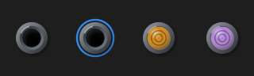

# DAW plan

The plan to turn [str]dltn Live[code] from an editor with side views into a DAW that is
written in code. Nothing in this file is built. The maintainer reads it, answers the
questions in "Decisions for the maintainer", and then we start with phase 0.

Each claim says where it comes from: "measured" (we ran it, the record is in
`doc/ARCHITECTURE.md` or `doc/TODO.md`), "read" (we read the code or the manual), or
"expected" (not tested). The spikes in "Spikes" turn the expected ones into measured
ones before the work that depends on them starts.

## Goal

The screen of Ableton Live, with code where Live has clips:

| Area of Live | What we build | Today |
|---|---|---|
| Browser (left pane) | One Browser view: search box, color tags, categories, places, and the results in the same column | Three tree views: Files, Sounds, Snippets |
| Session view with the mixer | A Mixer panel: one channel per chain of the song, made of the sliders that act on it, folded to its gain. Cables for sidechains (`.duck` to `.orbit`) and for MIDI (`.midi()` to a device), in two colors | The sliders are rows in the stage |
| Two decks with a crossfader, three EQ knobs and a fader each, synced by the beat | The DECKS view of the Mixer | Two songs can play at once, nothing ties them |
| Automation recording and the arrangement view | Record button; lanes of code, chains, sliders and decks on a timeline | Nothing |
| Clip and device view (bottom) | The stage, as now, and a Devices view: one panel per firmware that plays, and the SHRUB window | The stage. Firmwares have no panel. SHRUB is a mockup tab behind a setting |
| Arrangement | The code editor, as now | The Strudel editor and the native editor |
| MIDI in and out | Devices in the Browser, `.midi()`, `midin()`, `midikeys()`, MIDI learn on the mixer | Nothing. A webview may not use MIDI (measured) |

The code stays the song. Every panel either shows what the code says or changes the
code. A song sounds the same when it is opened on strudel.cc, apart from the features
strudel.cc does not have (MIDI devices by our bridge, firmwares).

## What we learned before planning

### The browser of Live 12

Read in the Live 12 manual, chapter "Working with the Browser", and the Live 12 release
notes. Items marked (forum) come from the Ableton forum and are not in the manual.

- The sidebar has three sections. **Collections**: seven color labels. An item gets a
  color from its context menu or with the keys 1 to 7, and 0 clears them. An item can
  have several colors, and a row shows at most three, as small squares. A label can be
  renamed. The first is "Favorites", red (forum). **Library**: All, Sounds, Drums,
  Instruments, Audio Effects, MIDI Effects, Modulators, Max for Live, Plug-Ins, Clips,
  Samples, Grooves, Templates, Tunings. **Places**: Packs, Splice, Cloud, Push, User
  Library, Current Project, the user's own folders, "Add Folder...".
- Above the results is the **filter view**: groups of tags shown as small chips. The
  groups differ per label. Seen in the maintainer's screenshot for "All": Content, Type,
  Sounds, Drums, Character, Devices, Function, Format, MIDI Tools. A click on a chip
  narrows the results. Ctrl+click takes several chips of one group. The manual does not
  name the rule; we expect "any chip inside a group, every group must match".
- Tags are a tree: group, tag, subtag. A tag editor adds groups, tags and subtags, and
  tags many files at once. Built-in tags cannot be removed. Live also tags the user's
  samples by listening to them (up to 60 seconds).
- Live keeps the user's tags in files beside the content, in a folder "Ableton Folder
  Info", and an index in a database (forum).
- **Search**: Ctrl+F jumps to "All" and puts the cursor in the search field. Every term
  must match. A term matches the file name. `#Drums` matches a tag. "Add Label" saves
  the search with its filters as a new entry of the sidebar.
- **Preview**: a click on a result plays it. With "Raw" off the preview loops in the
  tempo of the song and starts on the next bar.
- **Hot-swap**: the browser replaces the sound of the selected device in place.

### The cables of ableton-rackutils

Read in `../ableton-rackutils/packages/editor-ui/src/` (MIT, the maintainer's own
project): `PatchCable.tsx`, `MappingCables.tsx`, `useParamDrag.ts`, `holdToDrag.ts`,
`editor.css`.

- A cable is not a simulated rope. It is one SVG path, a cubic curve from plug to plug:
  `M from C (from.x, from.y + sag) (to.x, to.y + sag) to`. The only thing that moves by
  physics is `sag`, one number per cable on a damped spring.
- The step: `acceleration = STIFFNESS * (target - sag) - DAMPING * velocity`, then
  `velocity += acceleration * dt` and `sag += velocity * dt`, with `dt` at most 1/30 s.
  `target = min(distance * SAG_RATIO, SAG_MAX)`.
- Constants of the cable being dragged: `SAG_RATIO` 0.28, `SAG_MAX` 150, `STIFFNESS`
  110, `DAMPING` 11. On a connection the velocity gets +900, which is the bounce. A drop
  on nothing pulls the free end back to its start in 260 ms.
- Constants of the cables that stay: 0.18, 90, 120, 9. An end that moved adds
  `moved * 6` to the velocity, so a cable swings when its channel moves.
- The loop sleeps when every spring is at rest for 30 frames. A resize, a scroll, a DOM
  change or a CSS transition wakes it.
- A drag uses pointer events only. HTML drag and drop passed the tests and did nothing
  in a real browser. The listeners for move and up are attached inside the `pointerdown`
  handler, or a fast flick is lost. The drop target is found with
  `document.elementFromPoint(x, y).closest('[data-...]')`.
- Cables are not stored. They are worked out from the model every time, so they cannot
  disagree with it. A drop changes the model and the cables follow.
- Other lessons recorded there: draw in viewport coordinates on one fixed layer, clip
  the layer to the scroll area, hide the stored cable of the thing being dragged, end a
  cable to a hidden target at its visible container, and respect
  `prefers-reduced-motion`.

The code depends on React only for rendering. We write it again without React, as one
module of our own, about 300 lines.

### The engine of m4l-gugelhupf

Read in `../m4l-gugelhupf` (AGPL-3.0-or-later, the maintainer's own project):
`src/app/shared/engine.worker.js`, `src/max/shared/engine.mjs`,
`src/max/shared/transport.mjs`, `ARCHITECTURE.md`, `DRAWER_OF_FAILED_IDEAS.md`.

- Its MIDI devices run Strudel **without sound in a Web Worker**: `@strudel/core`,
  `mini`, `tonal` and `transpiler`. The worker evaluates the code, asks the pattern for
  the events of the next 150 ms (`pat.queryArc(from, to, { _cps })`), turns each event
  into a note (`pitch`, `velocity`, `durMs`, `chan`, `delayMs`) and posts it. The host
  (Max) applies `delayMs` with its own exact clock and sends the MIDI. The timing of a
  note never depends on a browser timer.
- The host is a "dumb client": it pushes time in (`tick {playing, beats}`, `tempo`) and
  gets events out. The lesson written there: design message driven, and timers barely
  matter. A dedicated worker is not slowed down when its page is hidden.
- Headless Strudel lacks what the repl adds, so `engine.mjs` has its own collector for
  `$:` lines and stand-ins for `setcps`, `slider`, `_scope`, `_pianoroll`.
- Two clocks drift. Late events were once all moved to "now", and a bar of notes fired
  at once. The fix: tie one cycle to one time of the output clock, place later events by
  pattern time, and tie again only on a tempo change or when far off.
- One pattern must have exactly one scheduler. Two engines doubled the notes.
- Its main device takes the other road: the whole strudel.cc site in a hidden window,
  with a shim. That road never got its clock in sync with the host. Our drawer already
  rejects the whole site in a webview.
- MIDI notes coming in do not reach the pattern there yet. It is planned as a message
  into the worker with "one tick" of delay.

What we take: the lookahead and `delayMs` protocol, the clock rule, and the idea that
the part with the exact clock sends the MIDI. What we do not take: its fork of Strudel
(our rule is upstream from npm) and anything of Max.

### Facts about Strudel we read for this plan

In `@strudel/core` 1.2.6 and `superdough` 1.3.0, the versions we pin.

- A line `$: chain` becomes `chain.p('$')`, and `name: chain` becomes `chain.p('name')`.
  `Pattern.prototype.p` keeps each pattern under its id in a private table of the repl
  and gives an id with `$` in it a running number (`$0`, `$kick1`). A name that starts
  or ends with `_` is muted. A name that starts with `S` and is longer than one letter
  is a solo. After the evaluation the repl stacks the table into one pattern.
- The repl puts `p` back on `Pattern.prototype` at every evaluation and calls our
  `beforeEval` after that. So `beforeEval` is a place where we can wrap `p` from
  outside, with no patch.
- Every sound goes through an **orbit**: `superdough` asks
  `audioController.getOrbit(orbit)` for a bus. The bus holds the delay and the reverb of
  that orbit, so `room` and `delay` are shared by everything on one orbit. The default
  orbit is 1.
- `.duck("2,3,4")` on a pattern calls `audioController.duck(...)`, which pulls down the
  volume of those orbits at each event. `duckattack`, `duckdepth` and `duckonset` shape
  it. That is the sidechain. `template/demo.strudel` has it: `$kick` ducks the orbits 2,
  3 and 4, `$bass` plays on orbit 2, `lowendbass` on 3, `$riser` on 4.
- There is no bus per chain. A chain is only a pattern. Volume per chain exists as the
  controls `gain` and `postgain` of each event.
- The repl has an option `sync` that uses `NeoCyclist`, a scheduler that shares one
  clock between windows through a `SharedWorker`. Not tried by us.

### Facts about VS Code we already measured

From `doc/ARCHITECTURE.md`, `doc/TODO.md` and the drawer.

- A webview may not use WebMIDI. An extension cannot change that.
- A webview starts no sound without a click inside it.
- VS Code has no hidden webview. A panel is a visible tab, and a view in the side bar or
  the bottom panel is created when it is first shown.
- In Codespaces the extension host is on a remote machine with no sound card and no
  MIDI devices. Sound has to be made in the user's browser.
- `@julusian/midi` 3.9.0 loads in the extension host and lists the devices. A send takes
  0.05 ms. A plain timer there is late: 10 ms in the middle, 80 ms at worst.
- A tree view draws one line of text per row, takes no color from us, and has no search
  box of its own. A snippet list as a webview was released in 0.1.0 and replaced by a
  tree, because it did not match the Sounds tree above it.

## Design

### Parts

```
extension host                        webviews (browser side)
+---------------------------+         +--------------------------------------+
| index     catalog + tags  | <-----> | Browser view (side bar)              |
| model     chains, orbits, |         |   search, colors, categories, list   |
|           routes of a song| <-----> | Mixer panel (bottom panel)           |
| relay     passes messages |         |   a channel per chain, its sliders,  |
|                           |         |   cables: sidechain and MIDI         |
|           between views   | <-----> | Devices view (bottom panel)          |
|                           |         |   one panel per running firmware,    |
|                           |         |   the SHRUB window                   |
|                           | <-----> | Engine: Strudel editor or stage      |
|                           |         |   firmwares run here, in worklets    |
| midi      devices, bridge |         |   StrudelMirror, superdough, taps    |
+---------------------------+         +--------------------------------------+
```

The engine stays where it is in the first phases: in the Strudel editor or the stage of
the song. The Browser and the Mixer are clients. They hold no engine. The extension
host passes messages between them and the engine of the song in front. Moving the
engine is its own phase, see "Engine".

### Browser

**One webview view replaces Files, Sounds, Snippets and the logo view.** A tree cannot
draw color squares, chips or a search field. The drawer entry "Snippet cards in a
webview" failed because one webview sat between trees. Here the whole side bar is one
webview, so nothing is inconsistent. It also ends two known gaps: the logo view with its
empty strip and its second title, and the missing search box.

Layout, one column, top to bottom:

```
+--------------------------------+
| [str]dltn Live[code]  (banner) |
| [ Search (Ctrl+F)          ] x |
| Collections   o o o o o o o    |   seven color dots, a click filters
| Library                        |
|   All  Sounds  Drums  Samples  |   one row each, with an icon and a count
|   Instruments  Snippets  Songs |
|   Functions  MIDI              |
| Places                         |
|   Current project  Packs       |
|   Template  Add folder...      |
| Filters                        |   chips, grouped, for the chosen category
|   Drums: Kick Snare Hihat ...  |
|   Character: ...               |
|--------------------------------|
| Results                        |   in the same column, under a border that
|   # bd            tr909  [o]   |   can be dragged. A tree where the
|   # RolandTR909  > 12 sounds   |   category has levels (banks, folders)
+--------------------------------+
```

Collections, Library, Places and Filters fold, like sections of Live. Live's second
column is not built: the results are in the same column.

**Categories.**

| Category | Holds | Source |
|---|---|---|
| All | Everything | - |
| Sounds | Synths, soundfonts, wavetables, ZZFX | The engine's sound list |
| Drums | Drum machines by bank, then the sounds of a bank | The engine's sound list, tag `drum-machines` |
| Samples | Local samples, default samples, cached packs | The engine's list, `samples/`, `.strdltn/cache/` |
| Instruments | VIBE FM firmwares | `firmware/` and the cache |
| Snippets | The files under `lib/`, by their `@category` | As today |
| Songs | The `.strudel` files of the workspace | As the Files view today |
| Functions | The Strudel functions with their documentation | `@strudel/reference`, which we already ship |
| MIDI | Outputs and inputs | The MIDI bridge, from phase 5 |

**Places.** Current project (the folders `samples/`, `lib/`, `firmware/` and the songs),
Packs (each cached remote pack, with its size), Template (the examples), and folders the
user adds (a setting `strdltn.browser.folders`).

**A row.** Icon of its kind, name, a dim second text (bank, tags), up to three color
squares, and on hover the buttons a row has today: play, insert, copy, open. A click
plays a sound (preview stays on by default, with the toggle of today). A double click or
Enter inserts at the cursor. The hover card of a snippet is drawn by us inside the
webview: title, details, tags, code.

**Keys.** Up and down move, right and left open and close, Enter inserts, Space plays, 1
to 7 set a color, 0 clears, Ctrl+F goes to the search field, Esc clears the search.

**Preview in tempo.** Built in phase 1: while a song plays, a preview starts on its
next beat and lasts one beat.

**Insert as code.** Built, asked by the maintainer after phase 1: insert at the cursor
types the code that plays the sound, not only its name. Copy keeps giving the bare name.
The rules are `soundCode` in `src/shared/catalog.ts` and `insideString` in
`src/shared/context.ts`, with their cases in the tests beside them.

| Row | Insert types |
|---|---|
| A sample, `bd` | `s("bd")` |
| A variation, `bd:3` | `s("bd:3")` |
| A drum machine sound, `bd` under the bank `RolandTR909` | `s("bd").bank("RolandTR909")`, the bank by the name the Browser shows |
| A synth, a soundfont, a wavetable | `note("c3").s("sawtooth")`: a pitched sound makes no sound without a note |
| A firmware | `note("c3").s("vibefm1:obervave")` |
| A bank heading | `.bank("RolandTR909")`, as now |
| A snippet, a function | As now: the code, the name |

When the cursor is already inside the string of an `s("...")` or a `.bank("...")`, only
the name goes in, so `s("bd hh <>")` becomes `s("bd hh sd")` and not a call inside a
string. `src/shared/context.ts` already finds what is around a position. In the native
editor the host reads the text around the cursor; in the Strudel editor the webview does.

**Hot-swap.** With the cursor inside `s("...")` or `.bank("...")`, a row gets a "replace"
button that swaps the name under the cursor. `src/shared/context.ts` already finds what
is around a position.

**Songs as files.** Asked by the maintainer on 2026-11-20, planned, not built. The Songs
of the Browser should work like the Explorer for `.strudel` files, so a user never has to
leave the Browser to start, name or remove a track.

| Gesture | Does | How |
|---|---|---|
| A `+` button "Create new track", in the title bar of the Browser left of "Refresh the Browser" | Opens Library > Songs, creates `New Track.strudel` (`New Track 2.strudel` when the name is taken), selects its row and puts the row in rename mode | A command `strdltn.newTrack` with `$(add)`, `navigation@1` in `view/title`. The host writes the file with `workspace.fs.writeFile` and opens it in the default editor |
| Rename: F2, the menu, or right after "Create new track" | The row's name becomes a text field. Enter renames, Esc cancels. The `.strudel` ending is kept and not shown in the field | `WorkspaceEdit.renameFile`, so an open editor of the song follows the new name and undo works as in the Explorer. A name that exists or has a `/` is refused under the field, as the Explorer does |
| Double click or Enter | Opens the song | As today |
| Right click | Open, Rename... (F2), Reveal in Explorer, Reveal in File Explorer, Copy path, Remove (Delete key) | Reveal: `revealInExplorer` and `revealFileInOS` |
| Remove | Asks first, then moves the file to the trash | `workspace.fs.delete(uri, { useTrash: true })`, with a modal like the Explorer's. A song that plays is stopped first |

Where the file goes: the Songs category is not a folder, so a new track goes into the
folder of the heading that is selected under Songs (`examples/`), else the root of the
first workspace folder. What the new file holds: a short header (`// @title New Track`)
and one line that plays, so Ctrl+Enter makes a sound at once. The text is to be agreed.

**Insert a song.** Asked by the maintainer on 2026-11-20. A song of the Template place
(the examples) gets an "Insert at the cursor" button beside "Open", which types the
song's code (without its header) at the cursor, the way a snippet is inserted. Noted,
not built.

Open questions for the maintainer: does "Locate in browser" mean Reveal in Explorer (VS
Code's side bar), Reveal in File Explorer (Windows), or both as above? Should a new
track start from the empty header or from a template song? Should the same menu work
for snippets in `lib/` (create, rename, remove)?

Steps: the command and the button; the row in rename mode in `src/browser/main.ts`; the
messages `newTrack`, `rename {id, name}`, `remove {id}`, `reveal {id, where}` in
`src/shared/browser.ts`; the handlers in `src/extension/browser.ts`; a case in the
integration test that creates, renames and removes a track in `tmp/`; README.

**Insert an example.** Asked by the maintainer on 2026-11-20, noted, not built. Every
function of the Functions category has an example (`example` of `dist/functions.json`,
the first of `@strudel/reference`). A function row gets a second button "Insert an
example" right beside "Insert at the cursor", and the context menu and the details pane
get the same entry. It types the example as it is, through the `insertText` message that
exists, so it lands at the cursor of either editor. "Insert at the cursor" keeps typing
the name.

### Reference and tutorial

The side bar is four views now: Library (sounds, with the search and the colors), Songs
and Snippets, Reference (functions), and Results, which shows what the other three pick
in one list. Built: see "Browser" in `doc/ARCHITECTURE.md`. The tutorial is the second
category of the Reference, and its lessons show in Results. Planned, not built.

**Source.** The workshop of strudel.cc (`strudel.cc/workshop/getting-started` and the
pages after it) and the "learn" pages. We do not scrape the rendered site: its pages are
MDX files in the Strudel repository, `website/src/pages/workshop/*.mdx` and
`website/src/pages/learn/*.mdx`, and `scripts/build-tutorial.mjs` already fetches them
from codeberg at the commit of the `@strudel/*` packages we pin. So the examples match
the engine that plays them, and an update of Strudel updates the tutorial with
`pnpm tutorial`. The pages are AGPL-3.0-or-later, like this extension, so they may ship
with it, with the credit line the script already writes. Today the script writes one
Markdown file for AI assistants (`template/reference/strudel-tutorial.md`, 25 pages,
about 310 examples). The same run writes the tutorial of the Reference too.

**What the build writes.** `dist/tutorial.json`: the pages in reading order, the six
pages of the workshop first, then the learn pages. Each page is split at its headings
into lessons. A lesson has a title, its page, and its body as blocks: text (Markdown with
paragraphs, lists, links and inline code), and code (an example). The script already
turns the site's components into text: `<MiniRepl tune=...>` into an example, `<QA>` into
a question and its answer, `<JsDoc name=...>` into a link to that function in the
Reference. Pictures are left out, as now.

**What the Reference shows.**

| Where | What |
|---|---|
| Library section | "Functions" and "Tutorial" as two categories, with counts |
| Results | A lesson per row, under the heading of its page, in reading order (not sorted by name) |
| Details pane | The lesson's text, and each example as a code block with "Insert at the cursor" and "Open as a song". A function name in the text links to that function |
| Search | The Library's field, as for the functions. It searches the titles and the text of lessons |
| Colors and tags | As for every item: a color can mark the lessons already done |

"Open as a song" makes an untitled `.strudel` file with the example and opens it, so
Ctrl+Enter plays it. A play button right in the details pane needs an engine in the
side bar, which is phase 6, so it waits for that. The details pane is short for a long
lesson, so a lesson can also open in an editor tab of its own (the same page, through
`Place`, see "Dock and float").

**Work.**

1. `scripts/build-tutorial.mjs` also writes `dist/tutorial.json`, split into lessons. The
   build copies it like `functions.json`. A unit test checks that every lesson has a
   title and every example is non-empty.
2. `lessonItem` in `src/shared/catalog.ts`, category `tutorial`, kind `lesson`, shown in
   the Reference (`pageOf`). Rows keep the order of the file.
3. The details pane draws Markdown blocks: a small renderer of our own for the few forms
   the pages use (headings, paragraphs, lists, links, inline code, code blocks), no new
   dependency. Links to strudel.cc open in the browser.
4. "Open as a song": a command that opens an untitled `.strudel` document with the code.
5. The integration test: the Reference shows the tutorial, a search finds a lesson,
   "Open as a song" plays the first example of "First Sounds".

Size: 1 to 2 sessions. Decision 23 is answered: the workshop pages first, then the learn
pages, all of them in the Reference.

### Index and tags

Every item of the browser has an id and a record in an index. The index is JSON.

**Ids.** `sound:<name>`, `bank:<name>`, `sample:<path in the workspace>`,
`pack:<address>`, `firmware:<id>`, `snippet:<path>`, `song:<path>`, `fn:<name>`,
`midi-out:<device>`, `midi-in:<device>`.

**Three layers, merged in this order:**

| Layer | File | Written by | Holds |
|---|---|---|---|
| Built in | `media/index.json`, shipped in the `.vsix` | `pnpm index`, a script of ours | Every default sound, bank, soundfont, synth and function, with tags from rules |
| Project | `strdltn.index.json` in the workspace root, committed with the songs | The Browser | Colors and tags the user gave, per id. Names of the colors. Saved searches |
| Live | Memory only | The engine and the file watchers | What exists right now: loaded sounds, files, devices |

The live layer decides what is shown. The other two only add what is known about it. An
item of the built-in layer that the engine has not loaded yet is still listed (dim), so
the Browser is full before a song is open. That ends the known gap "the Sounds view
shows the list the last engine reported".

A snippet keeps its tags in its own header (`@tags`, `@category`), as today. The header
wins, and a tag added to a snippet in the Browser is written into the header, not into
the project file.

**Record.**

```json
{
  "sound:RolandTR909_bd": {
    "kind": "sound",
    "name": "RolandTR909_bd",
    "tags": ["Drums/Kick", "Maker/Roland", "Machine/TR-909", "Source/Default"],
    "colors": [1],
    "count": 4
  }
}
```

**Tag groups.** A tag is `Group/Tag` or `Group/Tag/Subtag`, as in Live.

| Group | Tags | How an item gets one |
|---|---|---|
| Type | Sound, Drum, Sample, Instrument, Snippet, Song, Function, MIDI | From the kind |
| Sounds | Bass, Lead, Pad, Keys, Piano, Strings, Brass, Woodwind, Guitar, Mallets, Voice, FX | Soundfonts: from the General MIDI family. Synths and samples: from the name |
| Drums | Kick, Snare, Clap, Hihat, Cymbal, Tom, Percussion, Loop | From the sound part of the name: `bd`, `sd`, `cp`, `hh`, `oh`, `cr`, `rd`, `lt`, `mt`, `ht`, `perc`... |
| Maker, Machine | Roland, TR-909... | From the bank name |
| Source | Default, Local, Pack, Firmware | From where it was loaded |
| Category | The nine snippet categories | From `@category` |
| Function | Pattern, Effect, Sample, Synth, Tonal, Time, Random... | From the source file of the function (`meta.filename`) and a table of ours. `@strudel/reference` 1.2.2 has 577 functions and no categories (read) |
| Creator | A name | From `@by` and `@credits` of a snippet, and from the pack |
| User | Anything | Typed by the user |

The rules are in `src/shared/tags.ts` with a test file, like the other rule files. They
are plain tables (name part -> tag). We do not listen to the samples as Live does;
see "Not in this plan".

**Colors.** Seven, numbered 1 to 7, in the order of Live: red, orange, yellow, green,
blue, purple, gray. Their names can be changed and are kept in the project file. An item
can have several. A click on a color dot in Collections shows every item with it.

**Search.** The text is split into terms and every term must match. A term matches the
name, the bank, the tags and, for snippets and functions, the description. `#kick`
matches only tags. Chips: any chip inside a group, and every group with a chosen chip
must match (expected to be Live's rule). Search and chips work together. The match is a
plain scan: the index is about 2300 records (1347 drum sounds, 151 samples, 125
soundfonts and 25 synths measured, plus 577 functions), which needs no search library.
"Save search" adds the search with its chips as a new row under Collections.

**Tag editor.** Right click on a row or on several rows: "Edit tags..." opens a small
form in the Browser with the groups as checkboxes and a field for a new tag.

### Mixer panel

A webview view in the bottom panel of VS Code, next to Terminal and Problems, with the
id `strdltn.mixer`. It can be dragged elsewhere like any view. It shows the song in
front.

**The Mixer is made of the song's sliders.** Every `slider()` that the stage shows today
becomes a fader in the Mixer instead, and the stage keeps only the visuals. The sliders
are grouped by the chain they act on, and each group is a channel: a vertical strip with
the name of the chain on top, as in the Session view of Live. Folded, a channel shows
only its gain fader. Every other slider of the chain is a sub-control: it shows only
when the channel is unfolded. A click on its name unfolds it, and the strip widens to
show the gain and then the other sliders side by side, each with its label. A click
again folds it.

```
 folded                 kick unfolded, bass unfolded
+--------+--------+    +--------+--------+-----------------+-----------------+--------+
| vocals | kick   |    | vocals | kick   | bass            | lowendbass      | riser  |
| [M][S] | [M][S] |    | [M][S] | [M][S] | [M][S]          | [M][S]          | [M][S] |
|   ||   |   ||   |    |   ||   |   ||   |   ||       ||   |   ||       ||   |        |
|   ||   |   ||   |    |   ||   |   ||   |   ||       ||   |   ||       ||   |  (no   |
|   ##   |   ##   |    |   ##   |   ##   |   ##       ||   |   ##       ##   | slider)|
|   ||   |   ||   |    |   ||   |   ||   |   ||       ##   |   ||       ||   |        |
|  gain  |  gain  |    |  gain  |  gain  |  gain    lpenv  |  gain    lpenv  |        |
|  0.50  |  0.61  |    |  0.50  |  0.61  |  1.00    1.00   |  0.45    2.00   |        |
| duck o-+--------+----+--------+--o-----+-----------------+-----------------+--------+
+--------+--------+    +--------+-----\--+-----------------+-----------------+--------+
                                        \___ orbit 2 ___/ \___ orbit 3 ___/ \_orbit 4_/
```

**View switch.** A song with many chains and a studio with many instruments make too
many strips for one row. Sliders and MIDI devices are different things, so the top of
the Mixer has a switch with three positions:

```
[ ALL | CHAINS | MIDI ]
```

| View | Strips | Cables | Use |
|---|---|---|---|
| CHAINS | The chain strips, "global", and the master strip if decision 12 adds it | Sidechain (orange) | Mixing the song with its sliders |
| MIDI | The MIDI device strips only. Each one lists the chains that play it, by name, as small tags under its title. A click on a tag shows that chain in the code | None: the chains are not on screen | Setting up the instruments: names, ports, channels |
| ALL | Both, chains on the left and devices on the right | Both kinds | Routing a chain to a device by cable |

In CHAINS a chain that plays a device shows the device's name in its header
("-> Bass synth"), so the routing is still readable without the cable. A cable is drawn
by drag only in ALL, where both of its ends are on screen. The view is kept per window in
the webview's state. It starts on CHAINS. Before phase 5 there is no MIDI, so the switch
is hidden and the Mixer is the CHAINS view.

**Channels.** One per `$:` or `name:` line, in the order of the code, named as the line
names it: `$kick:` gives "kick", `lowendbass:` gives "lowendbass". An anonymous `$:` is
named by the rules of `src/shared/context.ts` that name a visual today. A chain with no
slider still gets a strip, so it can be muted, soloed and ducked, but it has no fader.
One more strip on the left, "global", holds the sliders that act on no chain (a slider
used in `setcps()`, or one not used anywhere). It is left out when it is empty.

**Which slider belongs to which chain.** A parser of the code (`src/shared/chains.ts`,
with tests) finds the range of every chain, every `slider(...)` call and every constant
a slider is assigned to. A slider belongs to a chain when its call is inside the range
of the chain, or when a constant it is assigned to is used inside that range.
`const KICK_VOL = slider(0.607, 0, 1)` at the top of the song and `.gain(KICK_VOL)`
inside `$kick:` puts it in "kick". A slider used by two chains shows in both, and the two
faders move together, because they are one slider. We parse with `acorn`, which
`@strudel/transpiler` already brings, so the Mixer can be drawn from the text before the
song plays.

**The label of a fader.** The name of the call the slider feeds, where it is used:
`.gain(KICK_VOL)` gives "gain", `.lpenv(BASS_ENERGY)` gives "lpenv", `.lpf(slider(...))`
gives "lpf". Under it, smaller, the name of the constant when there is one ("kick vol",
the label the stage shows today) and the value. A slider whose use is not a call gets
the label of today's rules. The tooltip says the rule, as the stage does now.

**The gain fader.** The fader a folded channel shows is the slider used in `.gain()` of
that chain, and nothing else. A chain whose sliders are all sub-controls (an `lpf`, no
`gain`) shows no fader when folded, only its name, mute, solo and a count such as "2
sliders". A slider in `.postgain()` or `.velocity()` is a sub-control like any other.
Two sliders in `.gain()` of one chain: the first is the gain fader, the second a
sub-control.

**What the song in the template gives.** From `template/demo.strudel`, read by hand, as
the test will check it:

| Channel | Folded: gain | Unfolded: sub-controls | Ducked by |
|---|---|---|---|
| vocals | gain (`VOCALS_VOL`) | - | - |
| kick | gain (`KICK_VOL`) | - | - |
| snare | gain (`SNARE_VOL`) | - | - |
| hh | gain (`HH_VOL`) | - | - |
| hhr | gain (`HHR_VOL`) | - | - |
| bass | gain (`BASS_VOL`) | lpenv (`BASS_ENERGY`) | kick, orbit 2 |
| lowendbass | gain (`SUB_VOL`) | lpenv (`SUB_ENERGY`) | kick, orbit 3 |
| riser | none | - | kick, orbit 4 |

**A fader does what a slider row of the stage does today** (see "Sliders" in
`doc/ARCHITECTURE.md`): the sound changes at once, and the number is written into the
code 150 ms after the last move. The message for that exists: the host sends the engine
`slider {index, value}`, which moves the slider "as a drag would". The Mixer sends the
host the slider by its position in the code, the host finds the index. When no engine
plays the song, a move only writes the code.

**Mute and solo.** Each strip has M and S, as a track of Live has. They write upstream's
own syntax into the code: `_kick:` mutes, `Skick:` solos (decision 5). A muted or soloed
channel is drawn as such from the text. Built: a click flips the label, and a song that
plays is evaluated again at once, so the mute is heard as in Live. Both on gives `Skick_`,
which upstream reads as muted. The maintainer chose the labels on 2026-11-21.

**Gain button.** Under M and S, a G button: lit when the chain has a gain fader. G on
writes `.gain(slider(1, 0, 1))` at the end of the chain, or turns a fixed `.gain(0.8)`
into `.gain(slider(0.8, 0, 1))`, so the level stays. G off takes that `.gain(...)` call
out; a `const` it names stays. A chain without a gain fader shows one that cannot move.
The maintainer asked for this on 2026-11-21, in place of the "+ gain" of decision 3, and
for the three buttons stacked and a thinner strip.

The maintainer said on 2026-11-20 that the way people do it by hand is with comments:
mute comments out the chain, solo comments out every other chain. We propose the labels
anyway, because a commented chain is gone from the code the parser reads, so its strip
would vanish and could not be unmuted from the Mixer; and a solo by comments edits every
other chain of the song, where `S` edits one line. Upstream reads `_` and `S` the same
on strudel.cc. Two catches of the labels: upstream solos any label that starts with `S`
(`Snare:` is a solo, the Mixer shows it so), and a soloed `$:` becomes `S$:`. If the
maintainer wants comments, the parser has to read commented chains too (a line `// $kick:
...` as a muted strip). Decision 5, asked again.

**Stacks.** Asked by the maintainer on 2026-11-20: a `stack()` groups patterns, and the
Mixer should show that grouping. (First asked as "rack", which Strudel does not have;
the maintainer meant `stack`.)

How it fits: a stack is a strip that holds strips, like a Group
track or an Instrument Rack in Live. Folded, it shows its own name, M, S and its own gain
fader when it has one; unfolded, its member strips sit inside its border, each foldable
as today. A duck cable to a rack ends at the rack's jack when every member is on the
ducked orbit, else at the members. The parser gives each chain a `parent`, and the model
a list of racks with their range in the code. A chain made of
`stack(a, b, c)` is such a strip, and its members are the arguments of `stack`, each with
the sliders used inside it (`$drums: stack(s("bd*4").gain(KICK_VOL), s("hh*8").gain(HH_VOL))`).
A stack inside a stack nests. Not built.

**Track colors.** Asked by the maintainer on 2026-11-21: each track (chain) gets a color
the user picks, as a track of Live has. The color is kept in the song, as a comment with
an annotation on the line right above the chain, in one normalized form:

```
// @color orange
$kick: s("bd*4").gain(KICK_VOL)
```

- The value is a name of our palette (lower case) or `#rrggbb`. The Mixer always writes
  it this way, so a file has one spelling and a diff shows a color change as one line.
- The annotation belongs to the chain directly under it. Other comment lines may sit
  between them (`// @color orange` then `// the kick` then `$kick:`); an empty line
  breaks the link. This is the same `// @name value` form as the snippet header
  (`@title`, `@tags`), so `src/shared/snippet.ts` and the parser share the reader.
- Picking a color: a click on a color square in the strip's header opens the palette.
  The Mixer writes, changes or removes the one comment line through the same versioned
  write as a fader, so undo takes it back and the editor does not jump.
- Upstream ignores comments, so the song plays the same on strudel.cc.
- A chain without the annotation gets one by itself: the next color of the palette that
  no other chain of the song has yet, written as `// @color <name>` above it, in the same
  versioned write (decision 24, answered by the maintainer on 2026-11-21). The user can
  change it like any other color. When the palette runs out, the colors repeat.
- The palette: the seven colors of the Browser's collections plus more shades, close to
  the clip colors of Live. Each is a fixed color, not a theme color, because it must look
  the same in the Mixer, the session view and the arrangement.

Where the color shows: the strip's header and border in the Mixer, the members of a
stack (each keeps its own), the duck cable from that strip (now always orange), and
later the session view, where the tracks are re-arranged by dragging, and the
arrangement view (phase 10). It is read from the text by `readChains` (`MixerChain.color`),
so every view gets it from the same model. Not built.

**Title and activity.** A click on the strip's title, beside the fold, moves the cursor
of the editor to that chain. A small light in the header blinks on each event of the
chain while it plays. The light needs the events to carry the id of their chain: in
`beforeEval` we wrap `Pattern.prototype.p` so that the pattern it keeps marks its events
with the id. Expected to work, spike D1. Without it, the Mixer works the same with no
light.

**The stage after this.** The dock of the stage keeps the visuals (`_scope`,
`_pianoroll`, `_punchcard`...) and loses its slider rows. The Strudel editor keeps
upstream's inline sliders in the code, so a slider shows twice while both are open:
inline in the code and as a fader. They are the same slider and move together.

**Messages added to the protocol.**

| Direction | Message | Meaning |
|---|---|---|
| host -> mixer | `model {chains, sliders, ducks}` | From the parser: channels, faders with their labels and values, duck cables. Sent on every change of the document, after the same pause the packs use |
| mixer -> host | `slider {position, value}` | A fader moved. The host passes it to the engine as `slider {index, value}`, or only edits the code |
| mixer -> host | `mute`, `solo`, `duck {from, to}`, `unduck {from, to}`, `reveal {chain}` | What the user did |
| engine -> host -> mixer | `activity {chains}` | About 20 times a second while playing, from D1 |

### Cables

Cables are of two kinds, and each kind has a color of its own, so the two can never be
taken for each other:

| Kind | From | To | Means in code | Color and line |
|---|---|---|---|---|
| Sidechain | The "duck" jack of the chain that ducks | Each chain it ducks | `.duck("n")` and `.orbit(n)` | Orange (`--vscode-charts-orange`), dashed, with the orbit number as its label |
| MIDI | The "midi" jack of a chain | The strip of a MIDI output device, right of the chains | `.midi("device")` | Purple (`--vscode-charts-purple`), solid, with the MIDI channel as its label when the chain sets `.midichan()` |

Everything else (which sliders belong together) is shown by the order and the grouping
of the strips, not by cables. The `--vscode-charts-*` colors follow the theme and stay
apart in dark, light and high contrast themes (expected, to check in the screenshots of
each). The line style differs too, so the kinds stay apart for a reader who does not see
the colors.

**MIDI device strips.** They come with phase 5. They show in the views MIDI and ALL, in
ALL on the right of the chains. They stand for the real instruments plugged into the
computer, and they are about routing only: a strip has no fader. A strip is one device
on one MIDI channel, with a name the user gives it, as a MIDI track of Live is an
instrument on a port and a channel:

```
+-----------+-----------+
| Bass synt | Pads      |   name, typed by the user
| M-Vave    | M-Vave    |   port, picked from the devices the bridge lists
| ch 2      | ch 3      |   MIDI channel, 1 to 16
|  o in     |  o in     |   end of purple cables
|  [*]      |  [ ]      |   light: notes sent
+-----------+-----------+
```

- "+ device" at the end of the strips adds one: pick the port from the list of the
  bridge, type a name, pick a channel. The same port can have several strips, one per
  channel: one synth with four parts is four strips.
- A drag from a chain's "midi" jack onto a strip writes `.midi("M-Vave", { midichannel:
  2 })` into the chain. `midichannel` is an option of upstream's `.midi()` (read in
  `@strudel/midi` 1.2.6), so the song runs the same on strudel.cc. Pulling the cable off
  removes the call. A chain that already sets `.midichan()` keeps it, and the strip it
  reaches is the one of that channel; the Mixer shows a cable that does not match any
  strip as dashed purple to the port, with "channel 5 has no strip" and a button to make
  one.
- The level of a device is set on the device. A song that wants to change it sends a
  CC from a chain (`.ccn(7).ccv(...)`), and a slider in that `.ccv()` shows as a fader
  of that chain, in CHAINS, like any other.
- A port that is not plugged in keeps its strips, greyed out, and the chains still have
  their cables. Notes to it are dropped with one message in Output > `strdltn`, as
  upstream does.
- Where the strips are kept: in `strdltn.index.json` of the project, under
  `midiDevices`, as `{ name, port, channel }`. The project then opens with its
  instruments set up, and a song only names the port and the channel, so it still plays
  in another project or on strudel.cc. A chain cabled to a strip shows the strip's name
  in its header ("-> Bass synth").
- Before phase 5 there are no device strips and no "midi" jack.

**One chain, two devices.** Strudel allows it. In `@strudel/core` 1.2.6, which we pin,
`Pattern.onTrigger` keeps the trigger that was there and adds the new one, and
`@strudel/midi` 1.2.6 sends each event to the port in the event (`.midiport()`) or else
to the port given to that `.midi()` call. So `.midi("A").midi("B")` sends every event to
A and to B. Read in the code, not tested with devices. In the Mixer that is two purple
cables from one "midi" jack, and a second drag adds a second `.midi()` call instead of
replacing the first. Our own `.midi()` for the bridge (phase 5) keeps the same rule, so a
song written for strudel.cc behaves the same. One catch, also upstream's: a `.midiport()`
in the chain wins over both calls and sends both copies to the same port. The Mixer
shows that chain's MIDI cables as locked, with the reason in the tooltip.

**Two devices with each other.** A cable from one device strip to another (MIDI thru: a
keyboard's notes straight to a synth) is not something Strudel does. Notes in Strudel
always go through a pattern: `midikeys()` gives a pattern of the keys being played, and
that pattern can be sent with `.midi()`. So the Mixer refuses a drop of a device on a
device (the cable turns red and goes back), and the tooltip offers the Strudel way: two
lines, `const kb = await midikeys('A')` and `$thru: kb().midi('B')`, which the user can add
with a click. The notes then pass through the scheduler, so they arrive with its delay
(about 100 ms), which is too late to play live; a real MIDI thru stays the job of the
device or the operating system. Input devices
get strips only when this is built; in phase 5 the device strips are outputs.

A MIDI cable also changes the sound of the chain: `.midi()` marks its events as
"dominant", and superdough then does not play them. The chain is heard only from the
device. The strip shows that with its own sound name greyed out.

**What a cable means in Strudel.** `.duck("2,3,4")` on `$kick:` pulls down the volume of
the orbits 2, 3 and 4 on each kick. A chain is ducked when it plays on one of those
orbits with `.orbit(n)`. So a cable goes from the "duck" jack of the kick strip to the
strip of every chain on a ducked orbit, and carries the number of the orbit as its
label. Two chains on the same orbit both get a cable, and both are ducked together,
because the orbit is one bus. A ducked orbit with no chain on it gets no cable; the
kick's strip lists it under its jack as "orbit 5 (empty)".

**Editing a sidechain by cable.** Each gesture is one edit of the document, so undo
takes it back.

| Gesture | Edit |
|---|---|
| Drag "duck" of one strip onto another strip that has `.orbit(n)` | Add `n` to the `.duck("...")` of the first chain, or add `.duck("n")` |
| The same onto a strip with no `.orbit()` | That chain plays on orbit 1, which is everyone's default, so ducking 1 would duck most of the song. The target gets the next free orbit, `.orbit(k)`, and `k` is added to the duck list. The cable says so in a tooltip, because `room` and `delay` are shared per orbit and the target leaves the reverb of orbit 1 |
| Pull a cable off its target and drop it on nothing | Remove `n` from the duck list, and `.duck()` when the list is empty. When other chains are on orbit `n`, all their cables go, and the dialog in the tooltip says which |
| Drop on a strip whose `.orbit()` or `.duck()` is not a literal (`.orbit(pick(...))`) | Refused: the cable turns red and goes back |
| The settings of the duck (`duckattack`, `duckdepth`) | Not cables. They are calls on the ducking chain, and a slider in them shows as a fader of that chain |

A cable is never stored. After the edit the model is built again from the text and the
cables are drawn from the model.

**Jacks.** Every end of a cable sits in a jack: a round socket drawn in SVG with a hole
that looks sunk into the strip, like the socket of a patch bay. The design is in
`doc/jack.svg`, with its four states side by side:



| State | Look |
|---|---|
| Empty | Metal bezel, a darker bevel inside it, and the hole. The light comes from the top left: the bezel is lit there, the inner wall of the hole is dark there and lit at the bottom right, which makes the hole read as deep. A soft shadow under the bezel lifts it off the strip |
| Hover, or a cable being dragged over it | A ring in the focus color of the theme (`--vscode-focusBorder`) around the bezel. A jack that would refuse the cable gets the ring in the error color instead |
| Plugged | The head of the plug fills the hole, in the color of the cable's kind, with a highlight at the top left and two rings, so it reads as a round plug pushed in. The cable leaves from its center |

The jack is one `<symbol>` in the Mixer's page, used by every strip, 24 pixels across at
the normal zoom. The metal is gray tones that work on dark and light themes; the colors
of the plug and the hover ring come from the theme variables, so a theme change needs no
new drawing. When a plug is pulled out, the hole shows again under the moving end of the
cable, so it looks like the plug left it.

**How cables are drawn.** Ported from ableton-rackutils as `src/webview/cables.ts`,
plain TypeScript and SVG, no framework: the physics, constants, sleeping loop and
pointer handling listed under "The cables of ableton-rackutils". One fixed SVG layer over
the Mixer, `pointer-events: none`. A cable leaves the bottom of its strip and ends at the
bottom of the other one, so it hangs under the faders and does not cross them. The color
and the line come from its kind, as in the table above; the plug at the start has a
small ring in the color of the chain, to show where it comes from.
`prefers-reduced-motion` turns the spring off.

### Engine

Three things need more than a client view can give: sound that goes on when the editor
changes, preview without an open song, and MIDI. They are separate problems and the plan
solves them in order of cost.

**Phases 1 to 3 change nothing here.** The engine is the `StrudelMirror` of the Strudel
editor or of the stage, as today. The host relays.

**MIDI goes through the extension host on desktop (phase 5).** The road is the one of
gugelhupf, with the extension host in the place of Max:

```
webview                                  extension host
scheduler -> our .midi() output          worker thread with an exact clock
  note {device, bytes, at}  ---------->    waits until `at`, sends with @julusian/midi
  sent about 150 ms early
  cc(n), kb()  <----------------------   input {device, bytes, at}
```

- Our own `midi`, `midin`, `midikeys`, `midicmd`, `midimaps` and `defaultmidimap` are
  registered in the webview under the upstream names, so a song written for strudel.cc
  runs. They do what `@strudel/midi` does, with the device calls replaced by messages.
  `@strudel/midi` itself needs WebMIDI and cannot be used.
- A note leaves the webview when the scheduler triggers it, which is about 100 ms before
  it sounds (the scheduler's lookahead; `latencyMs` of `.midi()` adds to it). The
  message carries the time it is due. The host does not send it on arrival.
- The host runs a `worker_thread` that keeps a queue ordered by time and waits with
  `Atomics.wait` up to the last millisecond, then spins. Whether that is exact enough is
  spike S5, already listed in `doc/TODO.md`. The bar is 2 ms.
- The two sides have different clocks. The host measures the offset with a ping every
  few seconds and keeps the smallest round trip. Events are placed by the rule of
  gugelhupf: one anchor, later events by pattern time, a new anchor only on a tempo
  change or when far off.
- Input goes the other way with no waiting: the host posts each message at once. A knob
  reaches the pattern within one scheduler tick (expected: under 50 ms on desktop).
- In Codespaces this road does not exist: the host cannot see the user's devices.

**The browser page is the road for Codespaces, and for the maintainer's idea of the IDE
as a dumb client (phase 7).** The same engine bundle is served as a normal web page by a
small server in the extension host, and opened in the user's browser. A normal page may
use WebMIDI and Web Audio, and upstream `@strudel/midi` works there unchanged. VS Code
then holds no engine: editor, Browser and Mixer talk to the page over a WebSocket, as
the Max devices talk to their worker. In Codespaces the port is forwarded and the page
is opened by the user, so it runs in their browser, with their devices.

- The drawer rejected a local server for *samples* in Codespaces, because a `fetch` from
  a webview to a forwarded port carries no login. A page that the user opens on that
  port is logged in, and its own requests are same-origin. Expected to work, spike E3.
- Cost: a second window, a click in it to start sound, and visuals that are in that
  window and not in the editor. The Strudel editor in VS Code would show no highlighting
  unless the page sends the events back.
- This is an addition, not a replacement. A user who needs no MIDI in Codespaces never
  sees it.

**One engine for all songs and views (phase 6).** Today a switch between the Strudel
editor and the native editor stops the sound, a preview needs an open song, and two open
songs are two engines. The target: one engine webview that lives as long as the window,
and editors that are views of it.

- Where it lives: the Mixer panel. It is a view that stays once shown, and with
  `retainContextWhenHidden` it keeps running when another panel tab covers it. Whether
  its sound and its timers go on while hidden is spike E1. The scheduler would run in a
  dedicated worker if timers are slowed, as gugelhupf does.
- What the editor loses: `StrudelMirror` has editor, scheduler and drawing in one page.
  With the engine elsewhere, the editor must get the events from it to highlight notes
  and to draw `_pianoroll`, and audio data to draw `_scope`. Two ways: the editor runs a
  silent copy of the pattern on a shared clock (the repl's `sync` option with
  `NeoCyclist` exists for windows of one origin; webviews have different origins, so we
  would feed the clock by message), or the engine sends the events and the editor draws
  them with upstream's draw functions. Spike E2 decides.
- This phase is the one that can fail. It goes last among the engine work and is gated
  by its spikes. If they fail, the smaller step stays: keep the engine per song, and on
  a mode switch start the new webview at the same cycle (option 1 of "Sound across a
  mode switch" in `doc/TODO.md`).

### Audio without an open song

Two things the maintainer does not want to see any more: "Open a .strudel file to hear
sounds" when a sound of the Browser is clicked with no song open, and "Click to enable
audio" over the editor or the stage.

**What a worker can and cannot do.** The maintainer's proposal is a web worker. The facts:

- A web worker has no `AudioContext`. Web Audio lives in a page (a window), and an
  `AudioWorklet` runs on the audio thread of a context that a page made. So a worker
  alone cannot make a sound. (The Web Audio API, read; our own engine is built this way.)
- A worker can run everything except the sound: evaluate the code with
  `@strudel/core`, `@strudel/mini`, `@strudel/tonal` and `@strudel/transpiler`, keep the
  clock, query the pattern ahead (`queryArc`) and post the events with their times.
  `m4l-gugelhupf` does exactly that in its MIDI devices (read, see "The engine of
  m4l-gugelhupf" above). A dedicated worker is not slowed down when its page is hidden,
  so the timing does not depend on whether the page is in sight.
- The page that owns the `AudioContext` needs one user gesture inside it, once, before
  the context runs (measured in VS Code, see "Starting audio" in `doc/ARCHITECTURE.md`; it
  is the autoplay rule of every browser). After that the context keeps running for the
  life of the page. No extension can lift that rule for a webview (measured, see the
  drawer entry "Starting audio without a click").

So the design is a worker for the pattern and the clock, and one page for the sound,
chosen so that the one gesture it needs is a click the user makes anyway.

**The engine in the Browser.** That page is the Browser in the side bar:

- It is where the user clicks: a click on a sound to hear it is the gesture. From the
  first preview of the window on, the Browser's `AudioContext` runs.
- With `retainContextWhenHidden` it stays alive while another side bar is shown, so the
  gesture is needed once per window, not once per song or per tab.
- It exists before any song is open, so a sound can be heard with no song at all.

```
Browser webview (side bar)                          editors and stage
+------------------------------------------+        +-------------------------+
| page: superdough, the AudioContext,      | <----> | CodeMirror, highlighting|
|   sample maps, firmware worklets         | events | and drawing from the    |
|   the click on a row unlocks it          | via    | engine's events (E2)    |
| worker: evaluate, clock, query ahead,    | host   | no sound of their own   |
|   post events with their audio times     |        +-------------------------+
+------------------------------------------+
```

**Step 1, previews.** The Browser page gets superdough and the sounds the editor engine
loads today (synths, ZZFX, soundfonts, the default packs, the workspace's samples, the
firmwares), moved out of `src/webview/main.ts` into a module both pages use. A click on a
sound plays it in the Browser. While a song plays, the preview still goes to that song's
engine, so it lands on its beat (built in phase 1). The message "Open a .strudel file to
hear sounds" goes away. The Browser's engine also gives the sound list at start, so the
list no longer depends on the one kept from the last song. The Browser's bundle gets
larger (superdough and the soundfont list); measured when built. A pack that a song loads
by name is registered in the Browser the first time one of its sounds is previewed.

**Step 2, songs.** The songs play in the Browser's engine too: phase 6, with the engine in
the Browser and not in the Mixer panel as first planned, and with the scheduler in a
worker. The editor and the stage send the code and get events back for highlighting and
drawing (spike E2). Then:

- "Click to enable audio" can only show when nothing was clicked in the Browser since the
  window opened. It shows once, in the Browser, not over the editor: a play button at the
  top of the Browser that both starts the song and unlocks the audio. A play from the
  editor before that (Ctrl+Enter in the native editor, the title bar button) reveals the
  Browser with that button lit.
- Switching between the Strudel editor and the native editor no longer stops the sound:
  the engine is not in either of them.
- Two songs (the two decks) are two patterns in one engine, on one clock, so Sync of the
  decks becomes exact by construction (spike J1 is then not needed).
- A song in the native editor needs no stage to be heard. The stage stays for the
  visuals.

The side bar can be closed or never opened. A view is created only when it is first
shown (measured), so when a song is played and the Browser does not exist yet, the host
opens the side bar on the Browser first (`strdltn.browser.focus`), which creates the
engine.

### Dock and float

The maintainer wants every feature window to work both ways: docked as a tab of the
bottom panel, like the Mixer now, or floating on its own, like the stage. This applies to
the Mixer, the stage, the Devices and their panels, the arrangement view and the
sequencing devices of phase 11. The Browser can use it too.

**What VS Code gives.** It has two kinds of webview, and only one of them can float:

| Kind | Where it can be | Floats | Made |
|---|---|---|---|
| `WebviewView` | Side bar, secondary side bar, bottom panel. The user drags it between them | No. Views stay in the main window (expected, not tested in 1.147) | Declared in `package.json`, a fixed number |
| `WebviewPanel` | An editor tab, in any group. "Move into New Window" (`workbench.action.moveEditorToNewWindow`) puts it in a window of its own | Yes | At run time, any number |

Both expose the same `vscode.Webview`: `html`, `postMessage`, `onDidReceiveMessage`,
`asWebviewUri`. That is what makes one copy of the code enough.

**One feature, two hosts.** A feature is written once, as a `Surface`: its HTML, its
script in `dist/`, its message handler and its state. A surface never knows where it is
shown. One small class, `Place` in `src/extension/surface.ts` (built for the Mixer), shows it:
as the `WebviewViewProvider` of a view declared in `package.json` (`strdltn.mixer`,
later `strdltn.devices`, `strdltn.stage`), or as a `WebviewPanel` that it moves with
`workbench.action.moveEditorToNewWindow`. Measured (spike W1): every move gives a new
page, also the move of a tab into a new window.

Each host hands its `Webview` to the surface with `attach(webview)`. A button in the title
bar moves the surface: "Float" in the view's title (`view/title` menu), "Dock" in the
tab's title (`editor/title` menu). A move attaches the surface to the new host, closes the
old one and sends the state again: folds, the song it follows, the strip that was open.
The state lives in the host-side surface, not in the page, so a new page draws the same
picture. A setting per feature (`strdltn.mixer.place`, `strdltn.stage.place`: `dock`,
`tab` or `float`) says where it opens first. The Mixer's code today is close to this:
`MixerView` builds the page from `view.webview` only, and only `resolveWebviewView` ties
it to a view.

**What a move costs.**

| Feature | Holds | A move |
|---|---|---|
| Mixer, Browser, arrangement, sequencing devices | Nothing that a new page cannot get back from the host | Free. A new page draws the same strips |
| Stage | The engine: the `AudioContext`, the scheduler, Hydra | The page is new, so the sound stops and needs a click to start again (a webview starts no sound without a click inside it) |
| Devices | Firmwares run in the engine of the song (decision 11) | Free, the display is relayed |

So the stage can dock and float with the same code, but each move stops the sound until
phase 6 takes the engine out of the stage page. Until then the stage moves only when
stopped, or warns first (decision 22). Whether a `WebviewView` keeps its page when it is
dragged to another place with `retainContextWhenHidden` is not measured. Spike W1 checks
that, and whether a view can float at all in the VS Code we run.

The take-out button of the Devices panels is this same mechanism, for one panel at a
time.

### Devices

Live shows the device of the selected track at the bottom of the screen. We show the
instruments that make their own sound outside superdough: every VIBE FM firmware that is
running, and the SHRUB editor. Each one gets a panel. Every panel can be folded, shown
alone in the whole view, and taken out into a tab of its own, which VS Code can then
maximize or move to another window like any editor.

**Why one view and not one view per device.** VS Code knows the views of an extension
from `package.json`, so their number is fixed when the extension is installed. A song
can run any number of firmwares. So there is one webview view, "Devices"
(`strdltn.devices`), in the bottom panel next to the Mixer, and the panels are drawn
inside it. A tab (`WebviewPanel`) can be made at run time, which is what "take out" uses.

```
+ Devices ---------------------------------------------------------------+
| v obervave  orbit 2   [_] [max] [out]                                  |
|   +----------------------+  CUTOFF  RESO   ENV   ...  (parameters)     |
|   |  480 x 320 display   |   (o)    (o)    (o)                         |
|   +----------------------+  prog 12          [store]                   |
| > sloop     orbit 4   [_] [max] [out]          (folded: one line)      |
| v SHRUB     editor    [_] [max] [out]                                  |
|   +--------------------------------------------------------------+     |
|   |  shrub.audio/editor in a frame                               |     |
+------------------------------------------------------------------------+
```

**A firmware panel.** One per running copy. A copy is a firmware on an orbit, because
each orbit runs its own copy (see "Channels" under "Firmware" in `doc/ARCHITECTURE.md`).
The panel appears with the first note of that copy and stays while the song names it.

| Part | Shows | Does |
|---|---|---|
| Header | Firmware name, version, orbit, the channel color of the chain that plays it | A click selects the chain in the Mixer and its line in the code. Fold, maximize, take out |
| Display | The firmware's 480 by 320 screen from `vibe_wasm_draw`, about 30 frames a second (step 11 of "Firmware Hub" in `doc/TODO.md`) | Mouse and wheel become the firmware's encoder and button events, if the SDK has events for them (spike F2) |
| Parameters | Every parameter from `vibe_wasm_param_info`: name, range, unit, steps, as knobs | A turn sets the parameter at once. "Copy as code" types `.vp(id, value)` (step 4 of "Firmware Hub"). Decision 10 is whether a turn also writes the code |
| Program | The program the song sent with `.progNum()` | - |
| Store | What the firmware saved with `vibe_host_store` | Saved to `.strdltn/firmware-store/<id>/` (step 8 of "Firmware Hub") |

The firmware runs in an `AudioWorkletNode` of the engine, and the Devices view is
another webview. Parameters and events are small messages and go through the host like
the Mixer's. The display is not small: a frame of 480 by 320 is 300 KB at two bytes a
pixel (RGB565, spike F1), so 30 frames a second is about 9 MB a second through the host,
and twice that over the network in Codespaces. On desktop that is no problem: measured, 120
frames a second arrive whole, about 4 ms late (ARCHITECTURE "Firmware"). In a Codespace
the relay carried about 4 MB a second, 15 of 30 frames a second, and queued the rest, so
the delay grew to seconds. The plan: the worklet sends a frame only when it changed and
only for panels that are open and not folded, the frame goes whole as a `Uint8Array` (one
changed rectangle still carried 73% of the bytes of OBERVAVE at 30 a second), at most one
frame is in flight per panel, and the rate drops when the view is hidden. When the engine
moves into one webview (phase 6), the panels can live in that webview and the display
costs nothing to move.

**The SHRUB panel.** The mockup that exists today (a tab with `shrub.audio/editor/` in a
frame) becomes a panel of the Devices view, with the same fold, maximize and take-out
buttons. Taken out, it is the tab of the mockup. Its limits stay what the drawer entry "A
panel with the SHRUB editor" says: its sound is its own, not in our mix and not in time,
and it has no MIDI. Spike F3 measured that the site lets itself be framed and that it
makes sound inside a webview view, after a click inside its frame. A frame that is folded is
hidden with CSS, not removed, so its unsaved patches stay. If Xfer ever builds SHRUB as a
VIBE FM firmware (decision 15 of `doc/TODO.md`), it becomes a firmware panel like the
others.

**Fold, maximize, take out.**

| Button | Does | How |
|---|---|---|
| Fold | The panel shrinks to its header | Inside the view. The state is kept per firmware id in the webview's state |
| Maximize | The panel fills the Devices view and the others fold. Again to go back. A second click maximizes the whole bottom panel | Inside the view, and VS Code's command `workbench.action.toggleMaximizedPanel` for the bottom panel (expected, not tested from an extension) |
| Take out | The panel leaves the view and opens as a tab. The tab has VS Code's own maximize and "Move into New Window". Closing the tab puts the panel back | A `WebviewPanel` per device, created at run time |

Devices and Mixer are two views of one container in the bottom panel. VS Code gives each
view of a container a fold of its own, so the whole Devices view can also be folded
under the Mixer, and either can be dragged to another place.

### Two decks

The maintainer wants to DJ two songs: play song A, bring in song B in time with it, and
mix between them with a fader per song, a crossfader and three EQ knobs per song, as on a
DJ mixer.

**What exists already.** Two songs can play at once today: each open song is its own
engine, a webview with its own `AudioContext` and its own scheduler (measured: two songs
play together, and Stop stops one of them, see "Stop" in `doc/ARCHITECTURE.md`). A song
that is not in front keeps playing (`retainContextWhenHidden`). So a deck is a song that
plays in its own engine, and the two decks need no phase 6.

**Finding the beat costs nothing.** A DJ program has to listen to the audio to find the
tempo and the downbeat. We do not: each scheduler knows its tempo (`cps`) and where it is
in the cycle at every moment, to the sample. The preview on the beat (phase 1) already
uses that: the audio time of a cycle is
`(cycle - num_cycles_at_cps_change) / cps + seconds_at_cps_change + latency`. One cycle is
a bar of four beats, so a song's tempo is `cps * 240` BPM. A song that counts its cycles
differently (two bars per cycle) gets x2 and /2 buttons, as DJ software has.

**The two clocks.** The two decks are two `AudioContext`s in two webviews, and their
`currentTime`s start at different moments. To compare them, each engine maps its audio
time to the wall clock with `AudioContext.getOutputTimestamp()`, which gives a pair of
audio time and `performance.now()`, plus `performance.timeOrigin`. Two pages on one
machine share the wall clock, so "cycle 12.5 of deck B is heard at wall time t" means the
same in both. Expected to be exact to a few milliseconds, spike J1.

**Sync.** A Sync button on deck B makes B follow A:

1. Tempo: B's `cps` becomes A's (or x2, /2 when that is closer). `scheduler.setCps` is
   upstream's own call, so the tempo changes without a patch.
2. Phase: B's next bar must start when A's does. The host sends B the wall time of A's
   next downbeat; B works out how far off its own downbeat is and closes the gap with a
   short nudge: its tempo a few percent faster or slower for the time it takes, then back.
   That is what a DJ does by hand with the jog wheel, and it uses `setCps` only. Writing
   the scheduler's phase fields directly would be faster but is reaching into upstream's
   private state; the nudge is the first try, spike J4 measures how close it gets.
3. A phase meter on each deck shows the four beats of the bar and where the other deck
   is, so the offset can be seen and corrected by hand with nudge buttons.

Sync once, or keep in sync: while Sync is lit, B follows any tempo change of A.

A song sets its tempo in its code (`setcps(133/60/4)`), and every evaluation runs that
line again. The deck's tempo slider is an override of the performance, not of the song:
after each evaluation (`afterEval`, a hook upstream gives) the engine sets the deck's
tempo again. Changing the tempo does not change the pitch: synths play their notes, and
samples are not time-stretched unless the song asks for it (`.loopAt`, `.fit`), so the
key stays when the tempo moves. That is what DJ software calls master tempo, and here it
is free. A sample that `.loopAt()` follows the tempo, as it should.

**The deck strip.** This is the master channel of each song, as the maintainer put it:

| Control | Does | How |
|---|---|---|
| Song | Which song is on the deck | "Load to deck A / B" on a song in the Browser, or the song in front |
| Play, stop, cue | Starts at the next bar of the other deck when it plays, so a song comes in on the downbeat | The engine's play, timed with the clock above |
| Tempo slider | +- 8 % around the song's own tempo, wider on a click | `setCps`, kept across evaluations |
| BPM | `cps * 240`, x2, /2 | - |
| Sync, nudge -, nudge + | See "Sync" | `setCps` for a short time |
| Phase meter | The bar of this deck and of the other | The clocks of both decks |
| EQ: high, mid, low | Three knobs, each from off (kill) to +6 dB | See "The audio of a deck" |
| Filter | One knob: low pass to the left, high pass to the right, off in the middle | A filter in the same chain |
| Channel fader | The volume of the deck | A gain in the same chain |
| Meter | The level of the deck | An `AnalyserNode` at the end of the chain |

Between the two strips, a horizontal crossfader: in the middle both decks play at full
level, to the left B goes down, to the right A goes down, with an equal-power curve so
the middle does not dip.

**The audio of a deck.** superdough sends everything through one last gain node,
`getSuperdoughAudioController().output.destinationGain`, into `audioContext.destination`.
The controller and its `output` are exported and public. The deck chain goes in between,
from outside: disconnect `destinationGain` from the destination, and connect it through
our nodes:

```
destinationGain -> low shelf -> peaking (mid) -> high shelf -> filter -> fader gain
                -> crossfader gain -> analyser -> destination
```

EQ as three `BiquadFilterNode`s is the gentle kind (shelving, like most club mixers).
A kill that really removes a band needs an isolator: the signal split into three bands by
crossover filters and summed again, with a gain per band (decision 17). Both are plain Web
Audio nodes. Because the chain is after superdough's own output, it acts on the summed
sound: a reverb tail fades with the fader, unlike a pattern's `gain`. superdough rebuilds
its output on `reset()`, so the engine attaches the chain again after that. Spike J2.

These controls are the performance, not the song: they are not written into the code. A
deck remembers its last settings per song in `strdltn.index.json` (decision 16). With
recording (below) they are recorded like any other move.

**Pre-listening.** A DJ hears the next song in headphones before the crowd does. Each
deck has its own `AudioContext`, and a context can be sent to another output device with
`setSinkId` (it exists in the webview, measured). The cue would send a copy of a deck to
the headphones: a `MediaStreamAudioDestinationNode` played by an `<audio>` element with
its own `setSinkId`. That needs the names of the outputs, which a webview only gets with
the microphone permission (spike S6). Expected, spike J3. Without it, there is no cue.

**Where it is shown.** The Mixer panel gets a fourth position of its switch:
`[ ALL | CHAINS | MIDI | DECKS ]`. DECKS shows the two deck strips and the crossfader, at
full height. The knobs are drawn in the page (SVG): a drag up or down turns one, a double
click puts it back to the middle, and with phase 5 each can be learned by a MIDI
controller, which is how a DJ will want to use them.

**Messages.**

| Direction | Message | Meaning |
|---|---|---|
| engine -> host | `clock {cps, cycle, wallTime}` | About 10 times a second: which cycle is heard at which wall time |
| host -> engine | `deck {gain, xfade, eq, filter}` | The controls of its strip |
| host -> engine | `tempo {cps, keep}` | A new tempo; `keep` re-applies it after every evaluation |
| host -> engine | `nudge {factor, ms}` | Faster or slower for a moment |
| host -> engine | `startAt {wallTime}` | Start playing so that cycle 0 is heard then |

### Recording and arrangement

**Where the buttons go.** The maintainer placed them on 2026-11-21: in the top bar of
Music Controls, after Play, Stop and BPM. Record is a red filled circle, Record
Automation an empty red circle.

The maintainer wants a Record button. While it is on, everything the performer does is
recorded against the beat: code typed and evaluated, comments added, a part added or
taken out, sliders and faders moved, mute and solo, the deck controls. Afterwards another
view shows the recording as lanes on a timeline, like the arrangement view of Live, where
parts can be cut out over some bars and automation curves edited. It is the Session view
of Live for Strudel, with automation.

**What is recorded.** What changes the sound, each with the cycle it happened at, from the
scheduler of the song:

| Event | Recorded as | From |
|---|---|---|
| An evaluation (Ctrl+Enter, or an edit that runs) | The whole code as it was evaluated, stored as a diff to the one before | `afterEval` of the repl, with the cycle it took effect |
| A slider, a fader, a knob | Its value, at most 50 times a second while it moves, with the name of the slider | The `cm-slider` message, the Mixer, the decks |
| Mute, solo, `.duck` and `.orbit` edits from the Mixer | They are code changes, so they arrive as evaluations | - |
| Deck controls, crossfader, tempo, sync | Their values | The DECKS view |
| Typing that is not evaluated | Not by default: it makes no sound. With "record typing" on, every keystroke with its time, so the recording can be replayed as a video of the code being written (decision 19) | The document's change events |

A slider is named by what the Mixer parser gives it (the constant `KICK_VOL`, or the chain
and the call, `bass.lpf`), not by its position in the text: the position moves with every
edit before it. Strudel is deterministic, randomness included (it is seeded by the
cycle), so the code at a cycle plus the slider values at that cycle say exactly what was
heard.

**Where it is kept.** Beside the song, `demo.strudel` -> `demo.arrangement.json`: the cps,
and a list of takes, each a start cycle and its events. A plain file, so it is committed
with the song. The song file itself stays an ordinary Strudel song.

**Playing it back.** The engine plays the song from cycle 0 and applies each event at its
cycle: the code of an evaluation is evaluated a little ahead (the time an evaluation takes,
measured in spike A1) so that it takes effect on its cycle; slider values are set as the
cycles pass. Recording again over a range replaces the events of that range (punch in),
or adds a new take beside the old one.

**The arrangement view.** A webview tab in the editor area, because a timeline needs the
width: the custom editor of `*.arrangement.json`, so VS Code gives it save, undo, the dirty
marker and hot exit, like the Strudel editor has for `.strudel`.

```
 bar      1     5     9     13    17    21    25
 code     |+kick|  +bass |.lpf  |  +riser   |-hh |       one mark per evaluation
 kick     ######################################       a strip while the chain plays
   gain   ~~~~~~~~~~~~~~/~~~~~~~~~~~~~\________        its sliders as curves
 bass           ########################
   gain         ______/~~~~~~~~~~~~~~~~
   lpenv        ____/\/\/\____/~~~~~~~
 riser                          ###########
 deck A   fader ~~~~~~~~~~~~~~~~~~~~\______
```

- **Lanes.** A code lane with a mark per evaluation (a click shows its diff). Then one lane
  per chain: a strip where the chain exists in the code and is not muted, worked out from
  the code at each evaluation with the Mixer's parser. Under a chain, one lane per slider
  of that chain, as a curve, folded like the Mixer folds them: gain first, the rest under
  the fold. Deck lanes at the bottom.
- **Time.** Bars and beats, one cycle a bar. A playhead follows the song while it plays.
  A click on the ruler plays from there.
- **Editing.**
  - Select a range on a chain's strip and delete: the chain is muted there. That is an
    added pair of events (mute at the start, unmute at the end), not a rewrite of the
    code. "Take out strips over certain beats", as the maintainer put it.
  - Drag the edges of a strip: the mute or unmute moves.
  - Curves: drag a point, add one with a double click, draw with the pencil, delete a
    range. Values snap to the slider's step.
  - Move or delete a code mark: the evaluation happens on another bar, or not at all.
  - Copy a range of bars and paste it elsewhere: all lanes of that range.
- **Session.** Each evaluation of the recording is also a code snapshot. A row of them
  along the top can be launched by hand, on the next bar, like the scenes of the Session
  view: the code of that moment is evaluated. That is the step from "a recording of a
  performance" to "a set of parts to perform with".

**Export to plain Strudel.** A recording can be turned into one song that plays it on
strudel.cc, with no extension: each section of code between two evaluations becomes an
entry of upstream's `arrange()` (`arrange([4, partA], [8, partB])`, in `pattern.mjs` of
`@strudel/core`), and each slider curve becomes a pattern of values per beat in place of
the slider (`"<0.2 0.25 0.3 ...>"` or a `.segment()` of a signal). Expected to sound the
same as the playback; spike A3 compares them. Decision 18 is whether this is wanted early.

**Transport.** Record, play and stop of the arrangement sit in the title bar of the
arrangement tab and in the header of the Mixer. Record starts on the next bar, after an
optional count-in of one bar. The status bar item says "recording" in red while it runs.

### MIDI in the Browser and the Mixer

- Browser, category MIDI: outputs and inputs, as the list in `doc/TODO.md` says. A click
  on an output types `.midi("name")`. A click on an input types
  `const cc = await midin("name")`.
- Mixer: a chain with `.midi()` gets a purple MIDI cable to the strip of its device, see
  "Cables". A drag between a chain and a device strip writes or changes the call.
- MIDI learn: right click on a fader, mute or solo, "Learn", move a knob. The binding is
  kept in `strdltn.index.json` under the name of the controller. The demo song was
  written for an "MPK mini 3" with eight knobs as a mixer, and it is the first test.
- MIDI clock out and transport: `midicmd` through the bridge. Clock in (the song follows
  an outside clock) is not in this plan.

## Phases

## Order of work

The phase numbers are names, not the order. The maintainer set the order after phase 1:
the Mixer next, and the engine work last, because it changes the architecture.

| Step | Phase | Spikes first |
|---|---|---|
| 1 | Phase 2: Mixer, read only | D3 (D1 only for the activity light, can wait) |
| 2 | Phase 3: Mixer, editing | D1 |
| 3 | Phase 4: Devices | F1, F2, F3 |
| 4 | Phase 5: MIDI on desktop | S5 |
| 5 | Phase 8: two decks | J1 to J4 |
| 6 | Phase 9: recording | A1, A2 |
| 7 | Phase 10: arrangement view | A3 |
| 8 | Phase 1b: previews in the Browser | - |
| 9 | Phase 6: one engine, in the Browser, scheduler in a worker | E1, E2, E4, E5 |
| 10 | Phase 7: the engine as a browser page | E3 |
| 11 | Phase 11: Advanced sequencing, last | Q1, Q2 |

The maintainer settled decision 14 with this order: the decks and the recording come
after Devices and MIDI.

Each phase ends with a build the maintainer can use, on a feature branch, with a pull
request. Sizes are guesses in working sessions of an agent, not promises.

### Phase 0: spikes

Under `tmp/`, each deleted when its answer is written down.

| # | Question | How | Answer goes to |
|---|---|---|---|
| D1 | Can we mark every event with the id of its chain by wrapping `Pattern.prototype.p` in `beforeEval`? | In the webview, with `demo.strudel`: log the ids seen in the trigger | Built on 2026-11-21 for the pump meter ("Pump meter" in ARCHITECTURE "Mixer"); the activity light can use the same tags. Hand test pending |
| D3 | How late is a message from one webview to another through the host, on desktop and in a Codespace? | Timestamps on 1000 messages | ARCHITECTURE "Measured" |
| W1 | Does a webview view keep its page when the user drags it to another place, and can a view float in a window of its own? Does `workbench.action.moveEditorToNewWindow` float a `WebviewPanel` that was just created, and does the page survive it? | The Mixer: drag it, float a tab with it, log `ready` messages and a counter in the page | ARCHITECTURE "Mixer". Gates "Dock and float" |
| D4 | Can text be dragged from a webview view into the native editor and into the Strudel editor? | A draggable row with `text/plain` | ARCHITECTURE "Browser". If not: click and Enter only |
| S5 | Can the extension host send MIDI on time? | As in `doc/TODO.md` | TODO "MIDI" |
| S6 | Can a webview list the sound cards by name? | As in `doc/TODO.md` | TODO "Sound card" |
| E1 | Does a webview view with `retainContextWhenHidden` keep playing and keep its timers when hidden? | Play in the Browser, switch to the Explorer, record the scheduler's tick times | ARCHITECTURE "Engine" |
| E2 | Can the editor highlight and draw from events sent by another webview, with upstream's functions? | Send the events of the engine to a second `StrudelMirror` that does not play | ARCHITECTURE "Engine" |
| E4 | Can a worker started by the Browser page evaluate a song with `@strudel/core`, `mini`, `tonal` and `transpiler`, and feed superdough in the page on time? | Play `demo.strudel` that way next to the same song in the editor; compare the times of the events | ARCHITECTURE "Engine" |
| E5 | Does a click in the Browser keep the `AudioContext` running for the whole window: other side bars shown, the window minimized, an hour later? | Click once, then play from a command at those moments | ARCHITECTURE "Starting audio" |
| F1 | What is the frame format of `vibe_wasm_draw`, and how many frames a second can go from a worklet through the host to another webview, on desktop and in a Codespace? | Read the SDK headers, then send OBERVAVE's screen at 30 frames a second, whole and as changed rectangles | ARCHITECTURE "Firmware". Answered on 2026-11-21: 480 x 320 RGB565. On desktop whole frames as `Uint8Array` arrive at 30, 60 and 120 a second, about 4 ms late. In a Codespace the relay carried about 4 MB a second (15 of 30 frames a second) and queued the rest, seconds late. So: one frame in flight per panel |
| F2 | Which events does a firmware take for its encoders, buttons and touch screen? | The SDK headers and `vibe_sdk.c` | ARCHITECTURE "Firmware". Answered on 2026-11-21 from the headers, SDK 28 |
| F3 | Does `shrub.audio/editor/` load in a frame of a webview view, and does it make sound there? | The existing mockup, moved into a webview view | ARCHITECTURE "SHRUB editor panel". Answered on 2026-11-21: it loads and plays after a click inside its frame |
| F4 | Can fm1-emu (MIT, `github.com/joakimeriksson/fm1-emu`) run in our engine's worklet as a second way to play firmwares that exist only as a `.fwsc`? How fast than real time next to Strudel, how late is a note, and does SHRUB boot? | Its wasm built from a pinned commit (its releases have no web build), Felucca and SHRUB in a worklet beside `demo.strudel`, note timestamps against `vibefm1` | TODO "Two ways to play a firmware". Not gating phase 4: `vibefm1` stays the main way |
| J1 | How exactly do two webviews agree on time through `getOutputTimestamp()` and the wall clock? | Two engines play clicks on every beat at the same tempo; record both into one file through a loopback, or compare their reported wall times of a downbeat | ARCHITECTURE "Decks" |
| J2 | Can the chain EQ, filter, fader go between superdough's `destinationGain` and the destination from outside, and does it survive `reset()`? | In the webview with `demo.strudel` | ARCHITECTURE "Decks" |
| J3 | Can a deck send a copy to a second output for headphones (`MediaStreamAudioDestinationNode` and an `<audio>` with `setSinkId`)? | After S6 | ARCHITECTURE "Decks" |
| J4 | How close does Sync by nudge get two downbeats, and how fast? | Two songs at 128 and 124 BPM, Sync, log the offset per bar | ARCHITECTURE "Decks" |
| A1 | How long does an evaluation take, and can a recorded one be applied ahead so it takes effect on its cycle? | `demo.strudel`: evaluate at known cycles, log the cycle of the first event of the new code | ARCHITECTURE "Recording" |
| A2 | How many slider values a second does a drag give, and does a replay at that rate sound smooth? | Drag a gain slider while recording, play back | ARCHITECTURE "Recording" |
| A3 | Does a recording exported with `arrange()` and value patterns sound like its playback? | Export a short recording, play both, compare the haps cycle by cycle | ARCHITECTURE "Recording" |
| E3 | Does the engine page work in a normal browser from a forwarded port, with WebMIDI? | Serve `dist/` from the host, open in Chrome on desktop and from a Codespace | ARCHITECTURE "Engine" |

D3 and D4 come first. They gate phases 1 to 3. D1 can wait for phase 3. F1 to F3 gate phase 4. S5 gates phase 5.
E1, E2, E4 and E5 gate phase 6, E3 phase 7. J1 to J4 gate phase 8, A1 to A3
phases 9 and 10.

### Phase 1: index and Browser

Built on the branch `feat/browser`, waiting for the maintainer's hand test (the table in
`doc/TODO.md`). What was built differs from the steps below in three places, each for a
reason:

- There is no `media/index.json` with every default sound. The default sounds are only
  known once an engine has loaded their maps from the network, and the host already keeps
  the last list in `sounds.json` for the next start, which fills the Browser before a song
  is open. The functions come from `@strudel/reference` at build time instead, as
  `dist/functions.json`.
- There is no `src/extension/index.ts`. `BrowserView` in `src/extension/browser.ts` builds
  the items and keeps the project file; the item model is `src/shared/catalog.ts`.
- The free tags of all items are one group, `Tag`. The plan had a `User` group beside the
  snippet tags, and two groups for the same kind of word only split the chips.

Decisions taken by the plan's recommendation: the old views are removed (decision 2), the
user data is in the project (decision 4). Spike D4 (drag from the Browser into the editor)
is not run; a row is typed with Enter, a double click or the insert button. Hot-swap and
folders of the user's own as Places are not built.

1. `src/shared/tags.ts` and its test: the rules that tag a sound from its name, bank and
   type.
2. `scripts/build-index.mjs` and `pnpm index`: writes `media/index.json` from the
   default sound maps, the soundfont list, the synth list and `@strudel/reference`. Run
   after a Strudel update, like `pnpm reference`.
3. `src/extension/index.ts`: merges the three layers, watches `lib/`, `samples/`,
   `firmware/` and the songs, reads and writes `strdltn.index.json`.
4. `src/shared/search.ts` and its test: terms, `#tag`, chips.
5. The Browser webview: `src/browser/` as a second small bundle (`dist/browser.js`),
   plain TypeScript and CSS with the `--vscode-*` variables, no framework. Banner,
   search, Collections, Library, Places, chips, results as a virtual list (2300 rows).
6. Row actions through the existing commands: preview, insert, copy, open, `.bank()`.
7. Colors, the tag editor, saved searches.
8. Remove the views Files, Sounds, Snippets and logo, and their providers. Keep their
   commands. The old views stay behind a setting for one release if the maintainer
   wants a way back (decision 2).
9. The integration test records the Browser: the counts per category, one search, one
   color, a screenshot.
10. Docs: README, `doc/ABOUT.md`, `doc/ARCHITECTURE.md` ("Browser", "Index and tags"),
    the template's `AGENTS.md` (the new file `strdltn.index.json`), the drawer entry for
    the tree views.

Size: 4 to 6 sessions.

### Phase 2: Mixer, read only

Built on the branch `feat/mixer`, waiting for the maintainer's hand test (the table in
`doc/TODO.md`). What was built differs from the steps below in four places:

- The stage keeps its slider rows. Step 4 moves to phase 3: without faders that move,
  the stage would lose the only sliders a native editor has.
- The cables are `src/mixer/cables.ts`, not `src/webview/cables.ts`: only the Mixer uses
  them. The layer sits inside the scrolling strip area instead of a fixed layer over the
  page, so it scrolls and clips with the strips without code of its own.
- Spike D3 (latency of a message through the host) is not run. Phase 2 only sends the
  model from the host, which waits 300 ms for typing to stop anyway. D3 still comes before
  the faders move in phase 3.
- M and S are drawn with their state from the label; a click does nothing yet.

1. `src/shared/chains.ts` and its test: chains with their ranges and names, mute and
   solo, slider calls, the constants they are assigned to, where each one is used and
   in which call, `.orbit(n)` and `.duck("...")`. Cases from `template/demo.strudel`
   (the table under "Mixer panel") and the examples.
2. The Mixer webview: `src/mixer/` as a third bundle. Strips, fold and unfold, faders
   with labels and values, the "global" strip.
3. `src/webview/cables.ts`: the duck cables drawn from the model, with the spring, and
   the jack of `doc/jack.svg` at both ends.
4. The stage loses its slider rows.
5. The integration test records the model of `demo.strudel` and takes a screenshot with
   every strip folded and one with bass unfolded.

Size: 2 to 3 sessions.

### Phase 3: Mixer, editing

Started on the branch `feat/mixer`. Done: faders move the sound and write the code, in
both modes, and the stage lost its slider rows. Spike D3 was not run as planned: the
fader goes host -> engine, and the integration test moves it while typing without a
problem, but its latency is not measured. Also done: M, S and G (decisions 5 and 3,
answered 2026-11-21), and dock and float. Not started: cable drags, the activity light
(D1). Cable drags are built (step 3). A pump meter under the faders is built too, from the
notes of each chain (spike D1) (asked by the maintainer on 2026-11-21, see "Pump meter" under "Mixer" in
`doc/ARCHITECTURE.md`).

0. Spike D3, then the stage loses its slider rows (step 4 of phase 2).
1. Faders move the sound and write the code, through the existing `slider` message.
2. Mute, solo and gain as edits. Built: `toggledLabel`, `labelEdit` and `gainEdit` in
   `src/shared/chains.ts`, tested on text, and in the integration test on a scratch song.
3. Cable drag: the drag cable, the hit test on strips, connect, refuse, pull off, and the
   new orbit for a target on orbit 1. Built on 2026-11-21: `duckEdits` and `unduckEdits`
   in `src/shared/chains.ts`, the drag in `src/mixer/main.ts`.
4. The activity light, after D1.
5. Dock and float for the Mixer. Built: `Place` and `Surface` in
   `src/extension/surface.ts`, a float button in the Mixer's title, a dock button in the
   tab's title. Spike W1 ran in the integration test (see "Mixer" in
   `doc/ARCHITECTURE.md`). The setting `strdltn.mixer.place` is not built. The stage waits
   for phase 6 (decision 22).
6. Hand test by the maintainer: the table is written when the build exists.

Size: 2 to 3 sessions.

### Phase 4: Devices

1. The Devices view (`strdltn.devices`) in the bottom panel, beside the Mixer: a fourth
   small bundle, `src/devices/`.
2. Messages: `devices {list}` from the engine when a firmware copy starts or ends,
   `params {device, list}`, `param {device, id, value}` both ways, `event {device, ...}`
   for encoders and buttons, `frame {device, ...}` for the display, by the answer of F1.
3. `VibeCore`: read the parameter list once (it already can), call `vibe_wasm_draw`
   only while a panel of that copy is open, and send the frame by the rule of F1: the whole
   frame as a `Uint8Array`, skipped when it is the same as the last, and the next one only
   after the view says it painted the last (one frame in flight per panel).
4. The firmware panel: header, display, knobs, program, store, "Copy as code".
5. Fold, maximize and take out, with the state kept per firmware id.
6. The SHRUB panel: the mockup moved into the view, behind the same setting until F3
   says it works.
7. The integration test plays `template/examples/07-vibefm1-obervave.strudel`, records
   the device list and the parameter count, and takes a screenshot of the view.
8. Docs: ARCHITECTURE "Devices", the drawer entry of the SHRUB panel, README.

Size: 3 to 4 sessions.

### Phase 5: MIDI on desktop

1. `@julusian/midi` as a dependency, pinned. Its prebuilt binaries in the `.vsix`
   (2.2 MB measured). The build permission goes in `pnpm-workspace.yaml`.
2. `src/extension/midi.ts`: devices, a watcher for plugged and unplugged devices, the
   sending worker thread with the clock of S5, input forwarding.
3. `src/webview/midi.ts`: our `midi`, `midin`, `midikeys`, `midicmd`, `midimaps`,
   `defaultmidimap`, with the clock offset.
4. Browser category MIDI. The MIDI strips, the "midi" jack and the MIDI cables of the
   Mixer. MIDI learn on faders, mute and solo.
5. Notes off on stop, on a closed window and on an error, so no note hangs.
6. Tests: a unit test for the queue and the clock rule. The integration test sends to
   "Microsoft GS Wavetable Synth" when it exists and records the lateness. A hand test
   with the maintainer's controller and `demo.strudel` with its `midin` lines back in.
7. In Codespaces the MIDI category says that devices need the browser page (phase 7) or
   desktop.

Size: 4 to 5 sessions.

### Phase 1b: previews in the Browser

Step 1 of "Audio without an open song", and "Insert as code" from "Browser". Small, but part of
the change of architecture, so it comes last, with phase 6 (see "Order of work").

1. A module for the sounds of an engine (synths, ZZFX, soundfonts, default packs, local
   samples, firmwares), out of `src/webview/main.ts`, used by the editor's page and by
   the Browser's.
2. The Browser page: superdough, its own `AudioContext` made and resumed in the click
   handler of a row. The host sends it the workspace's sample map and firmwares, with the
   workspace folders in `localResourceRoots`, and the Content Security Policy of the
   editor's page.
3. Preview: in the Browser when no song plays, in the song's engine when one does.
4. The sound list from the Browser's engine at start.
5. Insert as code, with the rule for a cursor inside a string, in the host for the native
   editor and in the webview for the Strudel editor. Cases in `context.test.ts`.
6. Test: preview with no song open; the bundle size; insert of each kind of row.

Size: 1 to 2 sessions.

### Phase 6: one engine

Only after E1, E2 and E4. Step 2 of "Audio without an open song": the engine in the
Browser, the scheduler in a worker, the editor and the stage as views of it, sound across
a mode switch, one transport for the window. Steps are written when the spikes have
answered.

Size: unknown until the spikes. Expected to be the largest phase.

### Phase 7: the engine as a browser page

Only after E3 and only if the maintainer wants it (decision 7). A server in the host for
`dist/` and the workspace files, a WebSocket with the same messages as the webview
protocol, a command "strdltn: Open engine in the browser", a status bar item that says
where the engine is.

Size: 3 to 4 sessions after phase 6, more without it.

### Phase 8: two decks

1. Spikes J1 to J4.
2. The engine: the deck chain after superdough's output, re-attached after `reset()`; the
   `clock` message; `tempo`, `nudge`, `startAt`.
3. The host: which song is on which deck, relaying clocks, Sync.
4. The DECKS view of the Mixer: two strips, knobs, crossfader, phase meters.
5. "Load to deck A / B" in the Browser.
6. Test: two songs of the template at different tempos, Sync, record the offset of their
   downbeats over a minute (the bar is 5 ms). Hand test with headphones if J3 works.

Size: 3 to 4 sessions.

### Phase 9: recording

1. Spikes A1 and A2.
2. The engine: stamp each evaluation and each slider value with its cycle.
3. The host: takes, `*.arrangement.json`, punch in.
4. Record in the Mixer header and the status bar, count-in.
5. Playback of a recording in the engine.
6. Test: record a scripted session in the test (evaluations and slider moves at known
   cycles), play it back, and compare the cycles at which each change was heard.

Size: 3 sessions.

### Phase 10: arrangement view

1. The custom editor for `*.arrangement.json`: lanes, ruler, playhead.
2. Lanes from the parser: chains, their sliders, decks.
3. Editing: ranges, strips, curves, code marks, copy and paste, through the custom
   editor's edits so undo works.
4. Snapshots as scenes.
5. Export to plain Strudel, after A3.

Size: 4 to 6 sessions.

### Phase 11: Advanced sequencing

Asked by the maintainer on 2026-11-20, last in the order of work. Designed here, nothing
built and nothing measured.

Some Strudel functions do what a device of Live does. For those, the extension can
open a view that plays the part of the device: the user taps pads, clicks steps or plays
keys, and the view writes the pattern into the code. The code stays the truth, as with
the Mixer: the view reads the call it edits with the parser of `src/shared/chains.ts`
and writes it back as one edit, so undo works and the song still plays on strudel.cc.

| Device | Strudel functions | Like in Live | What the view does | What it writes |
|---|---|---|---|---|
| Drum pad | `s("bd ~ sd ~")`, `.bank()`, `sound:n` | Drum Rack | A pad per sound of a bank (from the Browser). Tap in time while the song plays; the taps are quantized to the grid | `s("bd ~ [sd bd] ~")` |
| Step sequencer | `s("bd*4")`, `.struct("x ~ x x")`, `beat("0,4,8,11", 16)`, `euclid(3, 8)` | Drum Rack's step view on Push, the Rhythm and Euclidean generators of MIDI Tools | A grid, a row per sound, 16 steps (8, 12, 32 too). Click or tap steps. A row can switch to Euclid: pulses, steps, rotation | `beat("0,4,8,11", 16)` per row, or `euclidRot(3, 8, 2)` |
| Piano roll | `note("c3 e3 g3")`, `n("0 2 4").scale("f:phrygian")`, `.legato()`, `.velocity()` | MIDI clip editor | Notes on a grid with a keyboard on the left, drawn or played on the computer keyboard (A to K, as Live's computer MIDI keyboard). With a `.scale()`, only the notes of the scale | `n("0 ~ 2 [4 5]").scale("f:phrygian")`, with `.velocity("...")` when the taps have velocity |
| Chords | `chord("<C^7 Dm7>").voicing()`, `.arp("0 2 1")` | Chord, Arpeggiator, the Stacks generator | Pick chords per bar from the key of the song; an arp pattern below | `chord("<C^7 Dm7 G7>").voicing().arp("0 1 2")` |
| Sample slicer | `.slice(8, "0 3 2 1")`, `.splice()`, `.chop()`, `.striate()` | Simpler in Slice mode | A waveform cut into N slices, a pad per slice, tapped in time | `s("break").slice(8, "0 3 [2 2] 1")` |
| Groove | `.swingBy(1/3, 4)`, `.nudge()` | Groove Pool | A swing amount and a grid, per chain | `.swingBy(0.2, 8)` |
| Chance | `.degradeBy(0.3)`, `.sometimesBy(0.5, x => ...)` | Chance per note, the Random MIDI effect | One knob per chain, or a chance per step in the step sequencer | `.degradeBy(0.3)`, or `?` on the steps of the mini-notation |
| Note repeat | `.ply(2)`, `.fast()`, `"hh!16"` | Note Repeat of Push | Hold a pad and a rate, the repeats are written | `"hh*8"`, `"hh!4 [hh hh]"` |
| Echo | `.echo(3, 1/8, 0.5)` | Note Echo | Count, time, feedback | `.echo(3, 0.125, 0.5)` |
| Clip launch | `pick([a, b, c], "<0 1>")`, `.mask("<1 0>")`, `.rib(offset, cycles)` | Session view clips and scenes, loop brace | A grid of the parts of `pick()`, a click picks the one that plays from the next cycle | The index of `pick` |
| Arrangement | `arrange([4, a], [8, b])` | Arrangement view | Phase 10 | - |
| Modulation | `sine.range(200, 2000).slow(4)`, `perlin`, `saw` | LFO, automation lanes | Draw a curve over N cycles, or pick a shape and a rate | `.lpf(sine.range(200, 2000).slow(4))` |

The names in the "Like in Live" column are from knowledge of Live 12, to check.

**Tapping.** A tap is stamped with the time of the engine, not the time it reaches the
host: the view asks the engine for its cycle when the tap happens (spike Q1). Recording
runs for a loop of N cycles, the taps are quantized to the grid of the view (1/16 by
default, off for free time), and a second pass adds to the first (overdub), as Live's
loop record does. Without a MIDI controller (phase 5), the pads are the mouse, the
touch screen and the computer keyboard.

**Where the views live.** A device view opens from the Browser (a function row of the
Functions category gets "Open device" when it has one) and from a code lens over the
call it edits. It is a panel of the Devices view of phase 4, so it sits next to the
firmware panels.

Spikes:

| # | Question | How | Answer goes to |
|---|---|---|---|
| Q1 | How exact is a tap from a view in the bottom panel, after the relay to the engine? | Tap on every beat of a click for 32 beats and log the offset of each tap from the beat, with and without the relay (D3) | ARCHITECTURE "Measured" |
| Q2 | Can the parser write back a mini-notation string and keep the user's own spaces and comments around it? | Cases in a test file on `template/demo.strudel` and the examples | `src/shared/chains.test.ts` |

Order inside the phase, best value first: step sequencer, drum pad, piano roll, sample
slicer, the rest one by one.

Size: unknown, at least one session per device.

## Decisions for the maintainer

| # | Question | Our recommendation |
|---|---|---|
| 1 | Strips side by side as in the Session view of Live, each unfolding sideways into its faders, or channels as rows under each other with horizontal faders? | Side by side. Faders are vertical, and the duck cables hang under the strips |
| 2 | Remove the tree views in the same release as the Browser, or keep them behind a setting for one release? | Remove them. Two browsers are worse than one |
| 3 | A chain with no slider: offer a button on its strip that writes `.gain(slider(1, 0, 1))` into it? | Answered by the maintainer: a G button under M and S, on every strip. G on adds the gain fader, G off takes it out. A chain without one shows a fader that cannot move. Built |
| 4 | The user's tags and colors: in the project (`strdltn.index.json`, committed, travels with the songs), global for the user (kept by VS Code, the same in every project), or both? | Project. A color on a default sound then follows the project, not the person. Global can be added later as a fourth layer |
| 5 | Mute and solo from the Mixer write `_name:` and `Sname:` into the code, or comment the chain out (mute) and every other chain (solo), as the maintainer does by hand? | Answered by the maintainer on 2026-11-21: the labels. Built |
| 6 | A slider used by two chains shows in both strips. Or only in the first one, with a note in the second? | Both. It is the truth of the song, and they move together |
| 7 | Is the browser page (phase 7) wanted? It is the only road to MIDI in Codespaces, and it is the "IDE as a dumb client" design | Yes, after phase 5, and before phase 6 if MIDI in Codespaces matters more than sound across a mode switch |
| 8 | The Mixer in the bottom panel, where the stage also opens "below the code". Both fit as two views of the panel, or the stage moves beside the code | Mixer in the bottom panel, stage where `strdltn.stage.position` says, as now |
| 9 | Order: Browser first, or Mixer first? | Browser. It has no open technical question, and the index is needed by the MIDI category later |
| 10 | A knob turned in a firmware panel: change the sound only, or also write `.vp(id, value)` into the code like the Mixer's fader? | Change the sound only, with "Copy as code". A firmware has dozens of parameters, and writing each turn would bury the song in calls |
| 11 | A firmware panel taken out into a tab: keep the firmware in the engine and relay the display, or move that firmware's copy into the tab? | Relay until phase 6. Decide with the measures of F1 |
| 12 | A master strip: the sliders in an `all(x => ...)` line of the song, folded to `all(x => x.postgain(...))`? It acts on each note, not on the summed sound, so a reverb tail does not follow it. Or also a real master fader on superdough's final gain node, kept outside the song? | The `all()` strip only. A level that the song does not hold would sound different elsewhere |
| 14 | When do the decks and the recording come: right after the Mixer (phase 3), or after MIDI (phase 5)? | Answered by the maintainer: after MIDI, as in "Order of work" |
| 15 | The deck strip is the master of a song. Decision 12 put the master in the code (`all()`). For a DJ the master should act on the summed sound, so a reverb tail fades too. Keep both: `all()` sliders in the Mixer, and the deck chain for the performance? | Both. The `all()` strip is part of the song, the deck is the performance |
| 16 | Deck settings (EQ, filter, fader, tempo) are not written into the song. Remember them per song in `strdltn.index.json`, or start each time at neutral? | Start at neutral, as a DJ mixer does when a track is loaded. A recording keeps them |
| 17 | EQ: shelving filters (gentle, like most club mixers) or an isolator that can kill a band completely? | Isolator, with a kill at the end of each knob. That is what is used to swap bass lines |
| 18 | Export a recording to plain Strudel with `arrange()`: needed early, or later? | Later, after the arrangement view works. It is the way to share a performance with somebody without the extension |
| 19 | Record typing that is not evaluated, to replay the writing of the code like a video? | Off by default, as an option. It makes the file large and adds no sound |
| 20 | Insert as code: `s("bd").bank("RolandTR909")` or `s("RolandTR909_bd")`? | Answered by the maintainer: `s()` with `.bank()`. Built |
| 21 | Phase 1b (previews in the Browser) before the Mixer? | Answered by the maintainer: no, last, with phase 6, because it is part of the change of architecture |
| 22 | Moving the stage between dock, tab and float makes a new page, so the sound stops until phase 6. Allow the move only when stopped, warn and stop, or wait with the stage until phase 6? | Answered by the maintainer: the stage waits. The Mixer has it now |
| 23 | The tutorial: the workshop only (6 pages, for a beginner), or the workshop and the 19 learn pages (everything the site teaches)? | Answered by the maintainer on 2026-11-21: both, the workshop first, then the learn pages |
| 24 | Track colors: a chain without `// @color` stays gray until the user picks one, or each new chain gets the next color of the palette written into the code by itself? | Answered by the maintainer on 2026-11-21: colored by themselves. A chain without `// @color` gets the next color of the palette, written into the code |

## Risks

- **The wrapper of `p` (D1)** depends on how the repl puts `p` back at each evaluation.
  A Strudel update can change that. Only the activity light depends on it.
- **Grouping by parser.** A slider used through a function or a variable that is not a
  constant (`let`, an object, an argument) is not traced to its chain and lands in
  "global". The test cases decide how far the parser goes.
- **Edits from the Mixer** change the user's code. Every edit goes through the parser's
  ranges, is one undo step, and is refused when the parser is not sure. A chain the
  parser cannot read is shown locked.
- **One webview for the whole side bar** loses what VS Code gives a tree for free:
  keyboard navigation, the filter of Ctrl+F, screen reader support. We build the first
  two. The third needs ARIA roles on the list and a test with a reader.
- **Phase 6** can end with "not possible without rebuilding upstream's editor". The plan
  keeps every other phase independent of it.
- **The display of a firmware through the relay (F1)** is slow in Codespaces: measured, about
  4 MB a second, so 12 to 15 frames a second for one panel and fewer for several. One frame in
  flight per panel keeps the delay short. A smooth display there waits for the engine and the
  panel to be in one webview (phase 6).
- **The deck chain (J2)** reaches into superdough's output from outside. If `reset()` or a
  new version rebuilds it differently, the chain is lost until the engine attaches it
  again. A test checks that the deck fader still changes the level after a reset.
- **Replaying code at a cycle (A1).** An evaluation takes time, more for a long song or a
  sample pack that loads. A change could land a beat late. The spike measures it; a
  pack that loads is loaded at the start of the playback instead.
- **`@julusian/midi` is native code.** A VS Code update with a new Electron can break
  its binary. The integration test loads it, so a break is seen before a release.

## Not in this plan

- Clips as Live has them. The snapshots of a recording are launched like scenes (phase
  10), but a chain cannot hold several clips to choose from.
- Audio plugins on a channel (WAM, VST3). `doc/TODO.md` has the notes.
- Tagging samples by listening to them, and "similar sounds".
- Recording audio or MIDI input. The recording of phase 9 records the code and the
  controls, not the sound.
- MIDI clock in.
