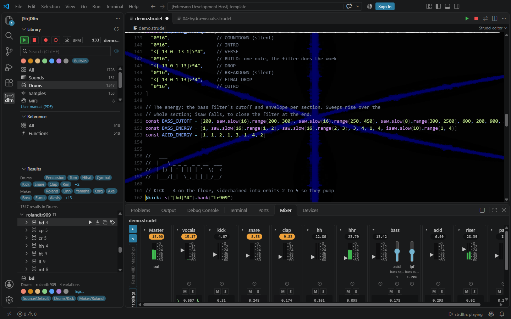
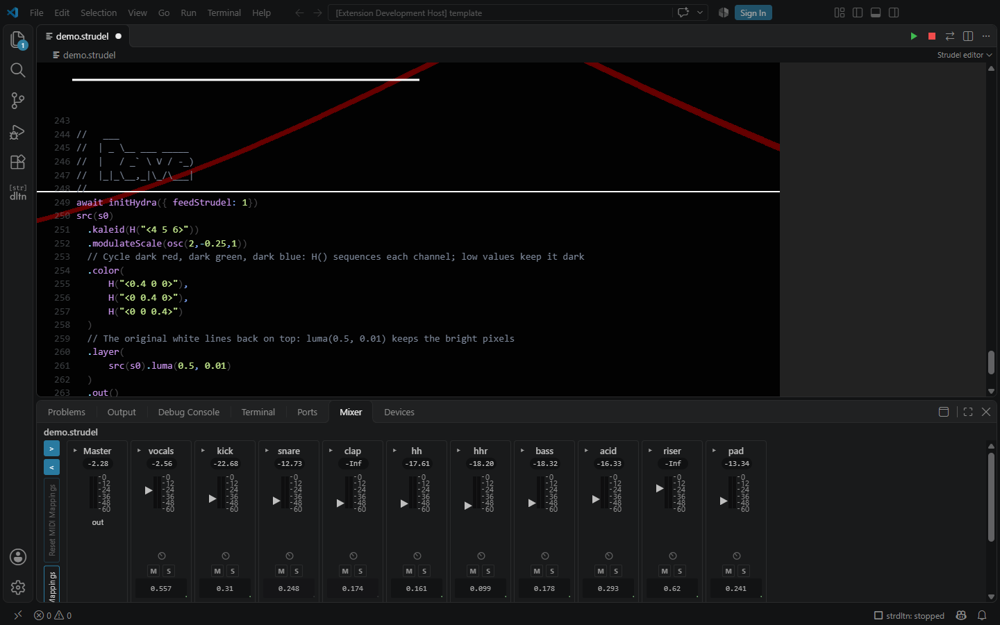
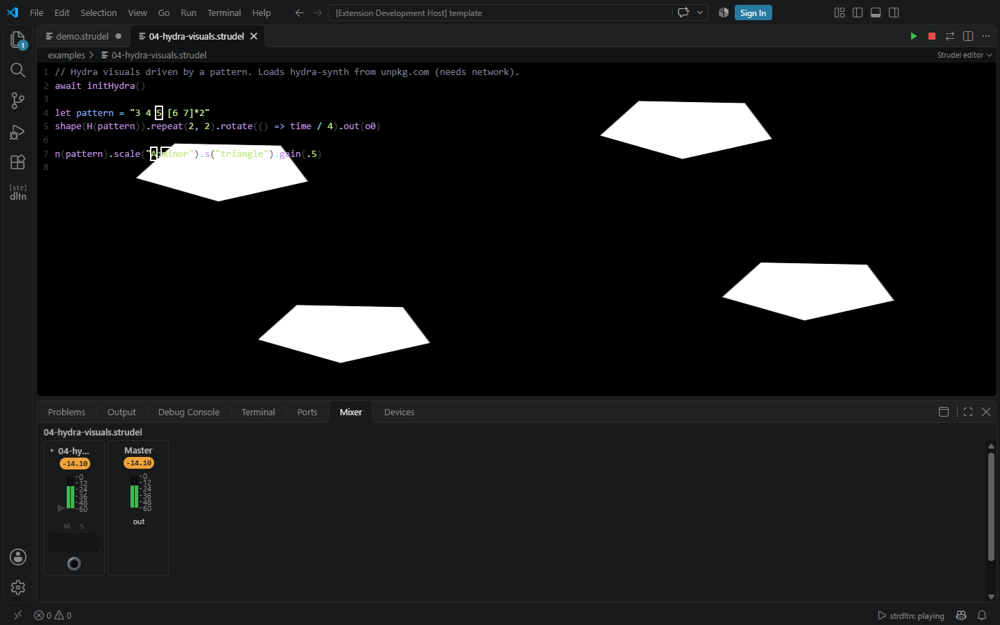
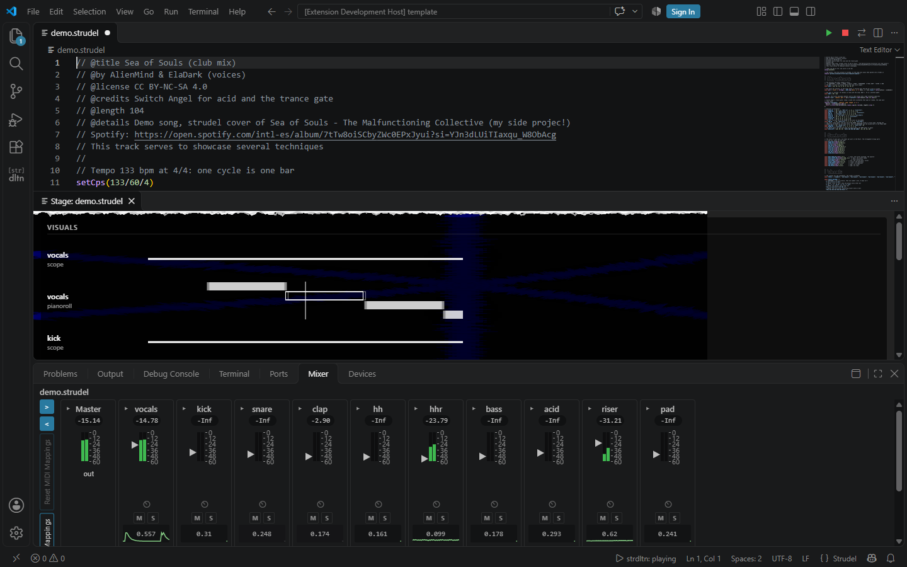
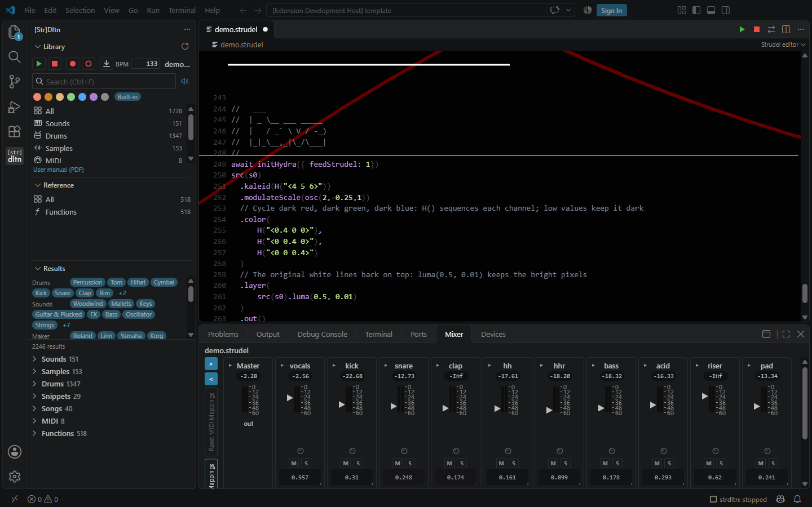
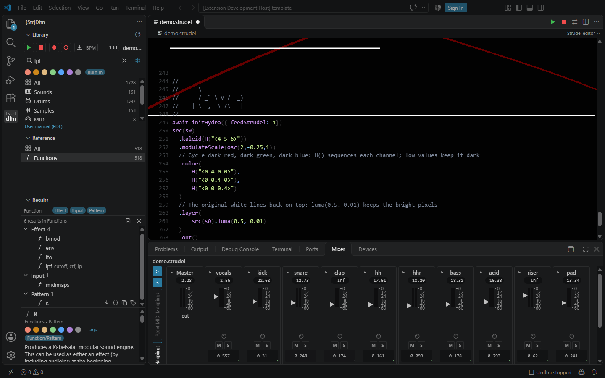
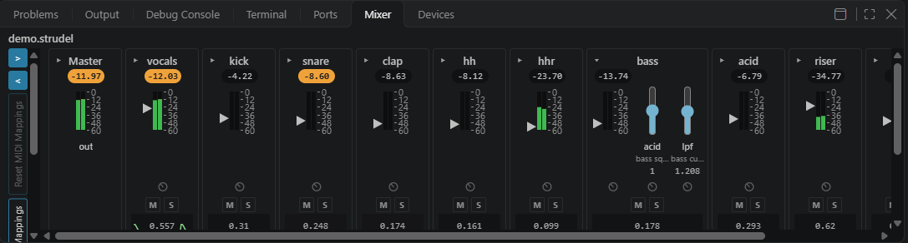
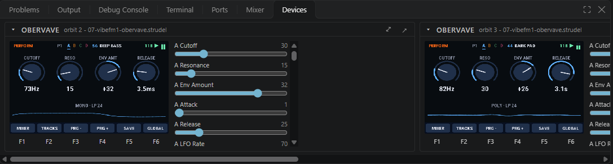

![[str]dltn Live[code]](logo.jpg)

# [str]dltn Live[code] - User manual

[str]dltn Live[code], pronounced "Stroo-del-ton", brings [Strudel](https://strudel.cc), the
language for making music with code, into VS Code, with the same editor and sound engine, and
adds a few things on top:

- a searchable library of sounds, snippets, songs, examples and techniques, with your own
  colors and tags;
- a Mixer with a strip per part of your song, level meters and sidechain cables;
- MIDI knobs on any slider of your code, with mappings you can list and reset;
- panels for synth firmwares, each with its own screen and keys;
- recording and rendering to `.wav` and `.mp3`.

This manual walks through everything you can see and do, one part of the screen at a
time. It does not teach Strudel itself: for that, the Reference in the side bar holds every
function, and strudel.cc has the workshop.

[str]dltn Live[code] is an independent project. It is not part of Strudel and not endorsed by
its authors.

## Contents

1. Getting started
2. The screen at a glance
3. The code: two editors
4. The Library
5. The Mixer
6. MIDI knobs on sliders
7. MIDI devices
8. The Devices panel
9. Recording and rendering
10. Your project: samples, snippets, packs
11. Colors and what they mean
12. Keys
13. Settings
14. When something goes wrong

## 1. Getting started

**Install.** Download `strdltn.vsix` from the
[latest release](https://github.com/alienmind/strdltn/releases/latest). In VS Code, open the
Extensions view, press `...` and choose "Install from VSIX...".

**First sound.** Make a file called `song.strudel` and type:

```
s("bd sd, hh*4")
```

Click into the code and press **Ctrl+Enter**. The drums play. Change `hh*4` to `hh*8` and
press Ctrl+Enter again: the song changes without stopping. **Ctrl+.** stops it.

The first time, the page may say "Click to enable audio". Browsers start no sound
without a click inside the page; one click is enough.

**Start from the template.** The `template/` folder of the project is a ready music
project: `demo.strudel` (a full song), `examples/` (songs to learn from, from a first beat
to full tracks), `lib/` (snippets) and `samples/` (your own sounds). Open the folder in VS
Code and open `demo.strudel`.

**In the browser, with nothing installed.** Fork the repository on GitHub, then Code,
Codespaces, `...`, "New with options", and choose "[str]dltn Live[code] template (released
extension)". The sound comes out of your browser. MIDI works on desktop VS Code only.

## 2. The screen at a glance



| Where | What |
|---|---|
| Activity bar, the [str]dltn icon | Opens the side bar with the Library, the Reference and the Results |
| Editor area | Your `.strudel` files, in the Strudel editor or the native VS Code editor |
| Bottom panel, Mixer tab | A strip per part of the song in front |
| Bottom panel, Devices tab | A panel per firmware synth that plays |
| Status bar, right | What the song in front does: playing, stopped, error. A click plays or stops |

The editor's title bar has Play (green), Stop (red) and the button that switches between the
two editors.

## 3. The code: two editors

A `.strudel` file opens in the **Strudel editor**, the editor of strudel.cc. One button in the
title bar (or **Ctrl+Alt+M**) switches the same file to the **native VS Code editor** and back.
Both edit the same file; pick the one that suits the moment.

### The Strudel editor



- **Inline visuals.** `._scope()` draws the wave under the line that makes it,
  `._pianoroll()` the notes. They move while the song plays.
- **Sliders in the code.** `slider(0.5, 0, 1)` becomes a small slider inside the line. Drag
  it while the song plays: the sound changes at once, and the number in the code follows
  when you let go. The arguments are the value, the lowest and the highest.
- **Notes light up.** The part of a pattern that is sounding is outlined in the code.
- **Hydra.** `await initHydra()` draws [Hydra](https://hydra.ojack.xyz) visuals behind the
  code, driven by your pattern.
- **The knob column.** Left of the line numbers, every line that holds a `slider(...)` has a
  small knob button. It maps a knob of your MIDI controller to that slider (see section 6).
  Other lines keep an empty space there, so the code stays aligned.
- **VS Code's keys.** Ctrl+F finds, Ctrl+H replaces, Ctrl+G goes to a line, Ctrl+D selects
  the next match, Ctrl+Shift+L selects every match. You can change these keys in Keyboard
  Shortcuts, under `strdltn.editor.*`.



### The native editor and the stage

The native editor is plain VS Code: your keys, your extensions, and an
underline under the exact place of an error. Press play there and a **stage** opens below the
code with the song's visuals and sliders, each named from your code.



How a visual or a slider on the stage gets its name, first rule that fits:

1. the name of the pattern: `$kick: s("bd*4")._scope()` is "kick";
2. the name of a variable: `const drums = s("bd")._scope()` is "drums";
3. the comment above the line: `// Rolling hihat` is "Rolling hihat";
4. the code itself, cut short.

The native editor also shows the knob buttons, left of the line numbers. Right click a line
number for "Map a MIDI knob to this line's slider".

The stage's place is the setting `strdltn.stage.position`.

### Playing and stopping

| Do | What happens |
|---|---|
| Ctrl+Enter, or Play | Plays the song, or updates it while it plays |
| Ctrl+. , or Stop | Stops the song in front. Again: stops a song playing in another tab |
| A click on the status bar item | Plays or stops the song in front |
| "strdltn: Stop all" | Stops every song |

Edits from outside, by git or another editor, show up at once, also while
the song plays.

## 4. The Library

The [str]dltn icon in the activity bar opens three views. **Library** and **Reference** pick
what you want to see; **Results** shows it. Each view folds and moves on its own.



### Music Controls

The row at the top of the Library:

| Button | Does |
|---|---|
| Play (green) | Plays the song in front |
| Stop (red) | Stops it |
| Record (red circle) | Records what you hear (section 9) |
| Render (arrow down) | Renders the whole song to a file (section 9) |
| BPM | The tempo. Type a number to write `setcpm(<bpm>/4)` into the song; double click to go back to Strudel's 120 |

### Search, colors, categories

- **Search.** Ctrl+F in the side bar, or Ctrl+Alt+F from anywhere. It looks at names,
  banks, folders, descriptions and tags; every word must match. `#kick` looks only at tags.
  Esc clears it.
- **Colors.** Seven dots under the search. A click shows everything with that color. Right
  click a dot to rename it; the first is "Favorites". The keys 1 to 7 color the selected
  rows, 0 clears.
- **Built-in.** Beside the colors: one click shows only what comes with Strudel, a second
  only what does not (your project and the packs your songs load), a third everything.
- **Collections.** Save a search with the button in the Results, and it becomes a row here.
- **Categories.** All, Sounds (synths and soundfonts), Drums (by drum machine), Samples,
  Plugins (FM-1 Synths: firmware synths), Render (the audio of your songs), MIDI (your devices),
  Songs, Snippets. The Reference has Functions: every function of Strudel with its
  documentation.



### Results

- Results are grouped under headings: the drum machine, the folder, the category.
- **Tag chips** on top narrow the list. Tags come by themselves from the names (Kick,
  Snare, Hihat for drums; Bass, Pad, Keys for instruments; the maker of a drum machine).
  Ctrl+click a chip to take several of one group.
- **Details** at the bottom: the selected item's tags, its description, a snippet's code, a
  function's parameters and an example, and seven dots to put it in a collection.

| Do on a row | What happens |
|---|---|
| Click a sound | Plays it, when the speaker button beside the search is on. It never types |
| Enter, or double click | Types the code that plays it at the cursor: `s("bd")`, `s("bd").bank("RolandTR909")`, `note("c3").s("sawtooth")`. Inside a string, only the name |
| Double click a song or a snippet | Opens its file in the Strudel editor |
| The second insert button of a song | Types the song's code, without its header, at the cursor |
| "Insert an example" on a function | Types the function's example from the reference at the cursor |
| Enter on a snippet | Inserts its code at the cursor |
| Space | Plays |
| Right click | Colors, insert, copy, open, "Edit tags..." |

While a song plays, a preview waits for the next beat and lasts one beat, so you hear the
sound against the music. With no song, samples, drum machines and the plain waves play at
once; soundfonts, supersaw and firmwares need a song open.

Your colors, tags and saved searches are kept in `strdltn.index.json` at the root of your
project. Commit it and they travel with your songs.

"User manual (PDF)", at the foot of the Library, opens this manual.

## 5. The Mixer

The Mixer tab in the bottom panel shows the song in front, as the Session view of Ableton
Live does: one strip per part of the song.



### Where the strips come from

The Mixer reads your code. It never needs the song to play.

- **A strip per chain.** A chain is a line that starts with a label: `$kick:`, `bass:`,
  `$:`. A song without labels shows as one strip named after the file.
- **The gain fader.** The slider inside a chain's `.gain(...)` is the strip's main fader. It
  sits on the strip's level meter, as a small triangle beside the bars.
- **The inner sliders.** Every other slider the chain uses (`.lpf(slider(...))`,
  `.room(DEPTH)`) is an inner slider. The arrow at the top left of a strip unfolds them; the
  label under each says the function it feeds ("lpf", "room") and the name of its constant.
- **Constants.** `const KICK = slider(1, 0, 1)` at the top and `.gain(KICK)` in `$kick:` puts
  that slider on the kick strip. A slider used by two chains shows on both, and their
  faders move together, because they are one slider: the fader says "shared:" and the
  other strip's name. Give each chain its own constant to set them apart.
- **The Master strip.** Always first. Its meter is the whole mix as it reaches the speakers.
  Its inner sliders are the **global** sliders: a slider inside `setcps()`, or inside a line
  such as `all(x => x.djf(DJ))` that acts on the whole song, or a slider nothing uses at
  all. A slider nothing uses is dimmed and says "not used": it changes nothing until a chain
  uses it.
- **Every change is code.** A fader writes the number in the code; M, S, G and the cables
  write labels and calls. Ctrl+Z in the editor takes any of them back.

### A strip, top to bottom

| Part | Shows, does |
|---|---|
| Arrow and name | Unfold the inner sliders. A click on the name shows the chain in the code |
| Peak number | The loudest moment of the last 3 seconds, in dB below full scale. "-Inf" in silence. Orange once it went over 0 dB (clipping); a click clears it |
| Meter and gain fader | Two bars, left and right, from 0 down to 60 dB. The triangle is the gain fader: drag it. A click without a drag takes the gain fader out of the code; on a chain without one, the dim triangle puts a gain in: the chain's own constant if one is named after it and unused (`KICK` for kick), else `.gain(slider(1, 0, 1))` |
| Inner faders | Blue sliders, each with its label, the constant's name and its value |
| Knob button | Under every fader: maps a MIDI knob to that slider (section 6) |
| M, S | Mute and solo. They write upstream's labels: `_kick:` mutes, `Skick:` solos |
| Pump meter | Under M and S: it jumps with the chain's notes while the song plays. Green with `._scope()` in the chain, a grey flat line without; a click adds or removes `._scope()`. The gain's value is in its corner |
| Jack | At the foot. Its tooltip says the chain's orbit |

### How the numbers are made

- **The meters measure real audio,** after the chain's own gain and effects and before the
  orbit's shared room and delay. They read every 50 ms; a bar falls 24 dB a second.
- **The pump meter shows notes, not audio:** it jumps on every note with that note's gain
  and decays in about a tenth of a second. That is why it moves even on a quiet chain.
- **A fader changes the sound at once and the code a moment later** (150 ms after you stop),
  like the slider in the code. Moving the slider in the code moves the fader.

### Sidechain cables

A chain with `.duck("2:3")` turns orbits 2 and 3 down each time it hits: the classic
pumping of a kick against a bass. The Mixer draws it as an orange dashed cable from the
kick's jack to every strip on those orbits.

- **Add one:** drag from a strip's jack onto another strip. The code gets the `.duck()`,
  and the target gets an `.orbit()` of its own if it had none.
- **Remove one:** drag the cable off by its end.

### The column of buttons

Left of the strips:

| Button | Does |
|---|---|
| `>` (blue) | Unfolds every strip, the Master included |
| `<` (blue) | Folds every strip back to its gain |
| Reset MIDI Mappings | Takes every knob mapping out of the song. One Ctrl+Z brings them back. Grey when there is none |
| Show MIDI Mappings | A window with every mapped knob (section 6) |
| Show MIDI Routing | Not available yet |

### Placing the Mixer

The window button in the Mixer's title floats it in a window of its own; the dock button,
or closing that window, puts it back. The Mixer comes to the front when a song starts.

## 6. MIDI knobs on sliders

Any slider of your song can follow a knob of a MIDI controller. Desktop VS Code only.

### Mapping a knob

1. Click the **knob button** of a slider: left of its line in either editor, or under its
   fader in the Mixer.
2. The button turns **red and blinks**: it is listening. Turn a knob on your controller
   within 10 seconds.
3. The button turns **green**, and the code gets `.knob(<cc>)` after the slider:

```
const CUTOFF = slider(800, 200, 4000).knob(74)
```

The first time, this line goes in at the top of the song too:

```
register('knob', (cc, pat) => pat)
```

It defines `knob` so that the song stays plain Strudel: pasted into strudel.cc, it plays at
the slider's value, and the knob does nothing there.

Other ways to map: put the cursor inside a `slider(...)` and press **Ctrl+Alt+K**; double
click a slider in the Strudel editor; right click a line number in the native editor.

### Unmapping

- A click on a **green** knob button takes that knob off its slider.
- **Show MIDI Mappings** in the Mixer lists every mapping: the CC, the line and its code,
  with a Remove button per row. A CC that moves more than one slider is marked. Esc closes
  it.
- **Reset MIDI Mappings** removes them all at once.

Mappings live only in the code, as `.knob(...)`. There is no other file: copy the song and
the mappings go with it.

### Pickup: why a knob sometimes waits

A knob takes over its slider only once it **reaches or passes the slider's value**. If the
slider is at 0.8 and your knob sits at 0.2, turning the knob does nothing until it gets to
0.8; from there the slider follows. This keeps the sound from jumping when you touch a knob
that sits somewhere else. If you drag the slider with the mouse, the knob lets go until it
passes the new value.

While a knob waits, its fader in the Mixer shows a **dim second handle** where your knob is:
a dim triangle beside the meter for a gain, a dim dot on the track for the other faders. It
moves with your knob and changes nothing. When it reaches the real handle, it disappears and
the knob takes over. So when a knob seems dead, look at its fader: turn toward the real
handle until the dim one meets it.

### What follows a knob

While you turn: the sound, the slider's handle in the editor, and the fader in the Mixer.
When you stop: the number in the code. Knobs work with the song stopped too; the sound
follows once you play.

## 7. MIDI devices

- **Play a synth or a drum machine:** `.midi('name')` sends the notes of a pattern to a MIDI
  device, in time with the sound. See `examples/09-midi-out.strudel`.
- **Read a controller:** `const cc = await midin('MPK mini 3')`, then `cc(74)` is a pattern
  with the knob's value from 0 to 1. `midikeys()` reads a keyboard.
- **Find your devices:** the MIDI category of the Library lists them; a click types
  `.midi('name')` or `midin('name')`.
- **See what a controller sends:** "strdltn: Show MIDI messages in the Output (on or off)" writes every
  message in and out to Output > strdltn, for example `CC 74 = 64 (ch 1)`.
- **Timing:** if notes come late on a busy machine, the setting `strdltn.midi.highPriority`
  raises VS Code's priority while MIDI plays. It is off by default because it raises every
  other extension too.

## 8. The Devices panel

[The Firmware Hub](https://thefirmwarehub.com) publishes synth firmwares for the VIBE FM.
[str]dltn plays them as instruments of your song.

- **Get a firmware:** put a `.wasm` file in a `firmware/` folder, or load one from an address
  with `firmware('https://.../name.wasm')`; it is kept in your project and plays offline.
- **Play it:** `note("c2 eb2").s("vibefm1:obervave")`. `.progNum(55)` picks one of its sounds.
  The firmware can change per step: `s("vibefm1:<obervave sloop>")`.
- **Find and install it in the Library:** **Plugins > FM-1 Synths** lists the firmwares you
  have under Installed, and the ones of The Firmware Hub under Available, each with a picture
  of its screen. Double click an Available one to install it into the `firmware/` folder of
  your project. Insert at the cursor types a `$:` line that plays it (and the `firmware(...)`
  line at the top of the song for one that a song loaded from an address). The display button
  opens the firmware's **screen** in a tab beside the song, running without sound, so you can
  try its keys before you install or use it.



The **Devices** tab shows a panel per firmware that plays, one per orbit:

- the firmware's own **screen**, live;
- its six soft keys **F1 to F6**;
- the mouse wheel over the screen turns its **DATA** knob;
- its **parameters** as sliders on the right.

Fold a panel with its arrow, fill the view with it, or take it out into a tab of its own.
Effects on its line, such as `.room()`, do not reach a firmware yet.

## 9. Recording and rendering

- **Record** (the red circle in Music Controls) records what you hear, while you play and
  turn knobs, into a `.wav` and an `.mp3` next to the song. Click again, or Stop, to end the
  take. Every take is kept, with the time in its name.
- **Render** (the arrow down) plays the whole song once from the start with the sound off
  and writes `<song>.wav` and `<song>.mp3`. It takes as long as the song; Cancel in its
  notification stops it. The length comes from `// @length <cycles>` in the song's header,
  else 16 cycles (setting `strdltn.render.cycles`).
- Both show under **Render** in the Library; a click plays one. The MP3's quality is the
  setting `strdltn.render.mp3Bitrate`.

## 10. Your project: samples, snippets, packs

- **Your samples.** Audio files in `samples/` are sounds, with no setup. A folder
  `samples/kick/` becomes `s("kick")`, and `s("kick:1")` is its second file. New files show
  up within seconds.
- **Sharing a song with its samples.** A `strudel.json` in the samples folder lists them, so
  `samples('github:<you>/<repo>/main/<path>')` loads them from GitHub. The demo does this for
  its vocals, so it plays when pasted into strudel.cc.
- **Sample packs.** `samples('github:user/repo')` or `samples('https://.../strudel.json')`
  load a pack. It is listed in the Library before you press play, and copied into
  `.strdltn/` in your project so it plays offline. "strdltn: Show sample pack cache size"
  and "strdltn: Clear sample pack cache" manage that copy. A pack that cannot be loaded is a
  warning in the Output, and the song plays on without it.
- **Snippets.** `.strudel` files in `lib/` are the Snippets of the Library. A snippet
  describes itself at the top:

```
// @title Four on the floor
// @category drums
// @details Kick on every beat, clap on 2 and 4, open hat on the off beat.
// @tags house, techno, 909
// @by alienmind
s("bd*4, ~ cp ~ cp, [~ oh]*4").bank("RolandTR909")
```

  Only the code is inserted. The categories are `drums`, `bass`, `melody`, `chords`,
  `texture`, `effect`, `function`, `song` and `visual`.

## 11. Colors and what they mean

| Color | Where | Means |
|---|---|---|
| Green bars | Mixer meters | The level of a chain or of the mix |
| Orange peak number | Mixer, above a meter | The level went over 0 dB and clipped. Click to clear |
| Green pump meter | Under M and S | The chain has `._scope()`; grey and flat when it has not |
| Blue faders | Mixer, inner sliders | Sliders other than the gain: filters, effects, sends |
| White triangle on a meter | Mixer | The gain fader. Dim when the chain has none: click to add one |
| Blue M or S | Mixer | The chain is muted or soloed |
| Blue border | Mixer, a whole strip | That strip is soloed |
| Dim strip | Mixer | The chain is muted, or no song is in front (Master) |
| Orange dashed cable | Mixer | A sidechain: the strip at the start ducks the strip at the end |
| Blue `>` and `<` | Mixer, left column | Unfold and fold every strip |
| Grey knob | Knob buttons | No knob mapped |
| Red, blinking knob | Knob buttons | Listening: turn a knob now |
| Green knob | Knob buttons | A knob is mapped; the Mixer's button shows its CC |
| Seven color dots | Library | Your collections; their names are yours |
| Red status bar item | Status bar | The code has an error; the song plays what worked last |

## 12. Keys

| Key | Does |
|---|---|
| Ctrl+Enter | Play, or update the playing song |
| Ctrl+. | Stop the song in front; again, stop a song in another tab |
| Ctrl+Alt+M | Switch between the Strudel editor and the native editor |
| Ctrl+Alt+F | Put the cursor in the Library's search |
| Ctrl+Alt+K | Map a MIDI knob to the slider under the cursor |
| Ctrl+F, Ctrl+H, Ctrl+G | Find, replace, go to line, in the Strudel editor |
| Ctrl+D, Ctrl+Shift+L | Select the next match, every match, in the Strudel editor |
| 1 to 7, 0 | In the Results: color the selected rows, clear |
| Space, Enter | In the Results: play, insert |

On a Mac, Cmd in place of Ctrl.

## 13. Settings

| Setting | Does |
|---|---|
| `strdltn.editor.theme` | The color theme of the Strudel editor, one of strudel.cc's |
| `strdltn.editor.fontFamily`, `strdltn.editor.fontSize` | Its font. Empty and 0 take your VS Code editor's |
| `strdltn.stage.position` | Where the stage opens beside the native editor |
| `strdltn.samplesFolder` | The folder of your samples. Default `samples` |
| `strdltn.libFolder` | The folder of your snippets. Default `lib` |
| `strdltn.firmwareFolder` | The folder of your firmwares. Default `firmware` |
| `strdltn.remoteSamples.cache`, `strdltn.remoteSamples.maxFiles` | Whether packs are copied into the project, and up to how many files |
| `strdltn.render.cycles` | Length of a render when the song has no `@length` |
| `strdltn.render.mp3Bitrate` | Quality of the `.mp3` of Record and Render |
| `strdltn.midi.debug` | Write every MIDI message to the Output |
| `strdltn.midi.highPriority` | Raise VS Code's priority while MIDI plays |

## 14. When something goes wrong

| You see | Try |
|---|---|
| No sound after play | Click once inside the editor: browsers start no sound without a click |
| An error | The status bar turns red and the Problems view says where. The song keeps playing what worked last; fix the line and press Ctrl+Enter |
| A knob does nothing | Turn it all the way down and up once (pickup, section 6). Check that its button is green |
| A dim slider on the Master says "not used" | No chain uses it: the chain probably has its own slider in `.gain(...)` |
| Two strips move together | They share one slider ("shared:" under the fader). Give each its own constant |
| A sample pack is missing | Read the warning in Output > strdltn: offline, or a wrong address |
| MIDI device not found | The Library's MIDI category lists the exact names; MIDI is desktop only |

Report problems at [github.com/alienmind/strdltn/issues](https://github.com/alienmind/strdltn/issues),
not to the Strudel project.

## This manual as a PDF

Every release carries this manual as `strdltn-manual.pdf`; "User manual (PDF)" at the foot
of the Library opens it. From the project's source, `pnpm manual` makes it with Chrome or
Edge.
